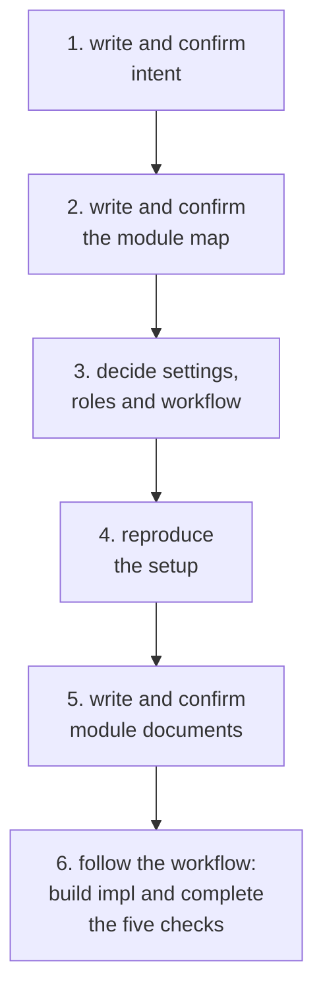

# plumbline design

This design says how plumbline's rules are divided and what each part promises. The rules are text an AI reads to reproduce a setup in another project.

## Modules

| Module | Document | What it does |
|---|---|---|
| Layers and settings | `layers.md` | the three layers and the settings form: layer locations, layers kept out of git, and role settings, including zones and guard choices |
| Roles | `roles.md` | the lead, the limits every project-defined role keeps, and how the role guard applies the settings |
| Design documents | `design-docs.md` | the module map and module documents: the seven sections, figures, plain writing |
| Writing intent | `intent-writing.md` | how intent is written and confirmed with the user |
| A change | `change.md` | from diagnosis to commit, the workflow each project defines, the five checks, and the work note |
| Status | `status.md` | how the lead answers when the user asks where things stand |
| Validate | `validate.md` | the checks run on request and their output |
| Setup record | `setup-record.md` | the settings used, the files and carriers made for the roles, what is enforced mechanically, and checksums |
| Conformance cases | `conformance.md` | the form of conformance cases |
| Reproduction | `reproduction.md` | how the lead builds the setup for the project's roles and workflow, checks the guards, and reproduces again |
| Public documents | `publishing.md` | this repository's README and license |

Read them in the order of this table.

## What relies on what

A relies on B when A uses names or promises B defines.

| Module | Relies on |
|---|---|
| Layers and settings | nothing |
| Roles | Layers and settings |
| Design documents | Layers and settings |
| Writing intent | Layers and settings |
| A change | Layers and settings, Roles |
| Status | A change |
| Validate | Layers and settings, Design documents, Setup record |
| Setup record | Layers and settings, Roles |
| Conformance cases | Roles, Validate |
| Reproduction | Layers and settings, Roles, Design documents, Writing intent, A change, Status, Validate, Setup record, Conformance cases |
| Public documents | Layers and settings, Roles, Reproduction |

## Flows

### Starting a project

1. The lead and the user write and confirm intent (Writing intent).
2. The lead writes the module map and the user confirms it (Design documents).
3. The lead and the user decide the layer locations, the layers kept out of git, and the role settings: names, read zones, write zones, duties, models, and guard choices (Layers and settings, Roles). They also decide the workflow: who receives and reports what, who handles findings, how work is shared, and who completes the five checks (A change).
4. The lead reads the rules and reproduces the setup for those settings and that workflow (Reproduction, Setup record, Conformance cases).
5. For each milestone, module documents are written and the user reads and confirms all of them (Design documents).
6. The project-defined roles follow the workflow to build impl and complete the five checks. The project decides whether the role that checks differs from the role that built it (Roles, A change).

### One change

Diagnosis → fix and confirm any affected upper layers → the project-defined roles change impl and complete the five checks through the project's workflow → handle findings → commit. Findings are resolved before the change ends. The lead can follow progress and knows whether the five checks are complete, including when roles communicate directly. See A change.

### Reproducing again

When the rules commit or the settings change, or the user asks, the lead reproduces again. It uses the previous setup record to find the files and reproduced parts to replace or remove, and preserves project parts. It checks the new setup and records which rules are enforced mechanically and which remain instructions. See Reproduction.

## Promises that hold for every module

1. The rules name no particular AI tool, model name or natural language, and set no code comment policy.
2. The rules hold rules only: no reasons, no history, nothing that points to intent or design.
3. What reaches the user (questions, notices, check results) is said in plain words, with no name left unexplained.
4. The content of a layer kept out of git is never copied into a file of a layer in git.
5. The design never names a location of impl (a file path, a test name).
6. Reproduced files are never edited by hand.

## Milestones

There is one milestone: letting each project define its roles. The eleven modules above are reviewed in it. Their documents are updated where the role settings, guards, workflow or five checks affect their contracts.

Current milestone: letting each project define its roles.
