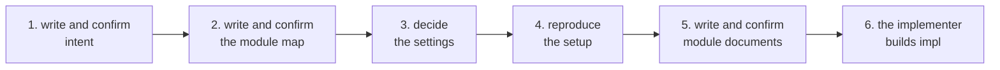

# plumbline design

This design says how plumbline's rules are divided and what each part promises. The rules are text an AI reads to reproduce a setup in another project.

## Modules

| Module | Document | What it does |
|---|---|---|
| Layers and settings | `layers.md` | what the three layers are and where they are, the settings file, what each project decides |
| Roles | `roles.md` | what the lead, the implementer and the verifier do, read and write; hand-offs; the two things blocked mechanically |
| Design documents | `design-docs.md` | the module map and module documents: the seven sections, figures, plain writing |
| Writing intent | `intent-writing.md` | how intent is written and confirmed with the user |
| A change | `change.md` | from diagnosis to commit, what the verifier checks, the work note |
| Status | `status.md` | how the lead answers when the user asks where things stand |
| Validate | `validate.md` | the checks run on request and their output |
| Setup record | `setup-record.md` | the setup record and checksums |
| Conformance cases | `conformance.md` | the form of conformance cases |
| Reproduction | `reproduction.md` | how the lead reads the rules and builds the setup, what each role receives, reproducing again |
| Public documents | `publishing.md` | this repository's README and license |

Read them in the order of this table.

## What relies on what

A relies on B when A uses names or promises B defines.

| Module | Relies on |
|---|---|
| Layers and settings | nothing |
| Roles | Layers and settings |
| Design documents | Layers and settings |
| Writing intent | Layers and settings |
| A change | Layers and settings, Roles |
| Status | A change |
| Validate | Layers and settings, Design documents, Setup record |
| Setup record | Layers and settings |
| Conformance cases | Roles, Validate |
| Reproduction | Layers and settings, Roles, Design documents, Validate, Setup record, Conformance cases |
| Public documents | nothing |

## Flows

### Starting a project

1. The lead and the user write and confirm intent (Writing intent).
2. The lead writes the module map and the user confirms it (Design documents).
3. The layer locations and the layers kept out of git are decided and written in the settings file (Layers and settings).
4. The lead reads the rules and reproduces the setup (Reproduction, Setup record, Conformance cases).
5. For each milestone, module documents are written and the user reads and confirms all of them (Design documents).
6. The implementer builds impl (Roles, A change).

### One change

Diagnosis → fix from the top layer down → the implementer fixes impl → the verifier checks what changed → commit. See A change.

### Reproducing again

When the rules commit or the settings change, the lead reproduces again. It finds the files it made before in the setup record, removes them and makes them anew, and writes a new setup record once every conformance case passes. See Reproduction.

## Promises that hold for every module

1. The rules name no particular AI tool, model name or natural language. They say only that each project decides its language and its code comment policy.
2. The rules hold rules only: no reasons, no history, nothing that points to intent or design.
3. What reaches the user (questions, notices, check results) is said in plain words, with no name left unexplained.
4. The content of a layer kept out of git is never copied into a file of a layer in git.
5. The design never names a location of impl (a file path, a test name).
6. Reproduced files are never edited by hand.

## Milestones

There is one milestone (fixing plumbline). All eleven module documents are written in it, in the order of the table above.

Current milestone: fixing plumbline.
