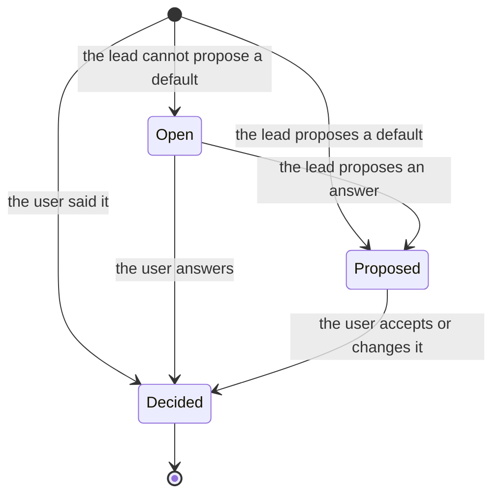
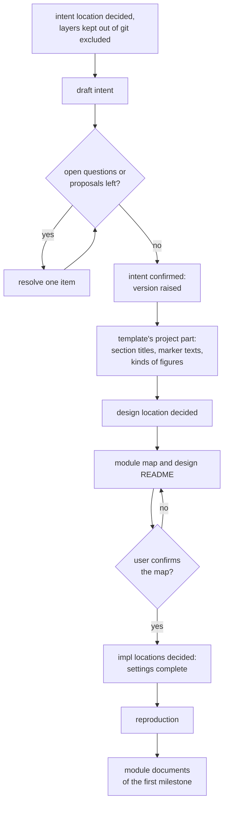

# authoring

> Basis: intent 1.5 — §3 (the form of intent is not prescribed), §4 (principle 7), §7 (settings; what plumbline does not handle), §8.5, §11 (M0).

## 1. Responsibilities

**Does**: defines how the lead and the user write a project's first intent, then the design's module map, then the module documents milestone by milestone. Defines how a draft marks what is decided, proposed and open, and how those are resolved; when intent is confirmed; when each project setting is decided; and when the template's words are settled.

**Does not**:

- Change an intent or design document after it was confirmed. `changes` does (M1).
- Say how a milestone's work is recorded once a setup exists. `changes` does (M1).
- Reproduce the setup. `reproduction` does.
- Prescribe the form of intent beyond what `layers` requires: Markdown files at the intent location, each with one version line.
- Ask about what each project decides in its own intent: natural language, comment policy, and the like. When the user says them, they go into intent.

## 2. Public interface

### Order

1. Intent: draft, resolve, confirm.
2. The template's project part (`design-docs`), then the module map and the design's top-level README, whose `milestone` line names the first milestone. The user confirms the map.
3. The settings are complete, and the setup is reproduced (`reproduction`).
4. The module documents of the first milestone. The user confirms them. Then that milestone's impl is built by implementers (`roles`).
5. Each later milestone: once the previous milestone's work is finished, as `changes` defines it, the lead changes the README's `milestone` line to it; then its module documents are written, then its impl.

The lead does all of this. It reads intent and design only, never impl (`roles`).

### Writing intent

1. The lead listens to the user and writes a draft at the intent location. Every item in the draft carries one of three marks: decided (the user said or chose it), proposed (the lead's default), open (a question).
2. Near its top, the draft names its three marks, in the project's own words. A new session can continue from the draft alone.
3. The lead resolves the open questions, then the proposals, one item at a time. A point that follows directly from earlier decisions is applied without asking, and the user is told. Only real choices are asked.
4. When no proposal and no open question is left, the intent is confirmed. The lead raises its version and states in it, in the project's own words, that the user confirmed it and on which date.

- The version stays the same while a draft is being worked on. It is raised when the intent is confirmed.
- The marks and the confirmation are not checked mechanically.

### Settings decided on the way

| Setting | Decided |
|---|---|
| the intent location | before the first draft is saved |
| the design location | before the module map is saved |
| the impl locations | before the reproduction |
| whether a layer stays out of git | before anything of that layer is saved |

- The lead proposes each setting, and the user confirms it.
- The lead writes each setting into the settings file (`settings`) as soon as it is decided. The file has to be complete and valid only when the reproduction starts.
- As soon as a layer is set to stay out of git, the lead lists its paths in `.git/info/exclude`, so nothing of it is committed before the reproduction. When the project is not yet a git repository, the lead tells the user that nothing is excluded until it is one.

### The module map

- After intent is confirmed, the lead settles the template's project part with the user: the seven section titles, the two marker texts and the kinds of figures the project uses (`design-docs`). It writes them into the template.
- Then the lead writes the module map from intent only: the modules, their dependencies, the flows, and the contracts that hold for every module. With it comes the design's top-level README: scope, reading order, terms, and the `milestone` line.
- The module map is a module document. Its name and place in the design are the project's choice.
- The map gives every module the milestone in which its document is written.
- The user confirms the map. Every design-level decision in it then carries the confirmed marker with the date.

### Module documents

- They are written milestone by milestone, in the map's order.
- Each is derived from intent and the design documents above it, never from impl (`layers`).
- Design-level decisions are written with the pending marker. When the user confirms them, each marker becomes the confirmed one with the date.
- The lead may present a milestone's documents in groups. Each group is confirmed before the next is written.
- A point the user must choose is asked one at a time. A point that follows directly from earlier decisions is applied, reported, and confirmed with the rest.
- When writing design reveals a gap in intent, the lead stops and proposes the change to intent. After the user confirms, intent is changed first and its version raised (`layers`).

## 3. Flow

An item in an intent draft:

When each thing is settled:

## 4. Invariants and contracts

- An intent is confirmed only when no proposal and no open question is left in it, and its version is raised then.
- The template's project part exists before the module map is written, and the map's level-2 headings equal it.
- The settings file is complete and valid before the reproduction starts.
- In a git repository, a layer set to stay out of git is listed in `.git/info/exclude` from the moment that is decided.
- A milestone's module documents are all confirmed before its impl starts.
- The lead never reads impl while doing any of this.

## 5. Decisions and reasons

- **A draft marks every item as decided, proposed or open; items are resolved one at a time; obvious consequences are applied and reported; intent is confirmed when nothing proposed or open is left.** intent §8.5.
- **The module map comes first, then module documents milestone by milestone.** intent §8.5.
- **Language, comment policy and the like are not asked about.** intent §7, §8.5.
- **The draft names its own marks, and nothing checks them.** The rules cannot fix the words, and the form of intent is not prescribed. The marks matter only while a draft is open. (Design-level — confirmed 2026-10-17)
- **The version is raised when the intent is confirmed, not while drafting.** A design cites a version. Each version then names something the user confirmed. (Design-level — confirmed 2026-10-17)
- **Each setting is decided when it is first needed and written into the settings file at once.** A new session finds them in the file. Nothing reads the file before the reproduction, so it has to be valid only then. (Design-level — confirmed 2026-10-17)
- **A layer that stays out of git is excluded as soon as that is decided.** Intent is written long before the first reproduction. Once something is committed, history keeps it. (Design-level — confirmed 2026-10-17)
- **The module map is a module document whose name and place are the project's.** Its choices are design-level decisions, which live only in section 5 of a module document (`design-docs`). How a design is laid out is each project's own choice (intent §7). (Design-level — confirmed 2026-10-17)
- **The map gives every module a milestone.** Module documents are written milestone by milestone, so each module needs one. (Design-level — confirmed 2026-10-17)
- **A milestone's module documents are written once the previous milestone's impl is done.** Details of a later milestone are then fixed only after the earlier one was built. The module map already fixes the modules, their dependencies and their milestones; only the details wait. Rejected: writing every module document before any impl, which fixes later details before anything was tried; writing the next milestone's documents while the current one is built, which fixes half of them too early; leaving the order to each project, which adds a question and makes the rules less definite. (Design-level — confirmed 2026-10-17)
- **Documents may be presented in groups, each confirmed before the next.** A long list of decisions at once is hard to check one by one. (Design-level — confirmed 2026-10-17)

## 6. Verification criteria

These are judgment checks. The carriers state them to the lead as instructions (`carriers`). The M0 Done of intent §11 checks them on an empty example project:

- the lead and the user write and confirm an intent; the confirmed intent has no proposal or open question left, its version was raised, and it states the confirmation and its date;
- the template's project part is written before the module map;
- the lead writes the module map from intent only, and the user confirms it; every design-level decision in it carries the confirmed marker with a date, and its level-2 headings equal the template's;
- the settings file is valid when the reproduction starts;
- with a layer set to stay out of git in a git repository, its paths are in `.git/info/exclude` before the reproduction;
- the lead does not ask about natural language or comment policy unless the user brings them up.

## 7. Out of scope

- Changing intent or design after confirmation as a change, with gap items (`changes`, M1).
- Bringing a project that already has code into the method.
