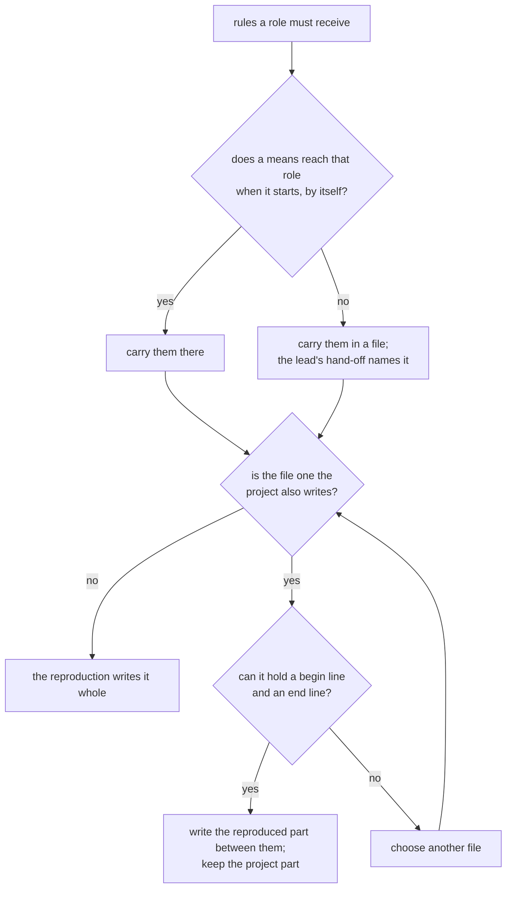
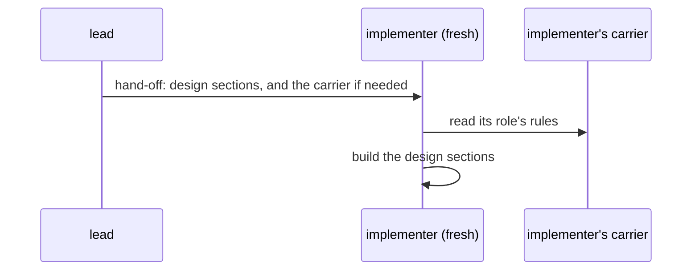

# carriers

> Basis: intent 1.2 — §4 (principle 8), §5.1 (the project runs without the rules; reproduced and project parts), §5.4, §8.4, §8.5.

## 1. Responsibilities

**Does**: defines what a setup's rule carriers must tell each role, how the carriers reach the agents that play those roles, what carried text may and may not hold, and how a carrier that the project also writes keeps the project's part. Defines what the template's reproduced part says. Connectors (`conformance`) are written under this module.

**Does not**:

- Choose the means for a particular coding agent. The reproducing agent chooses them from the means it has, and the setup record lists them (`setup-record`).
- Define the procedures that are carried. `layers`, `roles`, `design-docs` and `authoring` do; `changes` (M1) and `verify` (M2) add theirs.
- Fix the wording of carried text. Only what it must say is fixed.

## 2. Public interface

### What each role must receive (M0)

| Role | Must receive |
|---|---|
| `lead` | the three layers, their locations and which are kept out of git (`settings`); the read direction, the change direction and gaps as proposals (`layers`); the whole role table, fresh agents, hand-off and the gap flow (`roles`); how design documents are written: template, basis lines, design-level markers, figures, never naming impl locations (`design-docs`); the authoring procedure (`authoring`); that the content of a layer kept out of git is never copied into a file in git; that reproduced files and reproduced parts are never edited by hand, and that the setup changes only by changing the rules or the settings and reproducing again |
| `implementer` | its row of the role table: it reads design and impl, writes impl only, and never reads intent; the design and impl locations, and the intent location as a place it never reads; how to read a design document: what each of the seven sections holds, what the design-level markers mean, and that a design never names impl locations; that it builds only the design sections it is handed; that on a gap it stops and reports to the lead in terms of the design |

- Every location is stated as the settings give it.
- When a rule is enforced only by instruction (`setup-record`, `enforcement`), the carrier states it as an instruction. In M0 the role table is such a rule.

### How carriers reach agents

- The reproducing agent chooses the carriers from the means it has: an instruction file, part of one, a file it refers to, a script a hook runs, a skill, and so on.
- The lead's carrier reaches the lead at the start of every session, without the user doing anything.
- A carrier that every agent reads by itself holds only what every role may receive. The lead's own rules go in a carrier that only the lead receives.
- An implementer receives its rules when it starts. When the means cannot give a fresh agent its rules by themselves, the lead's hand-off also names the carrier that holds them. The hand-off still names nothing else but design sections (`roles`).
- Every carrier file is in git, lies outside every layer location, and is listed in the setup record (`setup-record`).

### What carried text may hold

- Rules only: no reasons, no history, no open questions (`layers`).
- No pointer to plumbline's intent or design.
- No content of a layer kept out of git. Only its location.
- Nothing the rules do not say. What a project adds goes in a project part.

### Reproduced and project parts

- When a carrier is a file the project also writes, the reproduction writes only its reproduced part, between a begin line and an end line. The reproducing agent chooses those two lines to suit the file type, and the setup record names them (`setup-record`). Everything outside them is the project's part, and reproducing again leaves it as it is.
- A project part holds the project's own working rules, such as what its intent decided about natural language or code comments. The reproduced part never holds such rules.
- A file the project also writes that cannot hold the two lines is not used. The reproducing agent chooses another file.

### The template's reproduced part

The template (`design-docs`) is a file with both parts. Its reproduced part says what each of the seven sections is for, how basis lines are written, and how the two markers are used. It holds no level-2 heading. Its project part is the lead's (`authoring`).

### Connectors

For each mechanical part connected to an agent or to CI, a connector is written under the contract in `conformance`. M0 has no mechanical part, so it has no connector.

## 3. Flow

Choosing how a set of rules reaches a role:

An implementer starting work:

## 4. Invariants and contracts

- Every rule that the lead and the implementer must follow reaches them through a carrier.
- Carried text holds rules only, with no reasons, no history, no pointer to plumbline's intent or design, and no content of a layer kept out of git.
- An implementer's carrier tells it nothing about intent but its location.
- A carrier that every agent reads by itself holds nothing that only the lead may receive.
- Reproducing again never changes a project part.
- Every carrier file is listed in the setup record.

## 5. Decisions and reasons

- **The reproducing agent chooses the carriers and records them.** intent §5.4.
- **A file the project also writes keeps the project's part across reproductions.** intent §5.1.
- **What each role must receive is listed per role. The implementer gets its own row, the design and impl locations, the intent location as a place it never reads, and how to read a design document. A carrier every agent reads holds only what every role may receive.** Reading the seven sections and the markers rightly lets the implementer follow the design closely and name a gap by its section, and it adds nothing about intent. The lead's rules stay out of the implementer's context, since many means give every new agent the same instruction file. Rejected: leaving out how to read a design document, which lets the implementer misread decisions and criteria; giving the implementer everything the lead receives, which shows it how intent is written and used. (Design-level — confirmed 2026-10-17)
- **When a means cannot give a fresh agent its rules, the hand-off names the carrier that holds them.** A hand-off may name only design sections. Naming a carrier file adds no intent content. (Design-level — confirmed 2026-10-17)
- **What a project adds goes only in a project part.** The reproduced part is replaced at every reproduction, so a project's own rules would be lost there. The rules cannot hold them either. (Design-level — confirmed 2026-10-17)
- **The template's reproduced part says what each section is for and how basis lines and markers are written.** Whoever writes a module document then has those rules next to the headings. (Design-level — confirmed 2026-10-17)

## 6. Verification criteria

These are judgment checks, made during the M0 Done of intent §11:

- after a reproduction, the setup record lists every carrier and its files;
- a new lead session with no earlier conversation can tell from the carriers alone: the layer locations, what it may read and write, how to write a design document, and how to go on with authoring;
- an implementer started by a hand-off receives its row of the role table and how to read a design document, and learns nothing about intent but its location;
- reproducing again leaves every project part as it was;
- no carried text points to plumbline's intent or design, or holds content of a layer kept out of git.

## 7. Out of scope

- What the lead and the implementer must receive about changes, gap items, diagnosis and the small-change path, and the gap guard's connector (M1).
- The verifier's carrier, the verify procedure, and the role guard's connector (M2).
