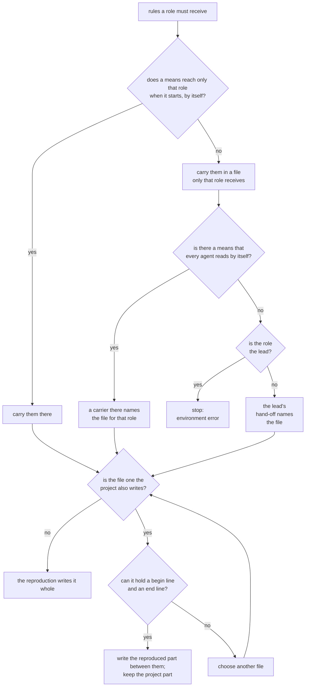
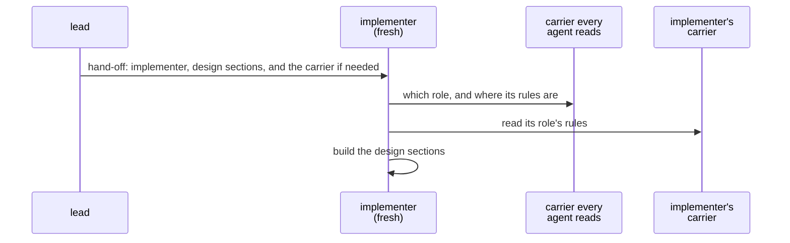

# carriers

> Basis: intent 1.4 — §4 (principle 8), §5.1 (the project runs without the rules; reproduced and project parts), §5.2 (newer rules only with a network), §5.4, §5.5 (validate also runs in CI), §8.1 (status takes the place of "start here"), §8.2, §8.3 (when validate reports and when it blocks; verify at closing), §8.4, §8.5.

## 1. Responsibilities

**Does**: defines what a setup's rule carriers must tell each role, how the carriers reach the agents that play those roles, what carried text may and may not hold, and how a carrier that the project also writes keeps the project's part. Defines what the template's reproduced part says. Connectors (`conformance`) are written under this module.

**Does not**:

- Choose the means for a particular coding agent. The reproducing agent chooses them from the means it has, and the setup record lists them (`setup-record`).
- Define the procedures that are carried. `layers`, `roles`, `design-docs` and `authoring` do; `changes`, `status` and `guards` add theirs in M1, and `validate` and `verify` in M2.
- Fix the wording of carried text. Only what it must say is fixed.

## 2. Public interface

### What each role must receive

From M0:

| Role | Must receive |
|---|---|
| `lead` | the three layers, their locations and which are kept out of git (`settings`); the read direction, the change direction and gaps as proposals (`layers`); the whole role table, which role an agent plays, fresh agents, hand-off and the gap flow (`roles`); when a hand-off must name the implementer's carrier, which file that is; when the means that reaches only the implementer needs the implementer to be started in a particular way, how to start it; how design documents are written: template, basis lines, design-level markers, figures, never naming impl locations (`design-docs`); the authoring procedure (`authoring`); that the content of a layer kept out of git is never copied into a file in git; that reproduced files and reproduced parts are never edited by hand, and that the setup changes only by changing the rules or the settings and reproducing again |
| `implementer` | its row of the role table: it reads design and impl, writes impl only, and never reads intent; the design and impl locations, and the intent location as a place it never reads; how to read a design document: what each of the seven sections holds, what the design-level markers mean, and that a design never names impl locations; that it builds only the design sections it is handed; that on a gap it stops and reports to the lead in terms of the design, leaves that point unbuilt and chooses no way to build it; that when a hand-off asks for a check of the role guard, it tries the reads the hand-off lists, and a blocked read is the expected result |

Added in M1:

| Role | Must receive |
|---|---|
| `lead` | changes (`changes`): opening one (its name, `change.md` with its state and diagnosis and the commit checked out when it was opened, making it current, and listing `/.plumbline/current-change` in `.git/info/exclude` before writing it); each milestone's work, from the first reproduction on, as one change with diagnosis `design`, opened before that work starts and closed when the milestone's impl is done; the three diagnoses, what each changes, when the intent version is raised, how to tell the design level from the intent level, and asking an implementer when a diagnosis needs impl; the current, expected and unchanged behaviour of a bug; recording a gap item before proposing it, and the user's answer with its date; making a wording fix at once without a gap item, recording what was aligned to what, telling the user, and turning it into a gap item when the user objects; what a gap item may hold for a layer kept out of git; closing (no gap item proposed, how the result was confirmed, emptying the current change) and archiving; the section 5 line of a decision from a gap, with its link to the change; that a change record holds no content of a layer kept out of git. status (`status`): how to run it, as the setup record gives its runner and entry; to run it at the start of every session, before anything else, with empty standard input, and tell the user the state in a few lines, in the project's words, before acting on the user's request; to use the rules only to reproduce, and their repository only to fetch tags as below; when the user asks for the state or about the rules, to fetch the tags of the rules repository the setup record names when the network is available, and run it with them. The gap guard (`guards`): when it blocks a write, to tell the user which gap item must be answered; when it reports an environment error, to tell the user; never to write a blocked file another way. A project file in no layer that is not one of the files `roles` lists with this rule: no role writes it; when the work needs one, to propose adding its path to a layer, and after the user agrees, to edit the settings and reproduce |
| `implementer` | when a write is blocked, to stop that work and report to the lead; never to write a blocked file another way; when the work needs a file in no layer, to stop that work and report it to the lead |

Added in M2:

| Role | Must receive |
|---|---|
| `lead` | validate (`validate`): how to run it, as the setup record gives its runner and entry; to tell the user the problems it reports at the end of a turn, without stopping on them; before closing a change, to run it in `gate` mode, and never to close while it blocks; to tell the user when the project has no CI that runs it. verify (`verify`, `changes`): once a change is closed, to hand its check to a fresh verifier with the hand-off `roles` defines, and how to start the verifier when its means needs that; to read `verify.md` and tell the user the findings; for each finding, to open a follow-up change or record the user's decision not to act with its date, linking the changes both ways; to archive only then. The role guard (`guards`): when it blocks a read or a write, never to do it another way, and to tell the user when the work needed it |
| `implementer` | when a read or a write is blocked, to stop that work and report to the lead; never to read or write a blocked file another way |
| `verifier` | its row of the role table: it reads design and impl and their git history, never reads intent or change records, and writes only the `verify.md` of the change it is given; the design and impl locations, and the intent location as a place it never reads; how to read a design document, as the implementer receives it; what the hand-off names; what it looks for and how it judges the diagnosis (`verify`); the form of `verify.md`: findings in terms of the design, impl locations allowed, impl content never quoted (`changes`); to tell the lead when it is done; when a read or a write is blocked, never to do it another way; that when a hand-off asks for a check of the role guard, it tries the reads the hand-off lists, and a blocked read is the expected result |

- Every location is stated as the settings give it.
- When a rule is enforced only by instruction (`setup-record`, `enforcement`), the carrier states it as an instruction. The role table is such a rule when its connector cannot be made to work: each role then receives its row as an instruction. The gap guard is one too in the same case; the lead then receives the rule itself: within the current change, while a gap item is proposed, no layer below it is edited. When validate cannot be run at the end of a turn by itself, the lead receives the instruction to run it in `report` mode at the end of every turn that edited files.

### How carriers reach agents

- The reproducing agent chooses the carriers from the means it has: an instruction file, part of one, a file it refers to, a script a hook runs, a skill, and so on.
- A means reaches a role by itself when, once an agent of that role has started, its rules reach the agent without anyone pointing the agent to them. Such a means may need the agent to be started in a particular way, for example as a given agent type; the implementer is then started that way (`roles`, hand-off). For the lead, and for a means that every agent reads by itself, only a means that needs no particular way of starting counts, since the lead's rules reach it without the user doing anything.
- Each role's rules go in a carrier that only that role receives.
- What the reproduction writes in a carrier that every agent reads by itself holds no role's rules. It holds nothing but the names of the roles, which role an agent plays (`roles`), and, for each role whose rules no means can bring to that role alone, the carrier that holds them (see the flow below). The reproduction writes such a carrier only when it must name at least one role's carrier.
- The lead's carrier reaches the lead at the start of every session, without the user doing anything: through a means that reaches only the lead, or because the carrier every agent reads names it. When the agent has neither a means that reaches only the lead nor a means that every agent reads by itself, the reproduction stops with an environment error (`reproduction`).
- An implementer or a verifier receives its rules when it starts: through a means that reaches only that role, or because the carrier every agent reads names its carrier. When neither is possible, the lead's hand-off also names the carrier that holds them. The hand-off still names nothing else but what `roles` lists for it.
- Every carrier file is in git, lies outside every layer location, and is listed in the setup record (`setup-record`).

### What carried text may hold

- Rules only: no reasons, no history, no open questions (`layers`).
- No pointer to plumbline's intent or design.
- No content of a layer kept out of git. Only its location.
- Nothing the rules do not say. What a project adds goes in a project part.

### Reproduced and project parts

- When a carrier is a file the project also writes, the reproduction writes only its reproduced part, between a begin line and an end line. The reproducing agent chooses those two lines to suit the file type, and the setup record names them (`setup-record`). Everything outside them is the project's part, and reproducing again leaves it as it is.
- A project part holds the project's own working rules, such as what its intent decided about natural language or code comments. The reproduced part never holds such rules.
- A file the project also writes that cannot hold the two lines is not used. The reproducing agent chooses another file.

### The template's reproduced part

The template (`design-docs`) is a file with both parts. Its reproduced part says what each of the seven sections is for, how basis lines are written, and how the two markers are used. It holds no level-2 heading. Its project part is the lead's (`authoring`).

### Connectors

For each mechanical part connected to an agent or to CI, a connector is written under the contract in `conformance`. M0 has no mechanical part, so it has no connector.

From M1:

- **The gap guard** is connected to the hook that an agent's file-writing actions pass through before they happen, for the lead and the implementer alike. The connector gives the guard the paths the action will create, change or remove (`guards`).
- **status** has no connector to an agent. The lead runs it with its runner and entry.
- **Checking the gap guard's connector** (`reproduction`, acting through each connector): the reproducing agent writes a temporary change with a proposed gap item at the intent layer and makes it current. An action that creates a new file in the design location must be blocked, and an action that creates a new file outside the project root must pass. Each new file is at a path that does not exist yet. Then it removes the temporary change and every file the check created, and puts `.plumbline/current-change` back as it was. Nothing of the check reaches git.

From M2:

- **The role guard** is connected to the hook that an agent's file-reading and file-writing actions pass through before they happen, for every role. The connector gives the guard the role the agent plays, the action, `read` or `write`, and the paths: for a search, the files and folders it searches (`guards`). When the connector cannot tell which role an agent plays, the role table is enforced by instruction only.
- **validate at the end of a turn** is connected to the hook that runs when the lead ends a turn. It runs `validate report` and gives its lines to the lead. It may let the lead go on once so that it can tell the user; it never holds the lead back more than once in a turn, and never blocks.
- **validate before closing** has no connector. The lead runs `validate gate` before it closes a change.
- **validate in CI** is a step of the CI the project uses. The step runs `validate gate` with its runner and entry, and fails when the verdict is `block` or `error`, saying which. When the project uses no CI, there is no such step, and the rule is enforced by instruction only.
- **Checking the role guard's connector**: acting as the lead, reading a path that does not exist under an impl location must be blocked, and reading a design document must pass. Then, for the implementer and for the verifier, an agent of that role is started as the setup starts it, with a hand-off that says it is a check of the guard and asks only for two reads: a path that does not exist under the intent location, which must be blocked, and a design document, which must pass. A path that does not exist reveals nothing, so no role has a reason to refuse it. Reads change nothing, so the check leaves nothing behind.
- **A connector that cannot be checked in this session**: when the agent cannot start an agent of a role until a new session, for example because the means that starts it was written by this reproduction, the rule whose check needs it is enforced by instruction only, and the final report tells the user to reproduce again in a new session. The connector stays in place and is listed in the setup record, like one whose check failed.
- **Checking validate's end-of-turn connector**: the reproducing agent writes a temporary module document with no sections in the design location, runs the connector as the hook would run it at the end of a turn, and sees that the lead would be given a `sections` line for it and that nothing is blocked. Then it removes the document.
- **Checking the CI connector**: the reproducing agent copies the project to a temporary folder outside it and runs the step's command there as CI would: once as the copy is, and once after writing a temporary module document with no sections into the copy's design location. The step must fail exactly when `validate gate` blocks on that copy. Then it removes the copy.

## 3. Flow

Choosing how a set of rules reaches a role:

- The figure covers the lead and the implementer alike. Only an implementer can be given the file by a hand-off. When nothing reaches the lead by itself, the reproduction stops with an environment error.
- The carrier that every agent reads by itself is also chosen this way. What the reproduction writes in it holds nothing but the names of the roles, which role an agent plays, and the files it names in the figure. It is written only when the figure names at least one file through it.

An implementer starting work:

- When the lead cannot start the implementer itself, the user starts it with the lead's hand-off (`roles`). The figure shows the lead starting it.
- When there is no carrier that every agent reads, the step through it does not happen. When there is one and a means reaches only the implementer, that carrier tells the implementer which role it plays but does not name its carrier.

## 4. Invariants and contracts

- Every rule that the lead, the implementer and the verifier must follow reaches them through a carrier.
- Carried text holds rules only, with no reasons, no history, no pointer to plumbline's intent or design, and no content of a layer kept out of git.
- An implementer's or a verifier's carrier tells it nothing about intent but its location.
- What the reproduction writes in a carrier that every agent reads by itself holds no role's rules: only the names of the roles, which role an agent plays, and, for each role whose rules no means can bring to that role alone, the carrier that holds them.
- Each role's rules reach only that role.
- Reproducing again never changes a project part.
- Every carrier file is listed in the setup record.
- No agent writes a file the gap guard blocked by another way.
- No agent reads or writes a file the role guard blocked by another way.
- The lead never closes a change while `validate gate` blocks.
- The connector checks leave nothing behind.

## 5. Decisions and reasons

- **status takes the place of a "start here" note and of status lines in documents: the lead runs it at the start of every session and tells the user the state.** intent §8.1.
- **The lead runs status at the start of every session without the rules repository's tags, and fetches them only when the user asks for the state or about the rules.** Every session then starts from where things stand, at once and without the network. Newer rules matter only when someone asks. Rejected: fetching the tags at the start of every session, which adds a network call to every start; running status only when the user asks, which lets a new session start work without knowing the gap items waiting for an answer. (Design-level — confirmed 2026-10-17)
- **No agent writes a blocked file another way, and the lead tells the user which gap item to answer.** A hook cannot see every write, such as one made by a shell command (intent §8.4), so the rule must also be an instruction. The gap item named in the block is what lets the work go on. (Design-level — confirmed 2026-10-17)
- **The gap guard's connector is checked with a temporary change that is removed afterwards.** A guard can be seen to block only when a gap item is proposed in the current change. Writing a file outside every layer shows a pass without writing into a layer, which a reproduction never does. Rejected: checking only the pass, which leaves a connector that never blocks recorded as mechanical; leaving the temporary change in place, which would show a change nobody opened. (Design-level — confirmed 2026-10-17)
- **The blocked action creates a new file in the design location, under a gap item at the intent layer.** The design location is always a folder (`settings`), so a path that does not exist yet can always be found there, and a connector that fails to block overwrites nothing of the project. An impl location may be a single file, where no new path exists. (Design-level — confirmed 2026-10-17)

- **The reproducing agent chooses the carriers and records them.** intent §5.4.
- **A file the project also writes keeps the project's part across reproductions.** intent §5.1.
- **What each role must receive is listed per role. The implementer gets its own row, the design and impl locations, the intent location as a place it never reads, and how to read a design document.** Reading the seven sections and the markers rightly lets the implementer follow the design closely and name a gap by its section, and it adds nothing about intent. Rejected: leaving out how to read a design document, which lets the implementer misread decisions and criteria; giving the implementer everything the lead receives, which shows it how intent is written and used. (Design-level — confirmed 2026-10-17)
- **A carrier that every agent reads holds no role's rules, only the roles, which role an agent plays and where a role's carrier is. Each role's rules go in a carrier that only that role receives.** Many means give every new agent the same instruction file, so the lead's rules must stay out of it, yet the lead's carrier must still reach the lead without the user doing anything. A carrier that only points draws a clear line: it holds no rule at all, and a new role adds one pointer. Rejected: also putting the implementer's rules in it, which shows the lead instructions meant for another role and leaves to the reproducing agent which rules may go there; putting only the implementer's rules in it, which leaves no way to point the lead to its own carrier when one instruction file is all the means there is. (Design-level — confirmed 2026-10-17)
- **When no means and no shared carrier can give a fresh agent its rules, the hand-off names the carrier that holds them.** Besides the role, a hand-off names only what `roles` lists for it. Naming a carrier file adds no intent content. (Design-level — confirmed 2026-10-17)
- **What a project adds goes only in a project part.** The reproduced part is replaced at every reproduction, so a project's own rules would be lost there. The rules cannot hold them either. (Design-level — confirmed 2026-10-17)
- **The template's reproduced part says what each section is for and how basis lines and markers are written.** Whoever writes a module document then has those rules next to the headings. (Design-level — confirmed 2026-10-17)
- **validate reports at the end of a turn and blocks in CI; before closing, the lead runs it and does not close while it blocks.** intent §8.3.
- **Blocking before closing is an instruction, with CI as the mechanical backstop.** A hook sees which file an edit writes, not that the edit closes a change; telling that would need the file's new content, which many agents' hooks do not give whole. Closing is rare and done by the lead alone, right after a check it can run. CI blocks any push with a problem, so a change closed against the instruction is still caught. Rejected: a close guard fed the file's new content, which needs a new part and a connector that computes edits, and falls back to an instruction wherever it cannot; a git pre-commit hook, which blocks at the commit rather than at closing, and leaves a closed change with a problem until then. (Design-level — confirmed 2026-10-18)
- **The CI connector is written for the CI the project uses and checked by running its command locally on a copy, with and without a problem; with no CI, validate in CI is an instruction.** Running the CI service is out of a reproduction's reach, but whether the command fails exactly when validate blocks can be seen locally, and what is left, whether the service reads the file, depends only on the file's form. Rejected: keeping it an instruction until the user sees a CI run, which needs a second reproduction; leaving CI to the user, which leaves a hand-written CI file outside the checksums. (Design-level — confirmed 2026-10-18)
- **A CI step fails on `error` as well as on `block`.** In CI no agent can be held back without end, and a setup that cannot run validate there must be seen and fixed. Rejected: passing on `error`, which lets a broken runner turn CI green. (Design-level — confirmed 2026-10-18)
- **The verifier receives its own row, how to read a design document, what verify looks for, and the form of its result; nothing about changes or intent.** It needs what the implementer needs to read a design rightly, and the rules of its check, and nothing that could carry intent content. (Design-level — confirmed 2026-10-18)
- **The role guard's connector is checked by reads, as the lead and as each role the setup starts by hand-off.** A read changes nothing, so the check is safe; and which role an agent plays is told differently for an agent started by a hand-off, so each such role is tried. Rejected: checking only as the lead, which leaves a connector that cannot tell an implementer recorded as mechanical. (Design-level — confirmed 2026-10-18)
- **validate's end-of-turn connector is checked by running it as the hook would, with a temporary problem in the design.** The reproducing agent cannot end its own turn and go on with the check. (Design-level — confirmed 2026-10-18)
- **The gap guard's connector check writes its passing file outside the project root.** With the role guard in place, the lead may not write a project file in no layer; a path outside the root passes both guards and touches no project file. (Design-level — confirmed 2026-10-18)

## 6. Verification criteria

These are judgment checks, made during the M0 Done of intent §11:

- after a reproduction, the setup record lists every carrier and its files;
- a new lead session with no earlier conversation, started without the user doing anything, can tell from the carriers alone: the layer locations, what it may read and write, how to write a design document, and how to go on with authoring;
- an implementer started by a hand-off receives its row of the role table and how to read a design document, and learns nothing about intent but its location;
- what the reproduction writes in a carrier that every agent reads by itself, if there is one, holds nothing but the names of the roles, which role an agent plays, and, for each role whose rules no means can bring to that role alone, the carrier that holds them;
- reproducing again leaves every project part as it was;
- no carried text points to plumbline's intent or design, or holds content of a layer kept out of git.

These are judgment checks, made during the M1 Done of intent §11:

- the lead's carrier holds everything added in M1 for the lead, and the implementer's holds what was added for it and nothing about changes;
- a new lead session runs status first and tells the user the state; asked about the rules, it fetches the tags and runs status again;
- after a reproduction, the setup record lists `gap-guard` and `status` in `parts`, and the gap guard as `mechanical` when its connector check worked; the check left no change, file or marker behind;
- a write blocked by the gap guard is not made another way, and the lead names the gap item to answer.

These are judgment checks, made during the M2 Done of intent §11:

- the lead's carrier holds everything added in M2 for the lead; the verifier's carrier holds its row, how to read a design document, what verify looks for and the form of its result, and nothing about intent or changes;
- at the end of a lead's turn the user is told what validate reports, and nothing is blocked; before closing, the lead runs `validate gate` and does not close while it blocks;
- a push with a problem fails in CI, when the project uses CI;
- after a reproduction, the setup record lists the four parts, `role table`, `validate at the end of a turn` and `validate in CI` in `enforcement`, and the connector checks left nothing behind.

## 7. Out of scope

- None. carriers is complete in M2.
