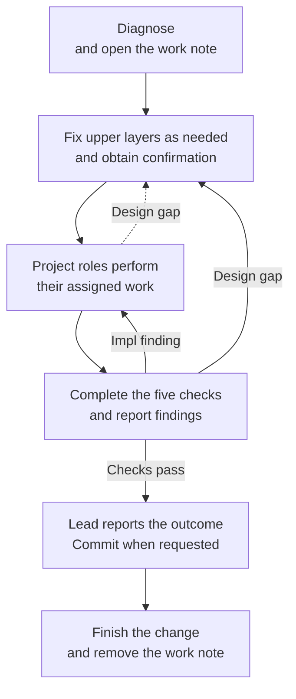

# A change

## 1. Responsibilities

- Defines how a change proceeds from diagnosis to commit.
- Defines what the project's workflow must specify and how roles exchange work and results.
- Defines the five checks and the work note.

Role names, duties, models and zones come from Layers and settings. Roles defines access limits and what hand-offs and reports may contain.

## 2. Public interface

### Diagnosis

| Diagnosis | Means | Layers fixed |
|---|---|---|
| impl | the design is right, and impl does not follow it | impl |
| design | something is missing or wrong in the design, and intent does not state the point | design, impl |
| intent | what intent states must change | intent, design, impl |

- A change is at the design level when it changes public interfaces, invariants, decisions or verification criteria. It is at the intent level when it changes goals, scope, decisions and their reasons, or milestones.
- The lead diagnoses from the user's request, intent and design. If diagnosis needs impl, it asks a role allowed to read the relevant parts and receives an answer in terms of design.
- The layers touched are the diagnosis's layer and those below it. If a gap requires fixing a higher layer, the lead updates the diagnosis and layers touched before continuing the dependent work.

### The project's workflow

The lead and user define the workflow before reproduction. It is written in the project parts of rule carriers, not in an additional settings field. It specifies:

| Choice | What must be stated |
|---|---|
| Assignments | Which role receives each task and design section, in what order, and what it reports |
| Work across zones | How one design section is divided when it needs more than one role's write zones |
| Shared write zones | Whether roles may work concurrently and how they coordinate to prevent conflicting edits |
| Communication | Whether roles exchange work directly or through the lead, and how progress and results reach the lead |
| Findings | Which role receives each kind of finding, who fixes it, and who checks the fix |
| Design updates | Whether updated sections return to the same AI or a new AI |
| The five checks | Who covers each check and scope, and whether those roles must differ from the roles that built the changed parts |

The project may assign all five checks to one role, divide them among roles, or let a role check its own work. It may add checks. The assigned roles use their configured models and permissions. A workflow does not grant extra access: if no assigned role can build or check a required part, the lead resolves the assignments or settings with the user before that part proceeds. Settings changes follow Layers and settings.

### Hand-offs and reports

- A task identifies the receiving role, its assigned design documents and section titles, and the work or question. A checking task also supplies the diagnosis, starting commit, layers touched, check scope and checks assigned to that role.
- A role reports completed work, unfinished work, gaps, findings and requested answers. A check report identifies its scope and checks, their results, and anything it could not check. A finding identifies the design document and section, what fails, and what must be checked after a fix.
- Roles follow the workflow's routes while keeping the content limits in Roles. Direct exchanges do not remove the lead's need to know progress, outstanding findings and whether all five checks are complete.
- A gap in design goes to the lead. Roles do not agree on a missing design decision among themselves.

### The work note

- It is `.plumbline/work-note.md`, maintained by the lead and kept out of git.
- There is at most one change and one work note per working tree. Several roles may work on tasks within that change. Independent simultaneous changes use separate working trees.
- It holds the request, diagnosis, starting commit (the commit checked out when the change begins), layers touched, tasks with assigned roles and progress, questions waiting for the user, check results and unresolved findings.
- The lead updates it from the workflow's reports in plain words, without copying impl content. Roles receive the context they need in hand-offs, not the whole work note.

### The five checks

Every change to impl completes these checks before the change ends. Changes are compared with the starting commit. The scope is the changed parts of impl and the design contracts that govern them, plus any changed design sections. Unchanged design still supplies the criteria for an impl-only fix. Each checking role reads only its allowed zones and their history; divided reports must together cover the whole check scope.

1. Every verification criterion relevant to the changed parts has a test or conformance case in impl that shows it.
2. The changed impl follows the applicable design invariants and contracts.
3. The applicable public names are present in impl, and the changed impl adds no public name absent from design.
4. The design sections in scope name no impl location, such as a file path or test name.
5. The diagnosis held: for impl, design is unchanged and impl now follows it; for design or intent, design changed and impl follows the updated design. In every case, nothing outside the layers touched changed.

Non-lead roles do not read intent even for an intent diagnosis. They check the design and impl changes; the lead handles intent with the user. An unassigned, unreadable or unfinished part is reported as remaining work, not as a passed check. After a fix, the affected checks are repeated for the affected scope; results for unaffected parts remain valid.

## 3. Flow

1. **Start**: the lead states the diagnosis to the user and writes the work note.
2. **Fix from the top down**: fix intent first when needed. The user reads and confirms changed design before dependent impl work begins.
3. **Perform the work**: assign tasks and exchange results through the project's workflow. Each role writes only its assigned share within its write zones. Work outside that scope remains reported and unbuilt until assigned appropriately.
4. **Resolve gaps**: the lead takes missing or wrong design to the user, fixes the upper layer according to the answer, obtains confirmation and hands over the updated sections. The workflow determines which AI continues. Independent tasks can continue while dependent tasks wait.
5. **Check and handle findings**: assigned roles perform the five checks. Impl findings go to the workflow's assigned roles for fixes and rechecks. Design gaps return to the lead. Findings are resolved within this change; checks affected by later edits are repeated before completion.
6. **Report and commit**: once required work, findings and checks are complete, the lead reports the changes and check results in plain words. Commit when the user requests it, with the reason for the change in the commit message.
7. **End**: remove the work note. If the change completes a milestone, update the current milestone in the design README.

A milestone's design and impl work is one change too. A wording fix that changes no meaning is made at once and reported to the user; an objection is handled as a gap.

## 4. Invariants and contracts

- A required upper-layer change is fixed and confirmed before dependent lower-layer work proceeds.
- Roles, models, routing and separation of building from checking follow the project's settings and workflow.
- Every impl change covers all five checks; splitting work never omits a part or grants access to it.
- The lead can report progress and check completion without reading impl, including when roles communicate directly.
- Findings and unfinished checks are resolved before the change ends. The work note remains until then.

## 5. Decisions and reasons

- The five checks are fixed while their assignments are not. Projects can divide work without losing the minimum checks.
- The starting commit and scope travel with checking tasks so divided work uses the same comparison point.
- The diagnosis stays only in the work note because it is needed while the change is in progress.
- The work note combines progress and check results. The lead can continue in another session without reading impl or assuming that one role's completion finishes the whole change.
- Only affected checks are repeated after a fix, while independent work and valid results are preserved.

## 6. Verification criteria

These are reviews of the rules and workflow, not executable conformance cases. The project's assigned roles review the flow and contracts above, including these situations:

- A role may build and check its own work when the workflow allows it; a separate role or lighter model is not required by plumbline.
- Tasks and checks split across roles cover all changed parts. Missing permission or an unfinished check remains visible and prevents completion of that work.
- Direct findings between roles reach the chosen fixer and checker, and the lead still receives progress and completion results.
- Shared write zones use the project's coordination rule; they are neither rejected outright nor treated as permission to overwrite another role's work.
- A design gap pauses dependent work, reaches the lead and user, and resumes after confirmation through the chosen same or new AI.
- An impl-only fix is checked against unchanged design. A later fix repeats the affected checks before the change is complete.
- The lead's work note and final report contain check results without impl content, and the note is removed only after the change ends.

## 7. Out of scope

None.
