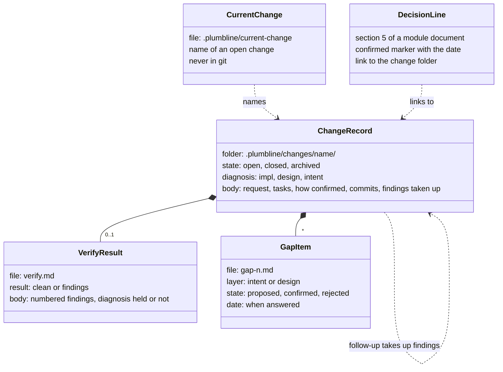
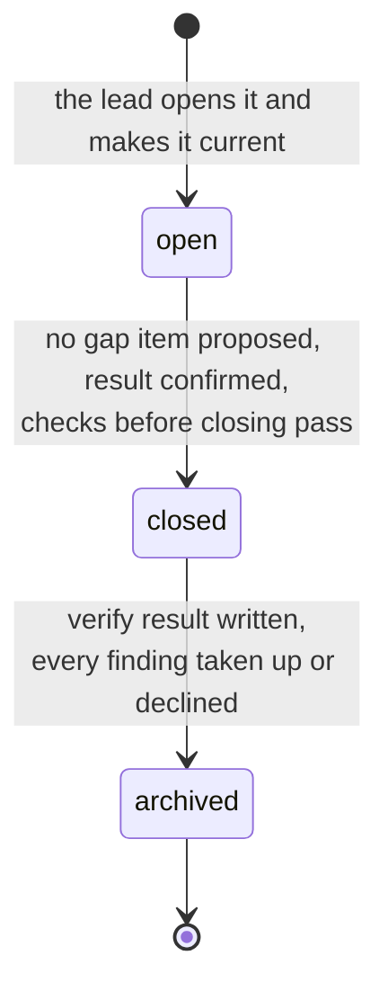
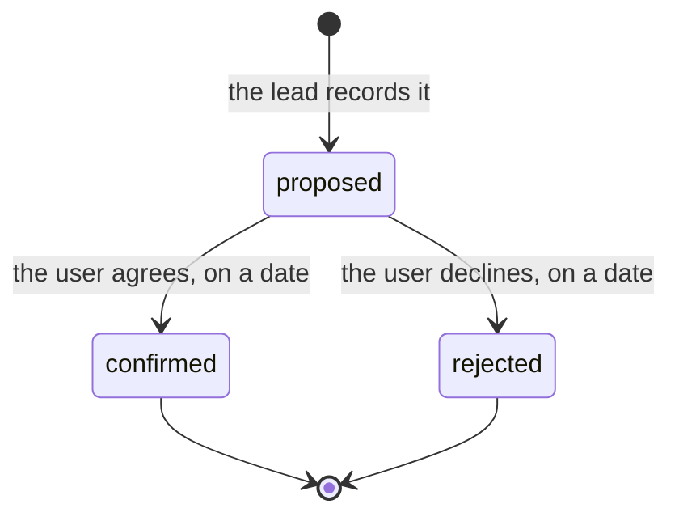
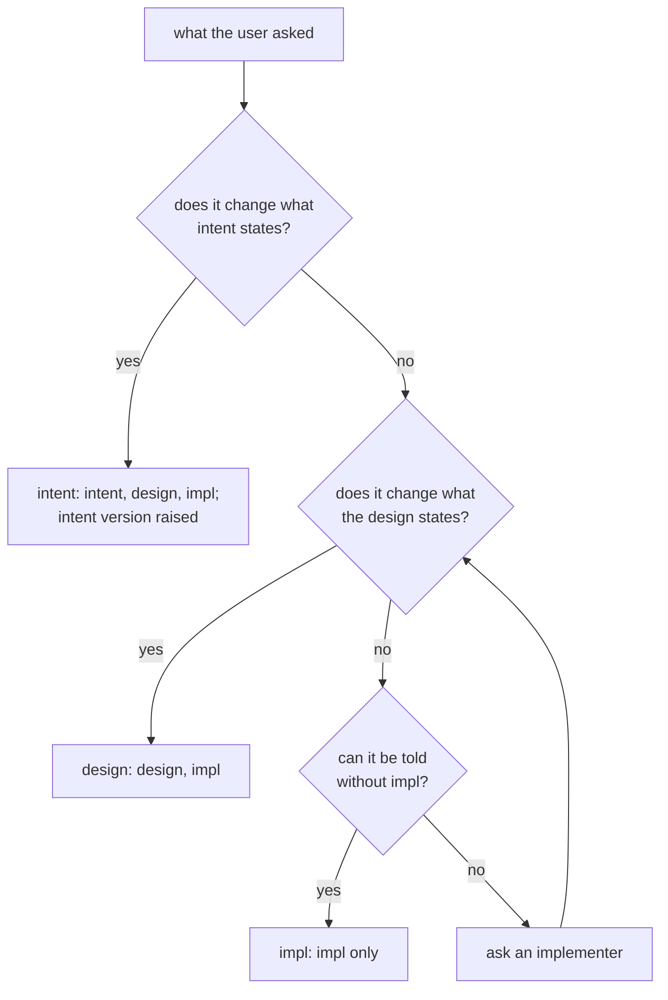

# changes

> Basis: intent 1.4 — §4 (principles 3, 4, 7), §7 (layers kept out of git), §8.1, §8.2, §8.3 (verify results stay in the change), §8.4 (the lead records gaps), §11 (M1, M2).

## 1. Responsibilities

**Does**: defines the change: one unit of work, from opening to archive. Defines the change record and its place, the gap item and its states, the diagnosis of which layer is wrong and what each diagnosis changes, the current change of a working tree, how a change is opened, closed and archived, how a milestone's work is a change, how a decision that came from a gap points back to its change, the verify result a change keeps, and how its findings are taken up.

**Does not**:

- Block edits while a gap item is proposed. `guards` does (the gap guard).
- Report changes and gap items. `status` does.
- Define what is checked before a change closes, or what the verifier checks. `validate` and `verify` do.
- Word the instructions agents receive. `carriers` does.

## 2. Public interface

### Change records

- Each change has one folder, `.plumbline/changes/<name>/`, in git (`settings`: `.plumbline/` holds what plumbline keeps in a project).
- `<name>` is `YYYY-MM-DD-<slug>`: the date the change was opened, then a slug of lowercase ASCII letters, digits and hyphens. No two changes have the same name.
- Every folder directly under `.plumbline/changes/` is a change.
- The folder holds `change.md` and one file per gap item, `gap-<n>.md`, numbered 1, 2, 3 and so on in the order the gap items were recorded. `<n>` is a positive integer written without leading zeros; a file whose name has any other form is not a gap item. Once the change is closed, the folder also holds `verify.md`, the verify result. The folder may hold other files the work needs.
- A change folder is never removed and never moved. A finished change stays where it is, with the state `archived`.
- A change record never holds content of a layer kept out of git. It may name only its location: a document path, a version, a section.

### `change.md`

Front matter (`layers`) with exactly these keys, each once:

| Key | Value |
|---|---|
| `state` | `open`, `closed` or `archived` |
| `diagnosis` | `impl`, `design` or `intent` |

The body is written in the project's own words. It holds:

- what was asked, briefly;
- the diagnosis and what it rests on;
- for a bug: the current behaviour, the expected behaviour, and the behaviour that must not change;
- the tasks;
- how the result was confirmed;
- the commit that was checked out when the change was opened, which a verifier's hand-off names as its start (`roles`);
- the commits that belong to the change.

### Diagnosis

When a change is opened, the lead decides which layer is wrong.

| `diagnosis` | When | Layers changed | Intent version |
|---|---|---|---|
| `impl` | the design states the point rightly, and impl does not follow it | impl | unchanged |
| `design` | the design has a gap or an error, and intent does not state the point | design, then impl | unchanged |
| `intent` | intent states the point, and it must change | intent, then design, then impl | raised |

- A change is at the design level when it changes what the design states: public interfaces, invariants, decisions, verification criteria. It is at the intent level when it changes what intent states: goals and scope, decisions and their reasons, milestones.
- The lead diagnoses from what the user said and from intent and design. When telling requires impl, the lead asks an implementer (`roles`).
- The diagnosis is written when the change is opened and is not changed afterwards. A gap found later in the change is recorded as a gap item.
- The layers a change touches are the layer of its diagnosis and every layer below it, together with the layer of each confirmed gap item and every layer below that.

### Gap items

`gap-<n>.md` has front matter (`layers`) with exactly these keys, each once:

| Key | Value |
|---|---|
| `layer` | `intent` or `design`: the layer that has the gap |
| `state` | `proposed`, `confirmed` or `rejected` |
| `date` | only when `state` is `confirmed` or `rejected`: the date of the user's answer, `YYYY-MM-DD` |

- The body says, in terms of the gap's layer, which section does not say something or says it wrongly, and what is proposed.
- For a layer kept out of git, the body names only the location in that layer and what the layer below needs to know. The proposed wording is given to the user, not written in the gap item.
- The lead records a gap item as `proposed` as soon as the gap is found, and records the user's answer with its date.
- When a gap item is confirmed, the gap's layer is changed first, then the layers below (`layers`). When it is rejected, the upper layer stays as it is and the layers below follow it.
- While a gap item is `proposed`, no layer below its layer is edited within its change. Other changes are not held back by it.

### Wording fixes

- A wording fix changes no meaning: it makes a document say what a confirmed decision, or another part of the same layer, already says. It is not a gap item.
- The lead makes it at once, writes in the change record which words were aligned to what, and tells the user in the same report. For a layer kept out of git, the record names only the locations.
- When the user objects, the point is recorded as a proposed gap item and handled like any other.
- A fix that adds or changes what a layer states, or that has to choose between two readings neither of which a confirmed decision settles, is not a wording fix.

### The verify result

`verify.md` is written by the verifier (`roles`) once the change is closed. Its front matter (`layers`) has exactly one key, once:

| Key | Value |
|---|---|
| `result` | `clean` when there is no finding; `findings` otherwise |

- The body is in the project's own words. It numbers each finding 1, 2, 3 and so on, and for each names the design document and section and says what impl does not show or does otherwise. Whether the diagnosis held is part of the result; a diagnosis that did not hold is a finding. What the verifier checks is defined by `verify`.
- It may name impl locations. It never quotes impl content.
- It holds no content of a layer kept out of git.

### Taking up findings

- For each finding, the lead writes in the body of `change.md` either the follow-up change that takes it up, as a link to that change's folder, or the user's decision not to act on it, with its date.
- A follow-up change is opened like any change, with its own diagnosis. Its body names the change and the findings it takes up, with a link to that change's folder. One follow-up change may take up several findings.

### The current change

- `.plumbline/current-change` holds one line: the name of an open change. Its content, with every CR LF read as LF and one final LF removed, is the name. When the file is absent or that content is empty, there is no current change.
- The file belongs to one working tree and is never in git. Before writing it, the lead makes sure `.git/info/exclude` lists `/.plumbline/current-change`.
- The lead writes it when it opens a change or turns to another open change, and empties it when the current change is closed.
- An edit made while a change is current belongs to that change.
- Two changes worked on at the same time use two working trees.

### Opening, closing, archiving

1. **Open**: the lead chooses the name, writes `change.md` with `state: open` and the diagnosis, and makes the change current.
2. **Work**: gap items are recorded and answered; the layers are changed top-down; implementers build impl (`roles`).
3. **Close**: when no gap item is `proposed`, the body says how the result was confirmed, and the checks that run before closing pass, the lead sets `state: closed` and empties the current change if it names this one.
4. **Verify**: a verifier checks the closed change and writes `verify.md` (`roles`).
5. **Archive**: when `verify.md` is there and every finding is taken up or declined, the lead sets `state: archived`.

### A milestone's work

- From the first reproduction on, the work of each milestone is one change: its module documents and its impl, and, for every milestone after the first, the change of the design README's `milestone` line to it (`design-docs`).
- Its diagnosis is `design`: the design does not yet hold that milestone's module documents.
- The lead opens it before that work starts: for the first milestone, after the first reproduction; for each later one, once the previous milestone's change is closed.
- A gap found while its documents are written or its impl is built is a gap item of this change.
- It is closed when the milestone's impl is done, like any change: no gap item proposed, and the body says how the result was confirmed.

### A decision that came from a gap

- When a gap item at the design layer is confirmed, the decision that settles it is written in section 5 of the module document it belongs to, with the confirmed marker (`design-docs`) carrying the gap item's date.
- The same line holds a Markdown link to the change folder, as a path relative to the module document. The link text is in the project's words.
- The change keeps the gap item after it is archived, so the line leads to how the decision came about.

## 3. Flow

What a change record holds:

A change:

A gap item:

Diagnosing a change:

## 4. Invariants and contracts

- Every change folder has a `change.md` whose front matter has exactly `state` and `diagnosis`, with the values above.
- A change's state moves only from `open` to `closed` to `archived`.
- A change is closed only when none of its gap items is `proposed`.
- A gap item's state moves only from `proposed` to `confirmed` or `rejected`. It has a `date` exactly when it is not `proposed`.
- The diagnosis of a change never changes after it is opened.
- `.plumbline/current-change`, when it names a change, names an open one. It is never in git.
- Within a change, while one of its gap items is `proposed`, no layer below the gap's layer is edited.
- A section 5 line that links to a change belongs to a decision that settled a confirmed gap item of that change at the design layer.
- A change record holds no content of a layer kept out of git.
- Change folders are never removed or moved.
- From the first reproduction on, a milestone's work happens within that milestone's change.
- A change is archived only when its `verify.md` is there and its body names, for every finding, a follow-up change or the user's dated decision not to act.
- Only the verifier writes `verify.md`.

## 5. Decisions and reasons

- **One folder per change, in git; gap items with the states proposed, confirmed and rejected, and a date on the answer; a change records its diagnosis, the layers it touches, its gap items, tasks, check results and commits.** intent §8.1.
- **While a gap item is proposed, layers below it are not edited within that change; other changes are not held back.** intent §8.1.
- **A decision that came from a gap is written in section 5 of its module document, and that line points to the change.** intent §4 principle 7, §8.1.
- **Documents are edited in place; finished changes are archived.** intent §8.1.
- **Three diagnoses, what each changes, when the intent version is raised, and how to tell the design level from the intent level.** intent §8.2.
- **The lead diagnoses; when telling needs impl, it asks an implementer. A bug records the current, the expected and the unchanged behaviour. A change is closed only once the result was confirmed.** intent §8.2.
- **The current change of a working tree is named in a file kept out of git, and an edit belongs to the current change.** The gap guard must know which change an edit belongs to. A marker per working tree is the lightest way, and other changes are held back by nothing. Rejected: a git branch per change, which makes small changes heavier; listing the files each change will touch, which must be known in advance and is ambiguous when two changes list the same file. (Design-level — confirmed 2026-10-17)
- **The marker is `.plumbline/current-change`, and the lead lists it in `.git/info/exclude` before writing it.** A mechanical part reads only what lies under the working directory, and the git directory of a second working tree lies outside it, so the marker cannot live under `.git/`. `.git/info/exclude` belongs to one clone, so the lead checks it whenever it writes the marker rather than leaving it to a reproduction that ran once. (Design-level — confirmed 2026-10-17)
- **A finished change is archived in place, by its state; a decision line links to the change folder.** The link never breaks, and its only machine-read part is a path, so no new marker text is needed and the existing template stays as it is. Rejected: moving finished changes to an archive folder with a reference whose words the template would define, which changes the template of every project already reproduced; moving them and fixing the links on archive, which breaks a link whenever one is missed. (Design-level — confirmed 2026-10-17)
- **Records sit in `.plumbline/changes/<name>/`; the values that checks read are in front matter, and each gap item is its own file.** Front matter is parsed without a library (`layers`) and holds no nesting, so a list of gap items with several fields each needs one file per item. (Design-level — confirmed 2026-10-17)
- **A change's name is the date it was opened followed by a slug.** Names then sort by time and need no counter. Rejected: sequence numbers, which two branches or two people can pick at the same time. (Design-level — confirmed 2026-10-17)
- **The diagnosis is fixed when the change is opened; a gap found later is a gap item.** Whether the diagnosis was right is checked when the change closes (intent §8.2), which needs the diagnosis as it was made. (Design-level — confirmed 2026-10-17)
- **The layers a change touches are derived from its diagnosis and its confirmed gap items, not written separately.** A separate list could disagree with them. (Design-level — confirmed 2026-10-17)
- **A wording fix is made at once and reported, without a gap item; an objection turns it into a gap item.** intent §8.1, §8.4. The change record says what was aligned to what, so the user can check each fix afterwards. A fix that must choose between readings is not a wording fix, because no confirmed decision makes the choice. Rejected: recording a wording fix as a gap item that is confirmed at once, which a date from the user cannot honestly carry. (Design-level — confirmed 2026-10-18)
- **Verify results stay in the change.** intent §8.3.
- **A finding of verify is taken up by a follow-up change, not by reopening the closed one.** A change's state moves only forward, and its diagnosis never changes; a finding that the diagnosis did not hold can be taken up rightly only by a change with a diagnosis of its own. Rejected: reopening the closed change, which breaks both; running verify before closing, which leaves `closed` with no meaning. (Design-level — confirmed 2026-10-18)
- **The verify result is one file, `verify.md`, whose front matter says `clean` or `findings`; its findings are numbered and named in design terms, and may name impl locations but never quote impl.** The lead reads the result and never reads impl; a location is enough to point at the problem. One key lets a check tell at a glance whether anything was found. (Design-level — confirmed 2026-10-18)
- **The user may decline a finding; the decline is written with its date.** A verifier can be wrong, and only the user settles that. (Design-level — confirmed 2026-10-18)
- **For a layer kept out of git, a gap item names only the location and what the layer below needs; the proposed wording goes to the user, not into the record.** Change records are in git, and the proposed wording would be content of that layer. (Design-level — confirmed 2026-10-17)
- **The body of a change record is free text with no template.** No check reads it; what it must hold is listed above, and its words are the project's. (Design-level — confirmed 2026-10-17)
- **From the first reproduction on, each milestone's work is one change with diagnosis `design`.** A gap found while the milestone's documents are written or its impl is built then has a change to be recorded in, the gap guard holds back the layers below it, status shows the work in progress, and the checks at closing (M2) cover the milestone's impl. Rejected: opening a change only when a gap is found, which leaves the milestone's work out of status and leaves its impl unchecked when no gap came up. (Design-level — confirmed 2026-10-17)

## 6. Verification criteria

The formats here are read by `status` and `guards` and checked by `validate`. Those modules list the conformance cases. Across them:

- `change.md` with `state: open` and `diagnosis: design` is valid; with `state: done`, with `diagnosis: code`, or with a third key, it is not;
- a gap item with `state: proposed` and no `date` is valid; one with `state: proposed` and a `date`, or with `state: confirmed` and no `date`, is not;
- with `.plumbline/current-change` naming change X, which has a proposed gap item at the design layer, an edit to an impl file belongs to X and is held back; with the marker naming change Y, which has none, the same edit is not;
- an absent or empty `.plumbline/current-change` means there is no current change.
- `verify.md` with `result: clean` is valid; with `result: ok`, or with a second key, it is not.

These are judgment checks, made during the M2 Done of intent §11, on the example project:

- a closed change gets a `verify.md` from a fresh verifier, and is archived only after every finding is taken up by a follow-up change or declined by the user with a date;
- a follow-up change and the change it comes from link to each other.

`validate` checks the form of `verify.md`.

These are judgment checks, made during the M1 Done of intent §11, on the example project:

- one change of each diagnosis is opened and closed, and each records its diagnosis, its tasks, how its result was confirmed, and its commits; the intent-level change raises the intent version;
- after the reproduction, the milestone's work is done in a change of its own with diagnosis `design`, and a gap found during it is recorded in that change;
- a wording fix is made at once, written in the change record and told to the user, and no gap item is recorded for it;
- a gap item found while a change is open is recorded as proposed, answered with a date, and, when confirmed at the design layer, leads to a section 5 line with the confirmed marker and a link to the change;
- no change record holds content of the intent when the intent is kept out of git.

## 7. Out of scope

- None. changes is complete in M2.
