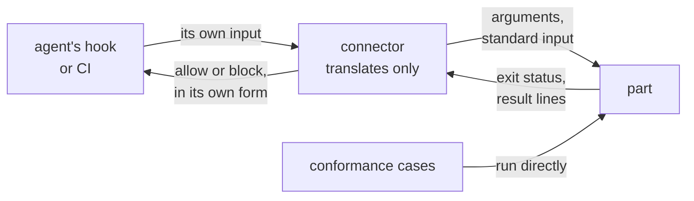
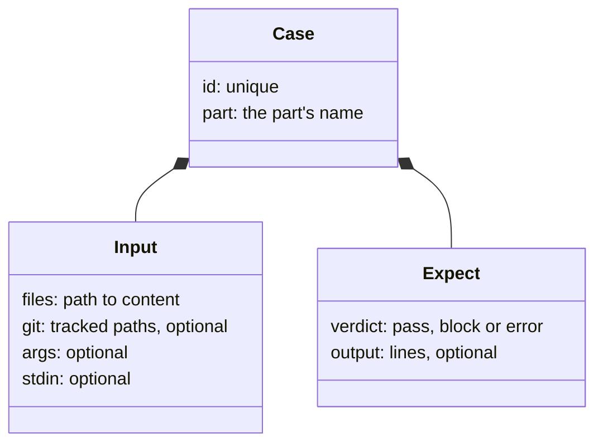
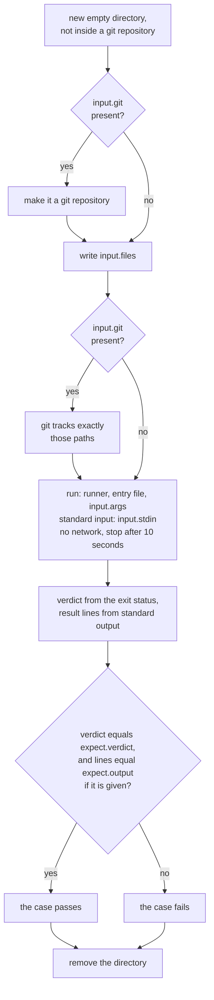
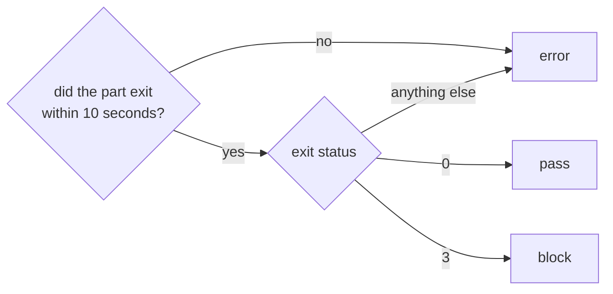

# conformance

> Basis: intent 1.2 — §5.2 (CI needs no cases), §5.3, §5.5, §8.4 (a guard never blocks without end; environment errors).

## 1. Responsibilities

**Does**: defines the contract every mechanical part of a setup keeps so that it runs without an agent: its input, its verdict and its output. Defines a conformance case, its format, how a case is run against a part and compared, which parts must have cases, and when cases run.

**Does not**:

- List the cases of each part. The module that defines the part does, in its section 6: `guards` and `status` (M1), `validate` (M2).
- Choose a part's runner. `reproduction` does, and `setup-record` records it.
- Check judgment checks. They have no cases. What they read and what they leave is set by `verify` and `changes`.
- Write a part's connector, or check it. `carriers` and `reproduction` do.

## 2. Public interface

### Mechanical parts

A mechanical part is a guard or a deterministic check in a setup. Every mechanical part keeps this contract.

**Running it**: the part's runner, then its entry file, then its arguments.

**Input**

- The working directory is the project root. The part finds the project only through it, never through where its own files are.
- Its arguments and its standard input, as its module defines them. Either may be empty.
- Its result depends only on the files under the working directory (a git repository there included), its arguments and its standard input. It does not use the network.

**Verdict**: given by the exit status.

| Exit status | Verdict |
|---|---|
| 0 | `pass` |
| 3 | `block` |
| anything else, or no exit within the time limit | `error` |

- `error` is an environment error: the part could not give `pass` or `block`. It crashed, its runner is missing, or it found a problem with its environment. A part that finds such a problem exits with a status other than 0 and 3 and says what in standard error.
- `error` is never treated as `block`.
- A part that never blocks gives `pass` whenever it ran.

**Output**

- Standard output holds the part's result lines. Each line is a code followed by fields, all separated by single tab characters. A field never holds a tab or a line break. The codes, the fields and the order of the lines are defined by the part's module.
- Standard error is free text for people. Nothing compares it.

### Connectors

A connector is what connects a mechanical part to an agent's hooks or to CI. It differs from one coding agent to another, so the rules do not fix it. The reproducing agent writes it.

- A connector only translates: what the agent or CI gives, into the part's arguments and standard input; and the part's verdict, into the form the agent or CI understands. It makes no judgment of its own.
- A connector to an agent blocks only on `block`. On `error` it reports an environment error and lets the agent go on.
- Cases do not run through a connector. A connector to an agent is checked at reproduction by acting through it (`reproduction`). How a connector to CI is checked is set with `validate` (M2).



### A conformance case

A case is a JSON object. In this one, the part, its argument and its output code are made up for illustration: a part that blocks when the file named by its argument does not exist.

```json
{
  "id": "example-missing-file-blocks",
  "part": "example",
  "input": {
    "files": {
      "notes/a.md": "hello\n"
    },
    "git": ["notes/a.md"],
    "args": ["notes/b.md"],
    "stdin": ""
  },
  "expect": {
    "verdict": "block",
    "output": ["missing\tnotes/b.md"]
  }
}
```

| Key | Value |
|---|---|
| `id` | the case's name, unique among all cases. A failing case is reported by it |
| `part` | the name of the part the case is for, as the module that defines the part names it |
| `input.files` | the files of the working directory: an object from path to content. A path is relative, with `/` |
| `input.git` | optional. When present, the working directory is a git repository in which git tracks exactly these paths. Each is in `input.files`. When absent, the working directory is not inside any git repository |
| `input.args` | optional. The arguments, a list of strings. Empty when absent |
| `input.stdin` | optional. The standard input, a string. Empty when absent |
| `expect.verdict` | `pass`, `block` or `error` |
| `expect.output` | optional. The result lines the part must write, in order. When absent, the output is not compared. An empty list means the part writes no result line |

Any other key is an error.

- A case expecting `block` is a must-block case. A case expecting `pass` is a must-pass case.
- A case with `expect.output` also expects an output.
- A case carries every file it needs, project settings included. It uses no file of the project it runs in, other than the part's own.

### Running a case

1. Make a new, empty directory that is not inside any git repository.
2. If the case has `input.git`, make the directory a git repository.
3. Write every file in `input.files`, making folders as needed. A path under `.git/` is written into the repository made in step 2.
4. If the case has `input.git`, have git track exactly those paths.
5. Run the part: its runner and its entry file, as the setup gives them, then `input.args`. The working directory is the case's directory, the standard input is `input.stdin`, and there is no network. If the part has not exited after 10 seconds, stop it.
6. Take the verdict from the exit status. In standard output, turn CR LF into LF and split it into lines. A final LF does not start an empty line.
7. The case passes when the verdict equals `expect.verdict` and, if the case has `expect.output`, the lines equal it, in order.
8. Remove the directory.

- The entry file is the one in the project being reproduced, found from that project's root, not from the case's directory.
- When a part's runner cannot be started at all, the run is reported as an environment error that names the runner.

### Which parts have cases

- Every mechanical part of a setup has cases. A part that can block has at least one must-block case and one must-pass case.
- The module that defines a part lists all of its cases in its section 6, each as an input and an expected result.
- Judgment checks have no cases.
- Cases run a part through the contract above, not through its connector.

### When cases run

- During a reproduction, in the project being reproduced, after the parts are written. The cases are read from the rules at the commit the reproduction uses.
- The reproduction is finished only when every case of every part passes. When a case fails, the reproducing agent corrects the part and runs every case again.
- Cases are not copied into the project, and nothing used to run them is kept there. After the reproduction, the checksums in the setup record (`setup-record`) find a part changed by hand, so CI needs no cases.

## 3. Flow



Running one case:



From the exit status to the verdict:



## 4. Invariants and contracts

- A mechanical part's result depends only on the files under its working directory, its arguments and its standard input.
- Exit status 3 is the only `block`. A crash, a missing runner or a hang is `error`, never `block`.
- Every mechanical part has cases, and a reproduction finishes only when all of them pass.
- A case uses no file of the project it runs in, other than the part's own.
- Standard error is never compared.
- Cases are never in the project.
- A connector makes no judgment. A connector to an agent blocks only on `block`.

## 5. Decisions and reasons

- **A case is an input and its expected result: block, pass, or an output.** intent §5.3.
- **Mechanical parts run without an agent; judgment checks have no cases.** intent §5.5.
- **Cases run at reproduction, and CI needs none.** intent §5.2, §5.3.
- **A part is a program: its working directory is the project root, its input is its arguments and standard input, its verdict is its exit status, its result is its standard output.** Every runner can start a program and read its exit status and output, so this interface depends on no language. (Design-level — confirmed 2026-10-17)
- **Exit status 0 is `pass`, 3 is `block`, anything else is `error`.** Common runtimes exit with 1 or 2 when a program fails unexpectedly, and a missing program gives 127. With only 3 meaning `block`, a crash or a missing runner can never block, so a broken guard cannot block without end. Rejected: 1 for `block`, which a crash also gives; a verdict word in standard output, which every caller would have to parse. (Design-level — confirmed 2026-10-17)
- **Result lines are a code and fields separated by tabs, compared exactly and in order; standard error is free text and never compared.** Codes keep what is compared free of any natural language. Free text in standard error lets a setup explain a result in the words its project uses. Each module defines the order, so the same input gives the same output down to the order of the lines. (Design-level — confirmed 2026-10-17)
- **A case is a JSON object that carries all of its input.** A temporary script in any runner can read one object. A case that does not depend on the project it runs in holds the same in every project. (Design-level — confirmed 2026-10-17)
- **Git state in a case is only the list of tracked paths.** validate (M2) needs it to find tracked files of a layer not in git. Rejected: describing commits and history, which no part in the module map uses. (Design-level — confirmed 2026-10-17)
- **A run gets 10 seconds.** A guard runs at every action, so a slow guard already fails its purpose. The limit turns a hang into `error` instead of a stalled reproduction. A case's input is a few files, and the formats a part reads need no library, so a working part ends well within it. Rejected: a longer limit, which only makes a hang slower to find; a limit per part, which leaves cases without one until each part's module sets it; a limit chosen at reproduction, under which the same case could get different verdicts in different projects. (Design-level — confirmed 2026-10-17)
- **Cases run without the network.** The same input must give the same result, and the network is not part of the input. (Design-level — confirmed 2026-10-17)
- **Cases run a part through this contract, not through its connector. A connector to an agent is checked at reproduction by acting through it.** Connectors differ from one coding agent to another and the rules cannot name them, so cases cannot cover them. Without a check, a connector the agent never calls would leave a rule recorded as mechanical while nothing enforces it. Rejected: cases alone, which cannot find that; rules for connectors alone, which make a wrong translation less likely but still cannot find a connector that is never called. (Design-level — confirmed 2026-10-17)
- **A connector only translates, and a connector to an agent blocks only on `block`.** Every judgment then stays in the part, where the cases reach it, and a broken part cannot block through its connector. (Design-level — confirmed 2026-10-17)
- **A part that can block has at least one must-block and one must-pass case.** Cases on one side only would let a part that always gives the same verdict pass them. (Design-level — confirmed 2026-10-17)

## 6. Verification criteria

Running cases (steps 5 to 7) gives these results:

- a case expecting `block` passes when the part exits with 3, and fails when it exits with 0 or with 1;
- a case expecting `error` passes when the part exits with 1, 2 or 127, and when it has not exited after 10 seconds;
- a case expecting `pass` with `expect.output` of `a` TAB `x` and `b` TAB `y`: fails when the part writes the same two lines in the other order; passes when it writes them with CR LF line ends; passes whatever it writes to standard error;
- a case without `expect.output` passes whatever the part writes to standard output; a case with an empty `expect.output` fails when the part writes a line;
- a case whose `input.git` names a path that is not in `input.files`, a case with an unknown key, and two cases with the same `id` are invalid.

The cases of each part are listed and checked in the module that defines the part.

## 7. Out of scope

- The cases of the gap guard and status (M1), and of the role guard and validate (M2). In M0 a setup has no mechanical part, so a reproduction runs no case.
