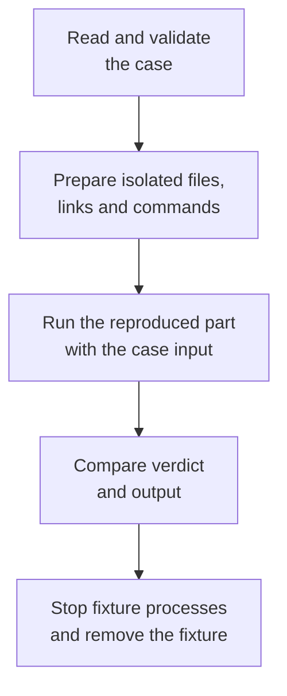

# Conformance cases

## 1. Responsibilities

- Defines the contract every mechanical part keeps (input, verdict, output).
- Defines the form of conformance cases and how to run them.
- Says what a connector, which connects a part to an AI's hooks, does.

Each part's arguments, output lines and list of cases are defined by the module that defines the part (the role guard in Roles, and Validate).

## 2. Public interface

### The contract of a part

The mechanical parts are the role guard (`role-guard`) and validate (`validate`). Every one keeps this contract.

**Running it**: the runner, then the entry file, then the part's arguments.

**Input**

- The working directory is the project root. A part finds the project only through it, never through where its own files are.
- The arguments and standard input are defined by the part's module. Either may be empty.
- The result depends on the project files (including its git repository), paths and contents explicitly selected by the request, the arguments and standard input. Role-guard requests may name paths outside the project, as defined in Roles. It does not use the network.

**Verdict**: given by the exit status.

| Exit status | Verdict |
|---|---|
| 0 | `pass` |
| 3 | `block` |
| anything else, or no exit within the time limit | `error` |

- `error` is an environment error: the part could not give `pass` or `block`. A part that finds such a problem exits with a status other than 0 and 3 and says what in standard error.
- `error` is never treated as `block`.

**Output**

- Standard output holds the result lines. Each line is a code and its fields, separated by single tabs. A field holds no tab or line break. The codes, fields and order of lines are defined by the part's module.
- Standard error is free text for people. Nothing compares it.

### Connectors

A connector connects a part to an AI tool's hooks. It differs from one AI tool to another, so the rules do not fix it; the reproducing AI writes it.

- A connector only translates: what the AI tool gives, into the part's arguments and standard input; and the part's verdict, into the form the AI tool understands. It makes no judgment of its own.
- It blocks only on `block`. On `error` it reports an environment error without presenting it as a policy denial. The role stops the affected operation and reports it under Roles; independent work can continue.
- It passes trusted role identity, copy provenance, instruction paths, ranges and edits from the actual setup and operation, as specified in Roles. It preserves the checked operation when applying it; unsupported guarantees are recorded as instructions. It never executes a shell command merely to inspect it.
- Cases run the part directly, not through a connector. A connector is checked at reproduction by acting through it (Reproduction).

### The form of a case

A case is one JSON object. In this example, the part, its argument and its output code are made up for illustration: a part that blocks when the file named by its argument does not exist.

```json
{
  "id": "example-missing-file-blocks",
  "part": "example",
  "input": {
    "files": {
      "notes/a.md": "hello\n"
    },
    "git": ["notes/a.md"],
    "args": ["notes/b.md"],
    "stdin": ""
  },
  "expect": {
    "verdict": "block",
    "output": ["missing\tnotes/b.md"]
  }
}
```

| Key | Holds |
|---|---|
| `id` | the case's name, unique among all cases. A failing case is reported by it |
| `part` | the name of the part the case is for |
| `input.files` | required object from project-relative file paths to UTF-8 text contents |
| `input.outside_files` | optional object from paths relative to the fixture's `outside` directory to UTF-8 contents; empty when absent |
| `input.symlinks` | optional object from project-relative link paths to relative link targets; empty when absent |
| `input.commands` | optional object of controlled helper commands, defined below; empty when absent |
| `input.git` | optional. When present, the working directory is a git repository in which git tracks exactly these paths. Each is in `input.files` or `input.symlinks`. When absent, the working directory is inside no git repository |
| `input.args` | optional. The arguments, as a list. Empty when absent |
| `input.stdin` | optional. The standard input. Empty when absent |
| `expect.verdict` | `pass`, `block` or `error` |
| `expect.output` | optional. The result lines the part must write, in order. When absent, the output is not compared. An empty list means there must be no result line |

Unknown fields or wrong types make the case invalid. `id` and `part` are nonempty strings; argument and output lists contain strings, and standard input is text. Invalid cases and failures to prepare the fixture are reported separately from the part's verdict. They never satisfy an expected `error`.

- A case expecting `block` is a must-block case; a case expecting `pass` is a must-pass case.
- A case holds all of its data, including the complete role settings. It uses the reproduced part and its helpers, but does not borrow the target project's settings, intent, design or other data. No default roles are supplied.
- `input.stdin` is passed verbatim. For a role-guard case it can carry the JSON for ranges, edits, known copies, instruction paths or shell inspection. Case-supplied metadata tests the guard; it is not evidence that a live connector obtains that metadata from a trustworthy source.

### Isolated fixtures

Each case gets a new temporary root outside every git repository. It contains `project` (the working directory), `outside` (data outside the project) and `bin` (helper commands). For example, `input.outside_files` key `intent-copy.md` is addressed from the project as `../outside/intent-copy.md`. A parent search uses `..` and cannot expose the real target project's files.

File and link keys are nonempty relative paths using `/`, with no empty component, `.` or `..`. File keys and link keys cannot collide or use another fixture file or link as an ancestor. `.git/` entries require `input.git` to be present. Link targets are resolved from the link's parent; they may use `..` and name missing paths, but must stay inside the temporary root after link resolution. Cycles and absolute targets make the case invalid. Linked data needed by the case is declared in the fixture. `input.git` may track declared files or links, not outside files or git's own metadata.

### Helper commands

`input.commands` keys match `PLUMBLINE_CASE_[A-Z0-9_]+`. Each value has exactly one of these forms:

- `{"stdout": "not valid JSON\n", "exit": 0}`: consume standard input, write this UTF-8 text and return the specified integer exit status from 0 to 255.
- `{"timeout": true}`: consume standard input, produce no output and remain running until the case's timeout cleanup stops it.
- `{"missing": true}`: do not create the command. Fixture preparation checks that this name cannot be found on the test PATH; a collision is a preparation error.

The case runner creates non-missing helpers using an available runtime and places `bin` first on PATH for this case only. Helper behavior is fixed; no arbitrary code is supplied in these fields. Helpers allow reproducible unavailable-program, malformed-recognition, nonzero-exit and timeout cases. They do not replace the separate reproduction check that a project's real recognizer matches its description.

### Running a case



1. Validate the case and create its temporary root and directories.
2. If `input.git` is present, initialize a git repository in `project`.
3. Write `input.files` under `project` and `input.outside_files` under `outside`, making directories as needed and preserving the supplied UTF-8 bytes and line endings. Then create the declared symbolic links. Do not replace links with copied files if the platform cannot create them; report a preparation error.
4. Prepare helper commands. If `input.git` is present, make git track exactly its paths.
5. Run the actual reproduced part with its runner, entry and `input.args`. Its working directory is `project`, standard input is `input.stdin`, and the case's helper commands are on PATH. There is no network. Stop it if it has not ended after 60 seconds.
6. Take the verdict from the part's exit status or timeout. Normalize CR LF to LF in standard output and split into lines; a final LF does not create an empty line.
7. The case passes only when the verdict equals `expect.verdict` and, if present, the ordered output lines equal `expect.output`.
8. Stop any fixture processes and remove the whole temporary root, including when execution or comparison fails.

The entry file and its reproduced helper files come from the project being reproduced; they are not the case's data files. An unavailable runner is a case-execution environment failure, not a successful expected `error`. A part that starts and returns an error is judged by its verdict as usual.

### Which parts have cases

- Every mechanical part has cases. A part that can block has at least one must-block case and one must-pass case.
- The module that defines a part lists all its cases in its verification criteria, as inputs and expected results.
- Work that needs judgment (diagnosis, the five checks, status) has no executable cases. Project-specific recognizers and live connector coverage are checked during reproduction as well as through applicable guard cases.

## 3. Flow

1. The reproduction writes the parts.
2. It reads the cases from the rules at the commit it reproduces, and runs every one in the project.
3. When a case fails, it fixes the part and runs every case again.
4. When all pass, the reproduction goes on.

## 4. Invariants and contracts

- A reproduction ends only when every case of every part passes.
- Cases are not copied into the project, and nothing used to run them is left there.
- The same case expects the same verdict and output in any project.
- Outside paths and links in a case stay inside its temporary fixture. A malformed fixture or missing execution capability is never counted as a passing part case.

## 5. Decisions and reasons

- A case is a promise of input and expected result, so a part written in any programming language is judged by the same cases.
- The verdict is the exit status. Any language can give it, and a connector translates it easily.
- `error` is never treated as `block`, so that an environment problem that cannot be fixed does not block work without end.
- Cases do not go through connectors. Connectors differ between AI tools, so the same case cannot run through them.
- Cases are not left in the project. A part edited after reproduction is found by its checksum.
- Isolated outside files and symbolic links exercise the real path-normalization contract without depending on a machine's directory layout. Fixed helpers exercise recognizer failures without choosing a project language.

## 6. Verification criteria

This module has no part of its own. During reproduction, verify that the runner prepares the fixtures exactly, runs every role-guard and validate case, compares the required output, and removes the fixture on success, failure and timeout. Include a link to intent, an outside intent copy, a parent search, a byte-range edit and each helper-command form. Unsupported links or an unavailable runner must be reported as environment failures, never as passing cases.

## 7. Out of scope

None.
