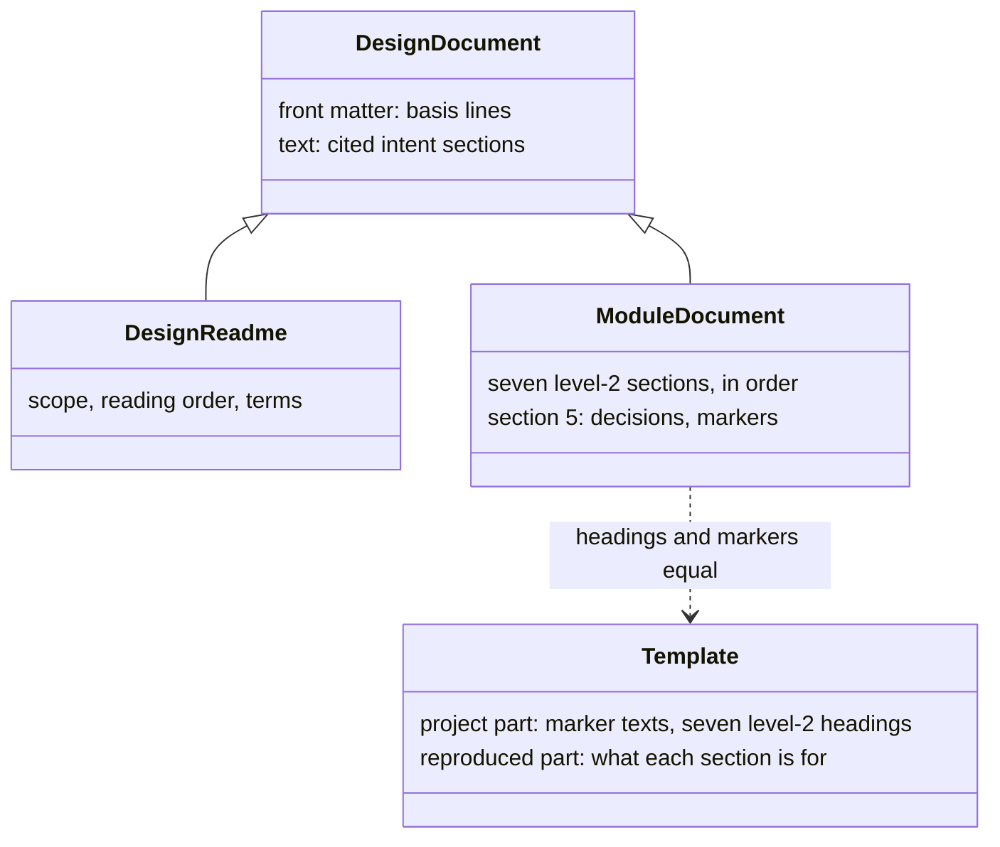
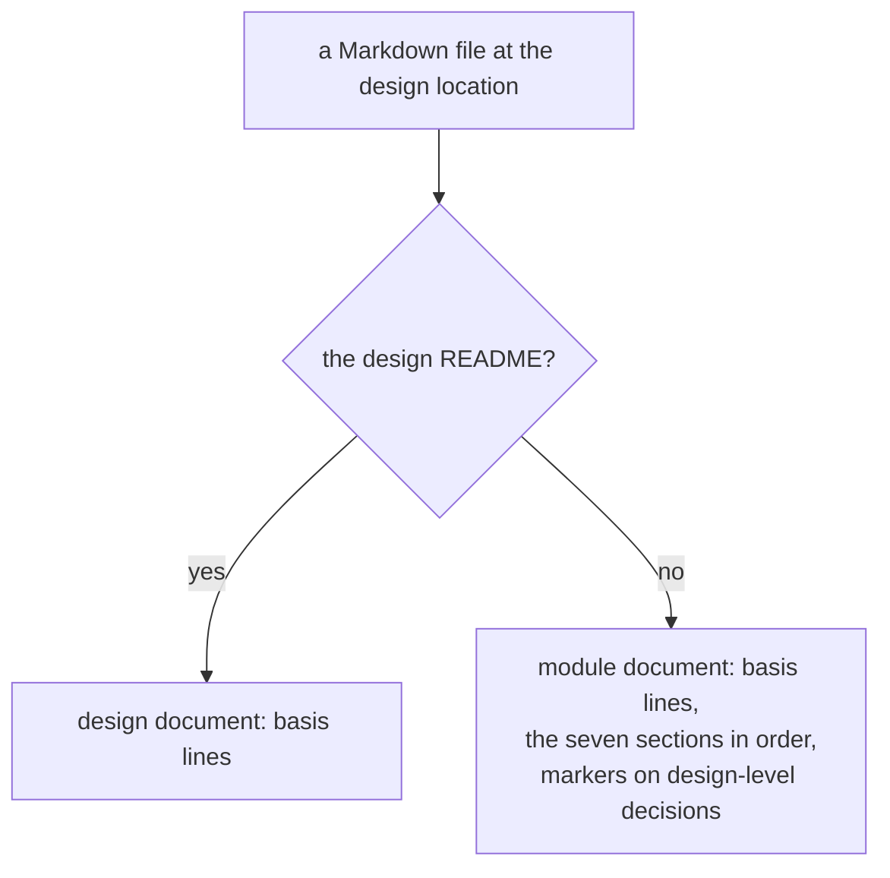

# design-docs

> Basis: intent 1.6 — §4 (principles 5–7), §7 (which documents are module documents), §8.3 (the template as validate's reference).

## 1. Responsibilities

**Does**: defines what every design document must have: the seven sections of a module document, which documents are module documents, how a design document cites the intent it is based on, how a design-level decision is marked, what figures must keep to, and what a design document must never name.

**Does not**:

- Choose the section titles' wording, the kinds of figures, or how design documents are laid out and named. Each project's template and its own design decide those.
- Say how a decision that came from a gap refers to its change. `changes` does.
- Check any of this. `validate` and `verify` do.

## 2. Public interface

### Design documents and module documents

- Every Markdown file at the design location (`settings`) is a design document.
- `<design location>/README.md`, the design README, is the only design document that is not a module document. It holds what applies to the whole design: scope, reading order, terms.
- The design README's front matter (`layers`) has one line `milestone: <name>`: the milestone the design is in now, named as the project's intent names it.
- Every other design document is a module document.

### The seven sections

Every module document has these seven sections, as level-2 headings, in this order. A section that does not apply still appears and says so.

| # | Meaning |
|---|---|
| 1 | Responsibilities: what the module does and what it does not |
| 2 | Public interface: names, fields and contracts others rely on |
| 3 | Flow: the main sequences |
| 4 | Invariants and contracts: conditions that always hold |
| 5 | Decisions and reasons: why it is this way, what was rejected |
| 6 | Verification criteria: what must be shown for the module to be right; for a mechanical part, its conformance cases |
| 7 | Out of scope: what a later milestone adds |

A module document has no other level-2 headings. Level-3 headings and below are free.

### The template

- Each project has one document template: `.plumbline/template.md`. It lies outside the design location, so it is not a design document.
- It has a project part and a reproduced part. A reproduction writes only the reproduced part and never changes the project part.
- The project part holds the project's own words:
  - front matter (`layers`) with the keys `confirmed` and `pending`, each once, and `figure`, any number of times. `confirmed: <text>` and `pending: <text>` are the two design-level markers; the `confirmed` text holds `YYYY-MM-DD` where the date goes. Each `figure: <name>` names a kind of figure the project uses, by the info string of its fenced code blocks. No other key is allowed, and `YYYY-MM-DD` appears in the `confirmed` text exactly once;
  - the seven level-2 headings, in order. Their exact text is the project's section titles.
- The lead writes the project part with the user before the module map is written (`authoring`). When a project later changes these words, every module document is changed to match.
- The reproduced part says what each section is for, how basis lines are written and how markers are used. It holds no level-2 heading.
- A module document's level-2 headings equal the template's, in order. Its design-level markers are the template's two texts, a confirmed one with a date in place of `YYYY-MM-DD`.

### Basis citation

- Every design document, the design README included, has front matter (`layers`) with one or more lines `basis: <intent document> <version>`. The intent document is its path from the project root. The version is that document's version when this design document was written or last checked against it.
- Every design document also names, in its text, the intent sections it is based on. That line is for readers and has no fixed form.

### Design-level decisions

- A decision the design makes because intent does not is a design-level decision. It is written in section 5 of the module document it belongs to.
- It carries the template's design-level marker: confirmed with the date the user confirmed it, or pending.
- A decision that only restates intent carries no marker.
- A point intent states is never a design-level decision. A design that would change or narrow it reveals a gap in intent (`layers`).
- There is no separate list or table of decisions. Section 5 of each module document is the only place.

### Figures

- A figure is a fenced code block in a design document whose info string's first word is one of the template's `figure` names. The kinds of figures are the project's choice.
- A figure says the same as the text. No fact appears only in a figure. Changing one changes the other.
- A figure shows only the current milestone's scope.
- A figure is rendered and checked for overlapping or cut-off text. Whether it renders is checked by `validate` where a renderer is present; whether its text overlaps is judged by whoever writes it.

### Reading a Markdown document

What a check reads in a design document or in the template. Every CR LF is read as LF.

- A fenced code block opens with a line that begins with three or more backticks or three or more tildes, and closes with a line that begins with the same character at least as many times. A block that is never closed runs to the end of the file. Its info string is the rest of the opening line; its first word is the first run of characters that are neither spaces nor tabs.
- A level-2 heading is a line that begins with `## `, outside fenced code blocks. Its text is the rest of the line, without spaces at its end.
- Section 5 of a module document is the lines between its fifth and sixth level-2 headings, or to the end of the file when there is no sixth.
- A link is the text `](target)`; its target is the text between the parentheses, without a `#` fragment.

### What a design document never names

- A location of impl: a path under any impl location (`settings`), a test name, a case name.
- How impl currently looks.

## 3. Flow

Which rules apply to a design document:

## 4. Invariants and contracts

- Every design document has at least one `basis` line, and each names an intent document and a version.
- Every module document has exactly the template's seven level-2 headings, in order.
- Every design-level decision carries a marker with a state. A confirmed marker carries a date.
- No fact appears only in a figure.
- No design document names a location of impl.
- The design README has exactly one `milestone` line.

## 5. Decisions and reasons

- **Design-level decisions live only in section 5 of their module document, with no separate table.** intent §4 principle 7.
- **The design README is the only design document that is not a module document.** intent §7.
- **Sections are matched by the level-2 headings of the project's template, exactly and in order.** Titles follow each project's own wording, so the rules cannot name them. Keeping them in one template file gives one copy that validate and writers share. (Design-level — confirmed 2026-10-17)
- **No other level-2 headings in a module document.** Otherwise a check cannot tell a misspelled section from an extra one. Level 3 and below stay free for the document's own structure. (Design-level — confirmed 2026-10-17)
- **The basis is machine-readable only for versions; the cited sections are free text.** validate compares versions. Section names differ in form from project to project and are for readers. (Design-level — confirmed 2026-10-17)
- **The basis names the intent document by its path from the project root.** An intent made of several documents needs each one named. The path is already known from the settings. (Design-level — confirmed 2026-10-17)
- **The design README carries a basis too.** Its scope, reading order and terms are derived from intent like everything else in the design. (Design-level — confirmed 2026-10-17)
- **The design README names the current milestone in a `milestone` line of its front matter.** The milestone is a fact about what the design now covers, next to its scope and reading order; front matter lets a script read it (`status`). (Design-level — confirmed 2026-10-17)
- **The template states the design-level marker, in two states.** The rules cannot name the words, and a fixed form lets validate find unmarked or undated decisions. (Design-level — confirmed 2026-10-17)
- **The section titles and the marker texts are the template's project part. The lead writes them with the user before the module map, and a reproduction never changes them.** The rules can hold no words of a natural language and the settings hold two values only, so neither can give them. If a reproduction chose them, reproducing again could change them and fail every module document already written. The module map is written before the first reproduction, so the words must exist by then. Rejected: matching sections by number only, which lets titles drift from one document to another; fixed English titles in the rules, which would make the rules choose a language. (Design-level — confirmed 2026-10-17)
- **The kinds of figures are the template's `figure` lines, by the info string of their code blocks.** A check must know which code blocks are figures, and the kinds are each project's choice (intent §7). The template's project part already holds the project's own words, and its front matter can be read by a script. Rejected: letting the reproducing agent find the kinds in the design documents, which can give a different answer at each reproduction; leaving rendering out of `validate`, which intent §8.3 puts there. (Design-level — confirmed 2026-10-18)
- **The template is `.plumbline/template.md`, and its marker texts are the front matter values `confirmed` and `pending`.** The lead writes the template before the first reproduction, when no setup record exists to say where it is, so its place is fixed. `.plumbline/` already holds what plumbline keeps in a project. Front matter lets a script find the texts without reading prose. (Design-level — confirmed 2026-10-17)

## 6. Verification criteria

These are checked by `validate`, which lists them as conformance cases:

- a module document missing one of the seven sections, or with two of them swapped, or with an extra level-2 heading, fails;
- a module document whose level-2 headings equal the template's, in order, passes, whatever the template's wording;
- with `confirmed: (DL ok YYYY-MM-DD)` in the template, `(DL ok 2026-10-17)` is a confirmed marker and `(DL ok)` is a malformed one;
- reproducing again leaves the template's project part as it was;
- a design document without a `basis` line fails;
- a design-level marker that is not one of the template's two forms, or a confirmed marker without a date, fails. (Whether a decision should have carried a marker at all is a matter of judgment, not a check.)
- a design document that names a path under an impl location fails;
- with `figure: mermaid` in the template, a `mermaid` code block is a figure and a `text` code block is not.

`verify` judges the impl locations that are not paths, such as test names.

## 7. Out of scope

- None. design-docs is complete in M2.
