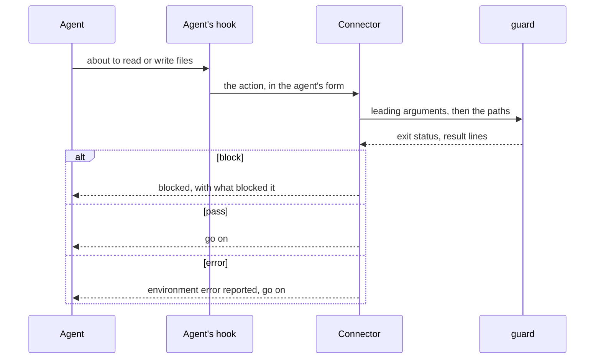
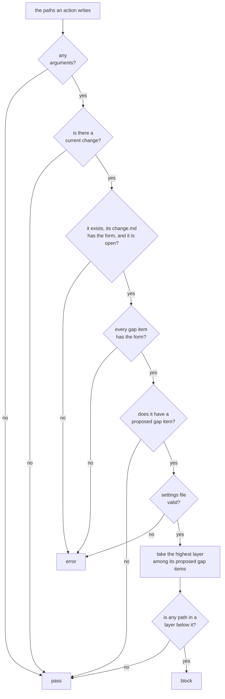
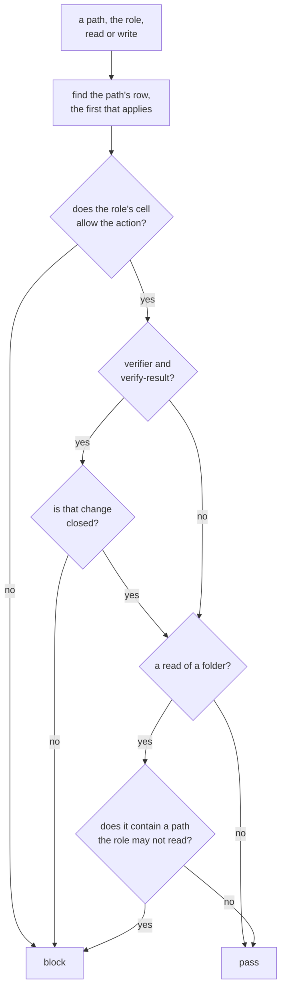

# guards

> Basis: intent 1.4 — §2.2 (a hook that blocks without end), §5.3 (cases for the read direction hook), §5.5, §8.1 (lower layers are not edited while a gap is unconfirmed, within that change), §8.4 (the role table, enforced where a means exists; a guard never blocks without end; environment errors; what a hook cannot see), §11 (M1, M2).

## 1. Responsibilities

**Does**: defines guards: mechanical parts that an agent's hook runs before an action, to let the action through or block it. Defines the contract every guard keeps (its input, its verdict, its output, how it avoids blocking without end), the gap guard (within the current change, no layer below a proposed gap item is edited) and the role guard (no role reads or writes outside its row of the role table). Lists the conformance cases of both.

**Does not**:

- Connect a guard to an agent's hooks. The reproducing agent writes the connector (`carriers`, `conformance`).
- Decide whether a rule is enforced mechanically in a project. `reproduction` does, and the setup record says so.
- Define change records, gap items and the current change. `changes` does.
- Define what each role may read and write. `roles` does.

## 2. Public interface

### Guards

- A guard is a mechanical part (`conformance`). An agent's hook runs it, through a connector, before an action that reads or writes files.
- **Arguments**: first the guard's own leading arguments, when its section names any; then the paths of the files the action touches. A path is relative to the project root, with `/`, or absolute. Empty segments and `.` segments are ignored, and a `..` segment removes the segment before it. An absolute path is compared, segment by segment as text, with the working directory as the system reports it; symbolic links are not followed. A path that lies outside the project root is in no layer.
- **Standard input**: empty.
- **Verdict**: `block` when at least one path is blocked; `pass` when none is, and when there are no paths; `error` when the guard cannot read what it needs, or when its leading arguments are not what its section names.
- **Output**: one line per blocked path, in the order of the arguments. Nothing when the verdict is `pass`.
- A guard blocks only the actions its own rule forbids. A block never keeps an agent from stopping, or from the actions its rule allows. The gap guard blocks only while a gap item is proposed, and that state can always be ended by edits it does not block.
- A guard that cannot read what it needs gives `error`, never `block`. The connector reports it as an environment error and lets the agent go on (`conformance`).
- Changes a hook cannot see, such as files written by a shell command, are not guarded.

### The gap guard

- Its name is `gap-guard`. It has no leading arguments; its paths are those of the files a writing action will create, change or remove. The rule it enforces is named `gap guard` in the setup record's `enforcement` (`setup-record`).
- It reads the settings (`settings`), `.plumbline/current-change`, and the gap items of the current change (`changes`).

How it decides, in this order. It reads only what the step at hand needs:

1. When there are no arguments, it gives `pass`.
2. When there is no current change (`changes`), every path passes.
3. When the current change does not exist, its `change.md` does not have the form `changes` defines, or its state is not `open`, it gives `error`.
4. When a gap item of the current change does not have the form `changes` defines, it gives `error`.
5. When no gap item of the current change is `proposed`, every path passes.
6. When the settings file is missing or not valid, it gives `error`.
7. Otherwise, take the highest layer among its `proposed` gap items: `intent` is above `design`. A path in a layer below it is blocked. A path in that layer or above, or in no layer, passes.

A path is in a layer when it equals one of that layer's paths in the settings or lies under one.

Output line for a blocked path:

| Code | Fields |
|---|---|
| `block` | path (relative to the project root), the path's layer, the current change, the number of the gap item, the gap item's layer |

The gap item named is the lowest-numbered `proposed` one at the highest layer.

It gives `error` only in steps 3, 4 and 6. A file it does not need for its verdict is not read, so a problem in it gives no `error`.

### The role guard

- Its name is `role-guard`. The rule it enforces is named `role table` in the setup record's `enforcement`.
- Leading arguments: the role of the agent that acts, `lead`, `implementer` or `verifier`; then the action, `read` or `write`.
- A read is an action that opens the content of a file or searches the content of files. Its paths are the files it opens, or the files and folders it searches. An action that only lists the names of files is not guarded. A write is an action that creates, changes or removes a file; its paths are those files.
- It reads the settings (`settings`), the setup record (`setup-record`), the state of changes (`changes`), and which paths git ignores, when the project root is a git repository.

The row of a path, the first that applies:

| # | The path | Row |
|---|---|---|
| 1 | lies outside the project root | `not-project` |
| 2 | is `.git/info/exclude` | `exclude` |
| 3 | is `.git` or lies under it | `not-project` |
| 4 | lies in the intent, design or impl layer (`roles`) | `intent`, `design`, `impl` |
| 5 | is `.plumbline/current-change` | `current-change` |
| 6 | is `verify.md` in a change folder | `verify-result` |
| 7 | is `.plumbline/changes` or lies under it | `change-record` |
| 8 | is `.plumbline/settings.json` | `settings` |
| 9 | is a file of a carrier in the setup record | `carrier` |
| 10 | is the setup record or another file it lists | `setup-file` |
| 11 | is ignored by git | `not-project` |
| 12 | anything else | `project-file` |

How it decides for one path:

1. Take the path's row, and the role's cell in it (`roles`). A carrier's cell is the one for a carrier meant for that role, or for every agent, when the setup record lists the role among the carrier's `roles`; otherwise it is the cell for other setup files.
2. When the cell does not allow the action, the path is blocked.
3. For the verifier, `verify-result` allows a write and a read only when the change exists and its state is `closed`.
4. For a read of a folder, the path is also blocked when it contains a layer path, a carrier's file, the setup record or a file it lists, `.plumbline/current-change`, `.git/info/exclude`, or a change folder, whose cell does not allow the role to read it. Containment is by path, whether or not the path exists; change folders are found by listing `.plumbline/changes/`. The project root is a folder like any other.

Only the project's own ignore rules count: the ignore files in the repository and `.git/info/exclude`, not a user's global ignore file. When the project root is not a git repository, no path is ignored.

Output line for a blocked path:

| Code | Fields |
|---|---|
| `block` | path (relative to the project root, or as given when it lies outside), role, action, row |

For a folder blocked by step 4, the row is that of the first forbidden path it contains, in the order of the rows above.

It gives `error`, before deciding any path, when:

- the role or the action is not one of those above;
- the settings file is missing or not valid;
- the setup record is missing or not valid.

When there are no paths, it gives `pass` without reading anything.

## 3. Flow

How the gap guard decides:

How the role guard decides for one path:

## 4. Invariants and contracts

- A guard blocks only with exit status 3, and only on its own rule.
- The same files and the same arguments always give the same verdict and lines.
- The gap guard never blocks a path in no layer, nor a path in the gap item's layer or above.
- The gap guard never blocks because of a change other than the current one.
- The edits that end a block, answering the gap item or changing the current change, touch no layer, so the gap guard never blocks them.
- The role guard blocks a path exactly when the role table does not let that role do that action there, or when a folder it reads contains such a path.
- The role guard never blocks a path that is not a project file, except a read of a folder that contains one the role may not read.

## 5. Decisions and reasons

- **Within a change, while a gap item is proposed, the layers below it are not edited, and a hook blocks such edits; other changes are not held back.** intent §8.1.
- **A guard never blocks without end; a problem with the environment is an environment error.** intent §8.4, §2.2.
- **Every guard is a deterministic part with conformance cases.** intent §5.3, §5.5.
- **What a hook cannot see is not guarded.** intent §8.4.
- **A guard takes the paths an action writes as its arguments.** Every agent's hook can tell which files an action writes, so the guard needs nothing that belongs to one coding agent, and the connector only translates. (Design-level — confirmed 2026-10-17)
- **A guard that cannot read what it needs gives `error`, not `block`.** A broken record would otherwise hold back work its rule is not about, and the error is reported at every action, so it is seen. Rejected: blocking until the record is fixed, which turns one broken file into a stop on every edit. (Design-level — confirmed 2026-10-17)
- **A blocked line names the gap item that causes it.** The agent can then tell the user which question to answer to go on. (Design-level — confirmed 2026-10-17)
- **A current change that does not exist or is not open is an error.** `changes` keeps the current change pointing at an open change; when it does not, the guard cannot tell which gap items count. (Design-level — confirmed 2026-10-17)
- **The role table is enforced before reads and writes where an agent has the means; otherwise it stays an instruction.** intent §8.4.
- **A read of a folder is blocked when the folder contains a path the role may not read; listing names is not a read.** A search over a folder shows the content of everything under it, so a search of the project root would show the lead impl. Names alone show no content. Rejected: blocking only paths inside a forbidden location, which lets the most common search show what the role must not read. (Design-level — confirmed 2026-10-18)
- **The connector gives the role and the action as the role guard's leading arguments.** Only the agent's own means can tell which role an agent plays, and the guard needs nothing that belongs to one coding agent. When a connector cannot tell the role, the role table is enforced by instruction only (`reproduction`). Rejected: a marker file naming the role, which two agents working in one tree at once would overwrite. (Design-level — confirmed 2026-10-18)
- **The role guard finds a path's row by a fixed order, layers before what git ignores.** A layer kept out of git is ignored by git, yet must still be guarded as a layer. Every path then has exactly one row. (Design-level — confirmed 2026-10-18)
- **The verifier may write a verify result only in a change that is closed.** The guard cannot know which change the hand-off named, but the change being checked is the one that is closed and not yet archived. Rejected: letting the verifier write any change's result, which lets a mistaken verifier write into a finished change. (Design-level — confirmed 2026-10-18)
- **The role guard gives `error` when the role, the action, the settings or the setup record cannot be read.** It cannot tell a row or a cell without them. (Design-level — confirmed 2026-10-18)
- Known limit: when two changes are closed and not yet archived, the verifier may write the result of either.
- Known limit: paths are compared as text, without following symbolic links, since a part reads nothing outside its working directory. A path that reaches the project through a symbolic link lies outside the project root and is in no layer.

## 6. Verification criteria

Conformance cases for `gap-guard`. Unless a case says otherwise, it uses these files:

- `.plumbline/settings.json`: `intent` `["docs/intent.md"]`, `design` `["docs/design"]`, `impl` `["src"]`, `not_in_git` `[]`;
- `.plumbline/changes/2026-11-02-a/change.md` with `state: open`, `diagnosis: design`;
- `.plumbline/changes/2026-11-02-a/gap-1.md` with `layer: design`, `state: proposed`;
- `.plumbline/current-change` holding `2026-11-02-a`.

| # | Difference | Arguments | Verdict | Lines |
|---|---|---|---|---|
| 1 | none | `src/main.rs` | `block` | `block src/main.rs impl 2026-11-02-a 1 design` |
| 2 | none | `docs/design/cli.md` | `pass` | none |
| 3 | none | `docs/intent.md` | `pass` | none |
| 4 | none | `.plumbline/changes/2026-11-02-a/gap-1.md` | `pass` | none |
| 5 | none | none | `pass` | none |
| 6 | none | `./src/main.rs` | `block` | `block src/main.rs impl 2026-11-02-a 1 design` |
| 7 | none | `../elsewhere/main.rs` | `pass` | none |
| 8 | none | `docs/design/cli.md`, `src/a.rs`, `src/b.rs` | `block` | `block src/a.rs …`, then `block src/b.rs …` |
| 9 | `gap-1.md` has `state: confirmed`, `date: 2026-11-03` | `src/main.rs` | `pass` | none |
| 10 | `gap-1.md` has `state: rejected`, `date: 2026-11-03` | `src/main.rs` | `pass` | none |
| 11 | no `.plumbline/current-change` | `src/main.rs` | `pass` | none |
| 12 | `.plumbline/current-change` is empty | `src/main.rs` | `pass` | none |
| 13 | a second change `2026-11-03-b` with `state: open` and no gap item; `.plumbline/current-change` holds `2026-11-03-b` | `src/main.rs` | `pass` | none |
| 14 | `gap-1.md` has `layer: intent` | `docs/design/cli.md` | `block` | `block docs/design/cli.md design 2026-11-02-a 1 intent` |
| 15 | `gap-1.md` has `layer: intent` | `src/main.rs`, `docs/intent.md` | `block` | `block src/main.rs impl 2026-11-02-a 1 intent` |
| 16 | a `gap-2.md` with `layer: intent`, `state: proposed` | `docs/design/cli.md` | `block` | `block docs/design/cli.md design 2026-11-02-a 2 intent` |
| 17 | `.plumbline/current-change` holds `2026-11-09-x`, which does not exist | `src/main.rs` | `error` | — |
| 18 | `change.md` has `state: closed` | `src/main.rs` | `error` | — |
| 19 | `gap-1.md` has `state: proposed` and a `date` | `src/main.rs` | `error` | — |
| 20 | the settings file has an unknown key | `src/main.rs` | `error` | — |
| 21 | none | `docs/../src/main.rs` | `block` | `block src/main.rs impl 2026-11-02-a 1 design` |
| 22 | none | `src/../docs/design/cli.md` | `pass` | none |
| 23 | none | `/plumbline-elsewhere/src/main.rs` | `pass` | none |
| 24 | `.plumbline/current-change` holds `2026-11-02-a` followed by CR LF | `src/main.rs` | `block` | as in case 1 |
| 25 | `gap-1.md` is named `gap-01.md` | `src/main.rs` | `pass` | none |
| 26 | `.plumbline/current-change` holds `2026-11-09-x`, which does not exist | none | `pass` | none |
| 27 | no `.plumbline/current-change`, and the settings file has an unknown key | `src/main.rs` | `pass` | none |
| 28 | `gap-1.md` has `state: confirmed`, `date: 2026-11-03`, and the settings file has an unknown key | `src/main.rs` | `pass` | none |
| 29 | `change.md` has `diagnosis: code` | `src/main.rs` | `error` | — |

Fields are separated by spaces in the table and by tabs in the cases. `…` stands for the same fields as in case 1.

These are checked in the M1 Done of intent §11, on the example project, through the connector: with a proposed gap item in the current change, an edit below its layer is blocked; with another change current, the same edit goes through.

Conformance cases for `role-guard`. Unless a case says otherwise, the working directory is a git repository that tracks every file in the case except `target/out.txt`, and it uses these files:

- `.plumbline/settings.json`: `intent` `["docs/intent.md"]`, `design` `["docs/design"]`, `impl` `["src"]`, `not_in_git` `[]`;
- `.plumbline/setup-record.json`: a valid record that lists `INSTRUCTIONS.md` as a carrier for all three roles, `.plumbline/lead.md` as a carrier for `lead`, `.plumbline/implementer.md` as a carrier for `implementer`, and `.plumbline/parts/gap-guard` as a part's entry;
- those four files, `docs/intent.md`, `docs/design/cli.md`, `src/main.rs` and `README.md`;
- `.gitignore` holding `target/`, and `target/out.txt`;
- `.plumbline/changes/2026-11-02-a/change.md` with `state: closed`, `diagnosis: design`, and `verify.md` beside it with `result: clean`;
- `.plumbline/current-change`, empty.

Every cell of the role table is a case: the role and the action as leading arguments, and one path from the table below. `P` is `pass` with no line; `B` is `block` with the line `block <path> <role> <action> <row>`.

| Path | Row | lead read | lead write | implementer read | implementer write | verifier read | verifier write |
|---|---|---|---|---|---|---|---|
| `docs/intent.md` | `intent` | P | P | B | B | B | B |
| `docs/design/cli.md` | `design` | P | P | P | B | P | B |
| `src/main.rs` | `impl` | B | B | P | P | P | B |
| `.plumbline/changes/2026-11-02-a/verify.md` | `verify-result` | P | B | B | B | P | P |
| `.plumbline/changes/2026-11-02-a/change.md` | `change-record` | P | P | B | B | B | B |
| `.plumbline/current-change` | `current-change` | P | P | B | B | B | B |
| `.plumbline/settings.json` | `settings` | P | P | P | B | P | B |
| `INSTRUCTIONS.md` | `carrier` | P | P | P | B | P | B |
| `.plumbline/lead.md` | `carrier` | P | P | B | B | B | B |
| `.plumbline/implementer.md` | `carrier` | P | P | P | B | B | B |
| `.plumbline/parts/gap-guard` | `setup-file` | P | P | B | B | B | B |
| `.git/info/exclude` | `exclude` | P | P | B | B | B | B |
| `README.md` | `project-file` | P | B | P | B | P | B |
| `target/out.txt` | `not-project` | P | P | P | P | P | P |
| `/plumbline-elsewhere/x.md` | `not-project` | P | P | P | P | P | P |

More cases:

| # | Difference | Arguments | Verdict | Lines |
|---|---|---|---|---|
| 1 | none | `lead read .` | `block` | `block . lead read impl` |
| 2 | none | `lead read docs` | `pass` | none |
| 3 | none | `implementer read docs` | `block` | `block docs implementer read intent` |
| 4 | none | `implementer read .plumbline` | `block` | `block .plumbline implementer read current-change` |
| 5 | none | `lead read .plumbline` | `pass` | none |
| 6 | `change.md` has `state: open` | `verifier write .plumbline/changes/2026-11-02-a/verify.md` | `block` | `block .plumbline/changes/2026-11-02-a/verify.md verifier write verify-result` |
| 7 | none | `implementer write src/a.rs README.md src/b.rs docs/intent.md` | `block` | `block README.md implementer write project-file`, then `block docs/intent.md implementer write intent` |
| 8 | `intent` in `not_in_git` in the settings and the record's copy, and `.git/info/exclude` lists `/docs/intent.md` | `implementer read docs/intent.md` | `block` | `block docs/intent.md implementer read intent` |
| 9 | the working directory is not a git repository | `implementer write target/out.txt` | `block` | `block target/out.txt implementer write project-file` |
| 10 | none | `implementer read ./src/../docs/design/cli.md` | `pass` | none |
| 11 | none | `admin read src/main.rs` | `error` | — |
| 12 | none | `lead delete src/main.rs` | `error` | — |
| 13 | the settings file has an unknown key | `implementer read src/main.rs` | `error` | — |
| 14 | no setup record | `implementer read src/main.rs` | `error` | — |
| 15 | no setup record | `implementer read` | `pass` | none |

Fields are separated by spaces in the tables and by tabs in the cases.

These are checked in the M2 Done of intent §11, on the example project, through the connector: an implementer that tries to edit the design is blocked.

## 7. Out of scope

- None. guards is complete in M2.
