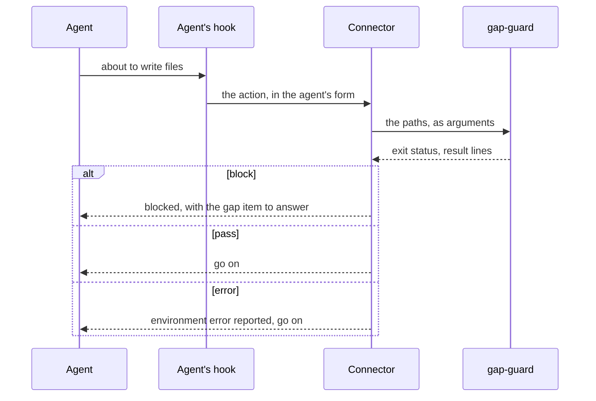
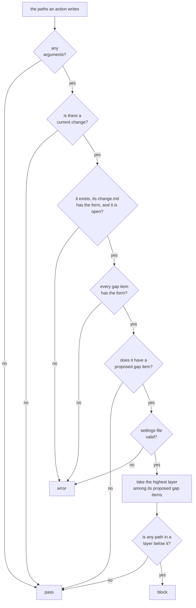

# guards

> Basis: intent 1.4 — §2.2 (a hook that blocks without end), §5.3, §5.5, §8.1 (lower layers are not edited while a gap is unconfirmed, within that change), §8.4 (a guard never blocks without end; environment errors; what a hook cannot see), §11 (M1).

## 1. Responsibilities

**Does**: defines guards: mechanical parts that an agent's hook runs before an action, to let the action through or block it. Defines the contract every guard keeps (its input, its verdict, its output, how it avoids blocking without end) and the gap guard: within the current change, no layer below a proposed gap item is edited. Lists the gap guard's conformance cases.

**Does not**:

- Connect a guard to an agent's hooks. The reproducing agent writes the connector (`carriers`, `conformance`).
- Decide whether a rule is enforced mechanically in a project. `reproduction` does, and the setup record says so.
- Define change records, gap items and the current change. `changes` does.

## 2. Public interface

### Guards

- A guard is a mechanical part (`conformance`). An agent's hook runs it, through a connector, before an action that writes files.
- **Arguments**: the paths of the files the action will create, change or remove. A path is relative to the project root, with `/`, or absolute. Empty segments and `.` segments are ignored, and a `..` segment removes the segment before it. An absolute path is compared, segment by segment as text, with the working directory as the system reports it; symbolic links are not followed. A path that lies outside the project root is in no layer.
- **Standard input**: empty.
- **Verdict**: `block` when at least one path is blocked; `pass` when none is, and when there are no arguments; `error` when the guard cannot read what it needs.
- **Output**: one line per blocked path, in the order of the arguments. Nothing when the verdict is `pass`.
- A guard blocks only on its own rule, and only while the state its rule names lasts. That state can always be ended by edits the guard does not block.
- A guard that cannot read what it needs gives `error`, never `block`. The connector reports it as an environment error and lets the agent go on (`conformance`).
- Changes a hook cannot see, such as files written by a shell command, are not guarded.

### The gap guard

- Its name is `gap-guard`. The rule it enforces is named `gap guard` in the setup record's `enforcement` (`setup-record`).
- It reads the settings (`settings`), `.plumbline/current-change`, and the gap items of the current change (`changes`).

How it decides, in this order. It reads only what the step at hand needs:

1. When there are no arguments, it gives `pass`.
2. When there is no current change (`changes`), every path passes.
3. When the current change does not exist, its `change.md` does not have the form `changes` defines, or its state is not `open`, it gives `error`.
4. When a gap item of the current change does not have the form `changes` defines, it gives `error`.
5. When no gap item of the current change is `proposed`, every path passes.
6. When the settings file is missing or not valid, it gives `error`.
7. Otherwise, take the highest layer among its `proposed` gap items: `intent` is above `design`. A path in a layer below it is blocked. A path in that layer or above, or in no layer, passes.

A path is in a layer when it equals one of that layer's paths in the settings or lies under one.

Output line for a blocked path:

| Code | Fields |
|---|---|
| `block` | path (relative to the project root), the path's layer, the current change, the number of the gap item, the gap item's layer |

The gap item named is the lowest-numbered `proposed` one at the highest layer.

It gives `error` only in steps 3, 4 and 6. A file it does not need for its verdict is not read, so a problem in it gives no `error`.

## 3. Flow

How the gap guard decides:

## 4. Invariants and contracts

- A guard blocks only with exit status 3, and only on its own rule.
- The same files and the same arguments always give the same verdict and lines.
- The gap guard never blocks a path in no layer, nor a path in the gap item's layer or above.
- The gap guard never blocks because of a change other than the current one.
- The edits that end a block, answering the gap item or changing the current change, touch no layer, so the gap guard never blocks them.

## 5. Decisions and reasons

- **Within a change, while a gap item is proposed, the layers below it are not edited, and a hook blocks such edits; other changes are not held back.** intent §8.1.
- **A guard never blocks without end; a problem with the environment is an environment error.** intent §8.4, §2.2.
- **Every guard is a deterministic part with conformance cases.** intent §5.3, §5.5.
- **What a hook cannot see is not guarded.** intent §8.4.
- **A guard takes the paths an action writes as its arguments.** Every agent's hook can tell which files an action writes, so the guard needs nothing that belongs to one coding agent, and the connector only translates. (Design-level — confirmed 2026-10-17)
- **A guard that cannot read what it needs gives `error`, not `block`.** A broken record would otherwise hold back work its rule is not about, and the error is reported at every action, so it is seen. Rejected: blocking until the record is fixed, which turns one broken file into a stop on every edit. (Design-level — confirmed 2026-10-17)
- **A blocked line names the gap item that causes it.** The agent can then tell the user which question to answer to go on. (Design-level — confirmed 2026-10-17)
- **A current change that does not exist or is not open is an error.** `changes` keeps the current change pointing at an open change; when it does not, the guard cannot tell which gap items count. (Design-level — confirmed 2026-10-17)
- Known limit: paths are compared as text, without following symbolic links, since a part reads nothing outside its working directory. A path that reaches the project through a symbolic link lies outside the project root and is in no layer.

## 6. Verification criteria

Conformance cases for `gap-guard`. Unless a case says otherwise, it uses these files:

- `.plumbline/settings.json`: `intent` `["docs/intent.md"]`, `design` `["docs/design"]`, `impl` `["src"]`, `not_in_git` `[]`;
- `.plumbline/changes/2026-11-02-a/change.md` with `state: open`, `diagnosis: design`;
- `.plumbline/changes/2026-11-02-a/gap-1.md` with `layer: design`, `state: proposed`;
- `.plumbline/current-change` holding `2026-11-02-a`.

| # | Difference | Arguments | Verdict | Lines |
|---|---|---|---|---|
| 1 | none | `src/main.rs` | `block` | `block src/main.rs impl 2026-11-02-a 1 design` |
| 2 | none | `docs/design/cli.md` | `pass` | none |
| 3 | none | `docs/intent.md` | `pass` | none |
| 4 | none | `.plumbline/changes/2026-11-02-a/gap-1.md` | `pass` | none |
| 5 | none | none | `pass` | none |
| 6 | none | `./src/main.rs` | `block` | `block src/main.rs impl 2026-11-02-a 1 design` |
| 7 | none | `../elsewhere/main.rs` | `pass` | none |
| 8 | none | `docs/design/cli.md`, `src/a.rs`, `src/b.rs` | `block` | `block src/a.rs …`, then `block src/b.rs …` |
| 9 | `gap-1.md` has `state: confirmed`, `date: 2026-11-03` | `src/main.rs` | `pass` | none |
| 10 | `gap-1.md` has `state: rejected`, `date: 2026-11-03` | `src/main.rs` | `pass` | none |
| 11 | no `.plumbline/current-change` | `src/main.rs` | `pass` | none |
| 12 | `.plumbline/current-change` is empty | `src/main.rs` | `pass` | none |
| 13 | a second change `2026-11-03-b` with `state: open` and no gap item; `.plumbline/current-change` holds `2026-11-03-b` | `src/main.rs` | `pass` | none |
| 14 | `gap-1.md` has `layer: intent` | `docs/design/cli.md` | `block` | `block docs/design/cli.md design 2026-11-02-a 1 intent` |
| 15 | `gap-1.md` has `layer: intent` | `src/main.rs`, `docs/intent.md` | `block` | `block src/main.rs impl 2026-11-02-a 1 intent` |
| 16 | a `gap-2.md` with `layer: intent`, `state: proposed` | `docs/design/cli.md` | `block` | `block docs/design/cli.md design 2026-11-02-a 2 intent` |
| 17 | `.plumbline/current-change` holds `2026-11-09-x`, which does not exist | `src/main.rs` | `error` | — |
| 18 | `change.md` has `state: closed` | `src/main.rs` | `error` | — |
| 19 | `gap-1.md` has `state: proposed` and a `date` | `src/main.rs` | `error` | — |
| 20 | the settings file has an unknown key | `src/main.rs` | `error` | — |
| 21 | none | `docs/../src/main.rs` | `block` | `block src/main.rs impl 2026-11-02-a 1 design` |
| 22 | none | `src/../docs/design/cli.md` | `pass` | none |
| 23 | none | `/plumbline-elsewhere/src/main.rs` | `pass` | none |
| 24 | `.plumbline/current-change` holds `2026-11-02-a` followed by CR LF | `src/main.rs` | `block` | as in case 1 |
| 25 | `gap-1.md` is named `gap-01.md` | `src/main.rs` | `pass` | none |
| 26 | `.plumbline/current-change` holds `2026-11-09-x`, which does not exist | none | `pass` | none |
| 27 | no `.plumbline/current-change`, and the settings file has an unknown key | `src/main.rs` | `pass` | none |
| 28 | `gap-1.md` has `state: confirmed`, `date: 2026-11-03`, and the settings file has an unknown key | `src/main.rs` | `pass` | none |
| 29 | `change.md` has `diagnosis: code` | `src/main.rs` | `error` | — |

Fields are separated by spaces in the table and by tabs in the cases. `…` stands for the same fields as in case 1.

These are checked in the M1 Done of intent §11, on the example project, through the connector: with a proposed gap item in the current change, an edit below its layer is blocked; with another change current, the same edit goes through.

## 7. Out of scope

- The role guard: what each role may read and write, enforced before reads and writes, with conformance cases for every cell of the role table (M2).
