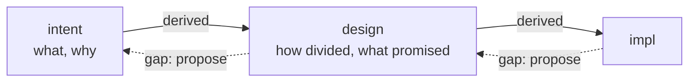
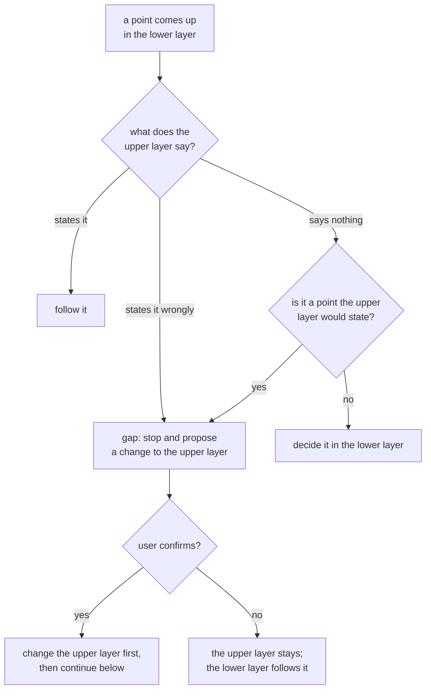

# layers

> Basis: intent 1.5 — §4 (principles 1–4, 8), §6, §7 (intent version).

## 1. Responsibilities

**Does**: defines the three layers and how they relate: what each layer says, which layer it is derived from, which layer may be read when writing it, the direction changes flow, what happens when a lower layer reveals a gap in an upper one, and what an impl product that agents read may contain. Defines the front matter every intent and design document carries, and how an intent document states its version.

**Does not**:

- Say which role reads and writes which layer. `roles` does.
- Define the module document template. `design-docs` does.
- Say where the layers are and which are in git. `settings` does.
- Record gaps or decide which layer a change starts in. `changes` does.

## 2. Public interface

### The layers

| Layer | Says | Derived from |
|---|---|---|
| intent | what to build and why: goals and scope, milestones, decisions and their reasons, open questions | nothing |
| design | how it is divided and what it promises: module responsibilities, public interfaces, invariants, decisions, verification criteria | intent only |
| impl | the implementation, and any other product built from the design (documents agents read, for example) | design only |

Each layer is the truth at its own level of detail.

### Read direction

| When writing | May read | Never reads |
|---|---|---|
| design | intent, design | impl |
| impl | design, impl | intent |

Writing intent is not restricted by this table. intent is derived from no layer.

### Change direction

- A change is made first in the highest layer it touches, then in each layer below.
- A lower layer may change alone only when the upper layer does not state the point being changed. What each layer states is in the table above.
- A lower layer never contradicts the upper one.

### Gaps

- A gap is a missing piece or an error in an upper layer, revealed while working on a lower one.
- On a gap, work on that point in the lower layer stops. The change to the upper layer is proposed to the user. After the user confirms it, the upper layer is changed first, and then work below continues.
- The lower layer never settles a gap by itself.

### Impl products that agents read

An impl product that agents read (prompts, rules) states rules only. Reasons, history and open questions stay in intent and design.

### Documents and front matter

- Intent and design documents are Markdown files (`.md`).
- A document's front matter is the block at its very top, between two lines that are exactly `---`. Every CR LF is read as LF.
- Every line inside is `key: value`: a key made of lowercase ASCII letters, digits, `_` and `-`; a colon and one space; then a value that is not empty. Spaces and tabs at the end of a line are not part of the value. A line of any other form, a blank line included, makes the front matter invalid. A document whose front matter is invalid, or missing, or has no closing `---` line, has no front matter values: an intent document then has no valid version, whatever lines it holds.
- In an intent or design document, a key may appear more than once, and keys not defined here or in `design-docs` are ignored. The template and change records also use front matter; `design-docs` and `changes` define their keys.
- Every Markdown file at the intent location (`settings`) is an intent document.
- Every intent document has exactly one `version` line: `version: V`.
- V is one or more non-negative integers joined by dots: `1`, `1.2`, `1.46`. Versions compare part by part as integers. A missing part counts as 0, so `1.2` equals `1.2.0`, and `1.10` is newer than `1.9`.

## 3. Flow

A point comes up while working on a lower layer:

- "Would state" is judged by the "Says" column of the layers table.
- A point the design decides because intent does not is a design-level decision. It needs the user's confirmation (`design-docs`).

## 4. Invariants and contracts

- Every design statement traces to intent. Every impl part traces to design.
- No lower layer contradicts an upper one.
- A gap is never settled in the lower layer.
- Every intent document has exactly one `version` line, and its value has the form above.
- An impl product that agents read holds no reasons and no history.

## 5. Decisions and reasons

- **Writing intent is not restricted by the read direction.** intent §4 sets the direction only for writing design and impl.
- **Intent and design documents are Markdown files.** Agents read and write Markdown as plain text, and its headings give the module sections a form a script can find in any language. (Design-level — confirmed 2026-10-17)
- **Front matter is limited to `key: value` lines between `---` lines.** The language of a project's scripts is not fixed, so the syntax must be parseable without a library. Rejected: full YAML, which most runners cannot read without one. (Design-level — confirmed 2026-10-17)
- **A version is dotted integers, compared part by part.** Versions in use look like `1.2` and `1.46`. Comparing as text would put `1.10` before `1.9`. (Design-level — confirmed 2026-10-17)
- **Every Markdown file at the intent location is an intent document.** One rule covers an intent that is a single file and one that is a folder. An index file in an intent folder carries a version like any other. (Design-level — confirmed 2026-10-17)

## 6. Verification criteria

- A reader can tell, for any statement, which layer it belongs to from the "Says" column alone.
- Parsing front matter:
  - a file whose first line is `---`, followed by `version: 1.2` and a closing `---`, has version `1.2`;
  - a file without front matter, or whose front matter has no `version` line or two of them, is an intent document without a valid version;
  - `basis` and other keys are read without error.
- Comparing versions: `1.10` is newer than `1.9`; `1.2` equals `1.2.0`; `2` is newer than `1.46`.
- The checks that use these definitions (validate, status) carry them as conformance cases in their own documents.

## 7. Out of scope

- None. The read direction is enforced by the role guard (`guards`).
