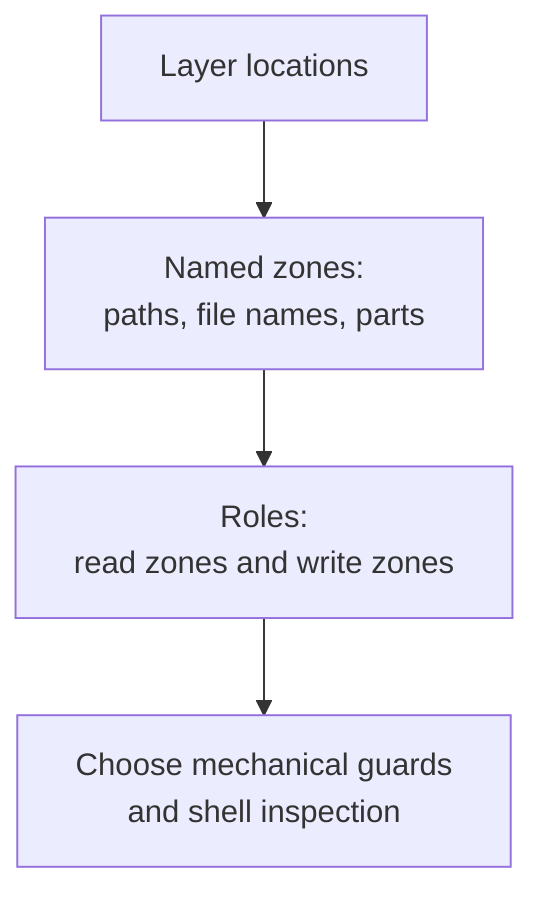

# Layers and settings

## 1. Responsibilities

- Defines the three layers, their locations and the settings form.
- Defines named zones, the role list and the guard choices a project supplies.
- Separates settings the setup uses from working practices the project defines.

Roles defines how permissions and guards work. A change defines what the project's workflow must cover.

## 2. Public interface

### The three layers

| Layer | Says | Read when writing it |
|---|---|---|
| intent | what to build and why: scope, milestones, decisions and reasons, open questions | — |
| design | how it is divided and what it promises: responsibilities, interfaces, invariants, decisions, verification criteria | intent, design |
| impl | code, tests and other things built from the design | design, impl |

### The settings file

It is `.plumbline/settings.json`. There are three settings: `layers`, `not_in_git` and `roles`. This example describes one possible project; its roles and guard choices are not defaults.

```json
{
  "layers": {
    "intent": ["docs/intent.md"],
    "design": ["docs/design"],
    "impl": ["src", "tests"]
  },
  "not_in_git": ["intent"],
  "roles": {
    "zones": [
      {"name": "design", "layer": "design", "paths": ["docs/design"]},
      {"name": "product", "layer": "impl", "paths": ["src"]},
      {"name": "tests", "layer": "impl", "paths": ["tests"]}
    ],
    "members": [
      {
        "name": "builder",
        "read_zones": ["design", "product", "tests"],
        "write_zones": ["product"],
        "duty": "Build the assigned design; report gaps and unfinished work.",
        "model": "MODEL_CHOSEN_BY_PROJECT"
      },
      {
        "name": "tester",
        "read_zones": ["design", "product", "tests"],
        "write_zones": ["tests"],
        "duty": "Write tests from the verification criteria and perform the five checks.",
        "model": "MODEL_CHOSEN_BY_PROJECT"
      }
    ],
    "guard": {"read_zones": false, "write_zones": true, "shell": "literal"}
  }
}
```

- `layers` has exactly `intent`, `design` and `impl`, each a nonempty list of locations. Design has exactly one location, a folder.
- A location is relative to the project root and uses `/`. It has no leading or trailing `/`, empty component, `.` or `..`. The locations of different layers do not overlap.
- `not_in_git` is a list of distinct layer names. It may be absent; absent or empty means all layers are in git.
- `roles` has exactly `zones`, `members` and `guard`. The two lists may be empty. An empty role list creates no other role; whether it can carry out the planned work is checked with the workflow before reproduction.
- `layers` and `roles` are required. Missing role settings are not replaced with a built-in role list. Unknown keys, wrong value types and repeated names break the form.

### Which layer a path belongs to

A path belongs to a layer when it equals a location or continues it with `/`. Thus `docs/design/a.md` belongs to design, but `docs/designer.md` and `docs` do not. Even a file location is treated this way: `docs/intent.md/x` belongs to intent. Existence does not affect membership. A path may belong to no layer.

### Zones

A zone names a selection within design or impl. Roles refer to that name.

| Field | Holds |
|---|---|
| `name` | a nonempty name, unique among zones |
| `layer` | `design` or `impl` |
| `paths` | a nonempty list of paths; each is within the stated layer and uses the location form above |
| `files` | optional, nonempty list of file-name patterns, relative to the project root |
| `part` | optional object with `description` and, optionally, `recognition` |

A path must lie in one of `paths` and, when `files` is present, match at least one pattern. Without `part`, the zone selects the whole matching file or subtree. With `part`, it selects only the described portions of matching files. A file-name filter applies to every target path; a matching folder name does not remove the filter from its descendants.

Patterns use `/`. `*` matches zero or more characters except `/`; `?` matches one character except `/`. A whole component `**` matches zero or more path components: `src/**/*.test.ts` includes `src/a.test.ts` and `src/ui/a.test.ts`. Other characters are literal. An absolute pattern, an empty component, `.` or `..`, or `**` embedded in another component breaks the form. Pattern matching is case-sensitive.

`part.description` is nonempty text saying what belongs to the part. Optional `part.recognition` makes that selection mechanical in one of two forms:

- `{"kind": "markers", "begin": "BEGIN TESTS", "end": "END TESTS"}` selects complete lines from the begin line through the end line, inclusive. The nonempty, distinct marker lines are matched exactly. Neither marker means an empty selection. Exactly one of each, in that order, selects the block. A single marker, repeated markers or reversed markers give an error.
- `{"kind": "command", "command": ["PROJECT_RECOGNIZER"]}` uses a program the project chooses. It can recognize language constructs or any other project-defined part. Roles, Recognizing file parts, defines its input and output. The command is a nonempty argument list, without shell interpretation. Its first element is a program name on PATH; arguments may name project-relative files. No element is an absolute path.

Only the fields shown for each form are allowed. Reproduction checks that the chosen method matches the description. A missing definition or disagreement is a gap to resolve with the user. When a program must be made during reproduction, its contract is settled with the user before it is used.

For example, a test zone can select files under `src` whose names match `src/**/*.rs`, then select the test blocks described by the project. A quality role can read the whole source zone, while a test role writes only the test zone.

A zone can overlap another zone. The selected contents are the union of a role's named zones. Giving two roles overlapping write zones is valid; the workflow decides how they coordinate.

### Role entries

Each member has exactly these fields:

| Field | Holds |
|---|---|
| `name` | a nonempty role name, unique among members; `lead` is reserved |
| `read_zones` | a list of distinct zone names, from design or impl |
| `write_zones` | a list of distinct zone names, all from impl |
| `duty` | nonempty text describing the role's work, in the project's own words |
| `model` | the nonempty model selection the project wants used to start this role |

Zone and role names have no tab or line break. Unknown zone names break the form. Read and write lists may be empty. An empty write list means the role reports without editing. Write permission does not add read permission; the project lists both when both are needed. The roles named in `members` are the complete list besides the lead.

### Guard choices

`guard` has exactly these fields; all are required:

| Field | Values and meaning |
|---|---|
| `read_zones` | boolean: request mechanical enforcement of roles' read zones |
| `write_zones` | boolean: request mechanical enforcement of roles' write zones |
| `shell` | `none`: do not inspect shell commands; `literal`: block an explicit, identifiable forbidden file action; `cautious`: also block when the command may do forbidden work and cannot be resolved |

There is no switch to permit a non-lead role to read intent or write design. These two restrictions apply with every choice. Roles, The role guard, defines how they reach file tools and shell commands.

When zone enforcement is requested, every part-based zone used by that permission must have `recognition`; otherwise the settings break the form. A recognition method that cannot be implemented with the available means is reported during reproduction and recorded as an instruction, as described in Reproduction. Choosing enforcement is not evidence that enforcement works.

### What each project decides

The project defines its workflow, intent format, design layout and file names, figure kinds, milestone names and project-specific checks between layers. It also chooses its document and code languages and comment policy; the rules do not prescribe or discuss language choices. The workflow is written in the project parts of rule carriers (A change, Reproduction), not added as a fourth setting.

## 3. Flow



1. Decide each layer's locations and whether it is kept out of git before saving its first file. Add excluded locations to `.git/info/exclude`.
2. Before reproduction, decide the zones, every role's five fields, and the guard choices with the user. Define the workflow as described in A change.
3. Write decisions into the settings as they are made. An incomplete draft is not usable by reproduction or the checks.
4. Check the completed settings and the workflow before reproduction. When settings change later, reproduce again.

## 4. Invariants and contracts

- A path belongs to at most one layer. Zones stay within their stated layer.
- No non-lead role has an intent zone or a design write zone.
- Every excluded layer location is in `.git/info/exclude`. Its content is not copied into a layer in git; only a document path and section title may be named.
- A check requiring an absent layer is skipped where that layer is absent.
- Missing roles, models or guard choices are not filled with defaults.

## 5. Decisions and reasons

- Role settings join layer locations and git exclusions because reproduction and guards need them.
- Named zones let several roles share a selection without repeating its description. Separate read and write lists allow a role to inspect more than it edits.
- A part's description can be useful even without mechanical recognition. Keeping them separate makes the limit of enforcement visible.
- Whole layers are kept out of git through `.git/info/exclude`; design has one folder so its module map has one home.

## 6. Verification criteria

Shown by the settings cases of the role guard and validate (Conformance cases):

- The example settings are valid. Two roles sharing a write zone, an empty write list, and an empty member list are also structurally valid.
- With location `docs/design`, `docs/design`, `docs/design/a.md` and `docs/design/sub/b.md` belong to design; `docs/designer.md` and `docs` do not. With file location `docs/intent.md`, it and `docs/intent.md/x` belong to intent.
- `src/**/*.test.ts` matches `src/a.test.ts` and `src/ui/a.test.ts`, but not `src/a.ts`; `src/*/a.ts` does not match `src/a.ts` or `src/ui/deep/a.ts`.
- Two design locations, overlapping layers, a zone outside its layer, an intent zone, duplicate names, a member named `lead`, an unknown zone reference, a design write zone, an empty model or duty, and an unknown key each break the form.
- Missing `roles`, missing guard choices, non-boolean zone guard values and a shell value outside the three choices each break the form.
- A part without recognition is valid when no requested zone guard uses it; it breaks the form when such a guard uses it.
- Missing or malformed settings give an environment error from the role guard and reproduction, and a `settings` problem line from validate. No default roles are substituted.

Judgment during reproduction also checks that the duties and workflow cover the planned work and the five checks, and that every claimed mechanical recognition method works (Reproduction).

## 7. Out of scope

Keeping only part of a layer out of git.
