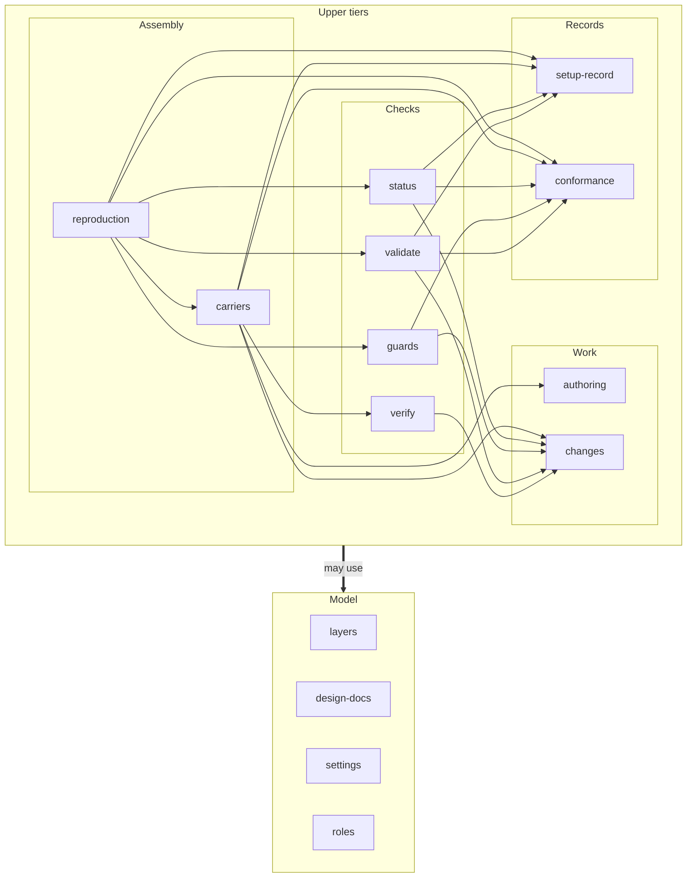
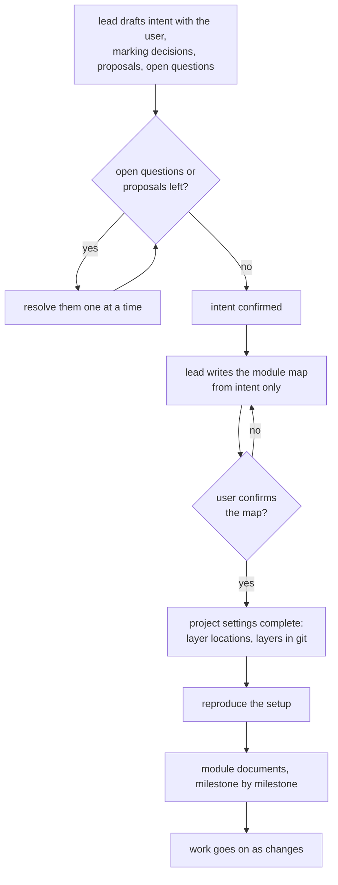
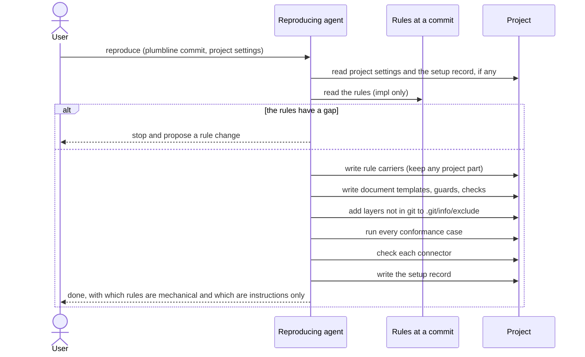
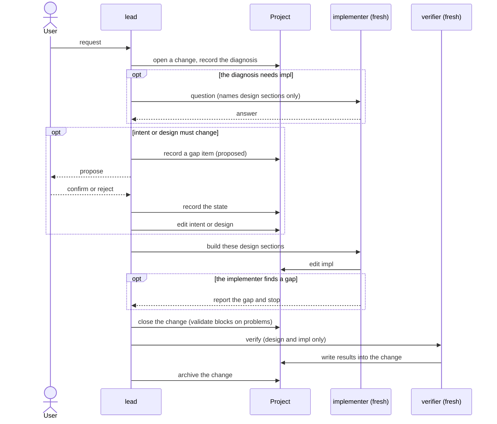

# overview

> Basis: intent 1.4 — §1, §3, §4, §5, §6, §7, §8, §11.

## 1. Responsibilities

**Does**: plumbline is a set of rules. In a target project, an agent follows the rules to help the user write the project's intent and design the project's module map. From the project settings decided on the way, the agent then reproduces a setup that keeps the project on the intent → design → impl method: rule carriers, document templates, guards, checks, and a setup record. This document maps the rule modules, how they depend on each other, how work flows through them, and the contracts every module keeps.

**Does not**:

- Ship an executable. Scripts a setup needs are reproduced in each project.
- Generate impl from a specification. Impl is the truth at its own level and keeps being edited.
- Decide what each project decides in its own intent and design: natural language, comment policy, design layout and naming, kinds of figures, milestone names, project-specific consistency checks.
- Prescribe a format for intent.
- Fix how rules reach agents. The reproducing agent chooses the rule carriers.
- Mention any specific coding agent.

## 2. Public interface

### The module map

Modules sit in five tiers. **A module uses definitions only from modules in lower tiers.** Modules in the same tier do not depend on each other. There are no cycles.

| Tier (top to bottom) | Holds | Modules |
|---|---|---|
| Assembly | putting a setup together | `reproduction`, `carriers` |
| Checks | mechanical and judgment checks | `status`, `guards`, `validate`, `verify` |
| Work | how work moves through the layers | `authoring`, `changes` |
| Records | formats written by a reproduction | `setup-record`, `conformance` |
| Model | what every other module talks about | `layers`, `design-docs`, `settings`, `roles` |

How to read it:

- A thin arrow `A --> B` means module A uses definitions from module B. The thin arrows in the figure are all of them.
- The thick arrow means any module in the upper tiers may use the Model tier. The table below says exactly which.

| Tier | Module | One-line responsibility | Uses (besides Model) | Uses from Model | Milestone |
|---|---|---|---|---|---|
| Assembly | `reproduction` | How an agent builds a setup from the rules at a commit and the project settings; what it does on a gap in the rules; how it decides what is enforced mechanically; choosing runners | carriers, setup-record, conformance, guards, validate, status | design-docs, settings | M0 |
| Assembly | `carriers` | What the reproduced rules tell agents, and how they reach agents; when a carrier is a file the project also writes, its reproduced part and its project part | authoring, changes, verify, conformance, setup-record | layers, design-docs, settings, roles | M0, M1, M2 |
| Checks | `status` | Deterministic report of the current state | changes, setup-record, conformance | layers, design-docs, settings | M1 |
| Checks | `guards` | Deterministic guards: the gap guard and the role guard; how a guard behaves on errors | changes, conformance | layers, settings, roles | M1, M2 |
| Checks | `validate` | Deterministic consistency check; when it only reports and when it blocks | setup-record, changes, conformance | layers, design-docs, settings | M2 |
| Checks | `verify` | Judgment check by a fresh verifier; what it reads and what it leaves | changes | design-docs, roles | M2 |
| Work | `authoring` | Writing a project's intent with the user, then its module map and module documents; the project settings that come out of it | — | layers, design-docs, settings, roles | M0 |
| Work | `changes` | Change records, gap items and their states, diagnosis, archive; how a decision from a gap is recorded in a module document | — | layers, design-docs, settings, roles | M1 |
| Records | `setup-record` | What a setup record holds and its format | — | settings | M0 |
| Records | `conformance` | What a conformance case is, how cases run, which parts must have them | — | — | M0 |
| Model | `layers` | The three layers, derivation, read direction, change direction, gaps as proposals, intent version, what agent-read impl may contain | — | — | M0 |
| Model | `design-docs` | The module document template, figures, basis citation, design-level decisions, which documents are module documents | — | layers | M0 |
| Model | `settings` | Project settings: layer locations and layers in git; excluding a layer; not copying an excluded layer's content | — | layers | M0 |
| Model | `roles` | lead, implementer, verifier: what each does, reads and writes; hand-off; how a gap travels between them | — | layers | M0, M1, M2 |

Where each part of intent 1.4 is owned:

| intent | Module |
|---|---|
| §4 principles 1–4, §6 | layers |
| §4 principles 5–7 | design-docs |
| §4 principle 8 | layers |
| §5.1 | reproduction; a carrier's reproduced and project parts: carriers |
| §5.2 | setup-record; settings kept apart from the record: settings |
| §5.3, §5.5 | conformance; choosing a runner: reproduction |
| §5.4 | reproduction; choosing rule carriers: carriers |
| §7 | settings; intent version: layers; which documents are module documents: design-docs; where status reads the milestone: status |
| §8.1 | changes; status: status; the gap guard: guards |
| §8.2 | changes |
| §8.3 | validate, verify |
| §8.4 | roles; the role guard: guards |
| §8.5 | authoring |
| §11 | the Milestone column above |

## 3. Flow

### Starting a project

- `authoring` owns steps A to G and I. `reproduction` owns H. `changes` owns J, and says that each milestone's work in I is done as a change.
- A proposal that follows directly from earlier decisions is applied without asking, and the user is told. Only real choices are asked.

### Reproducing a setup

- The agent reads only the rules and the conformance cases, at the commit this reproduction uses: the one the user names, or else the one in the setup record. It does not read plumbline's design.
- Until every conformance case passes, the reproduction is not done. The agent corrects what it produced and runs the cases again.
- Each connector is checked at reproduction: a connector to an agent by acting through it, one action that must be blocked and one that must pass; a connector to CI by running its command locally. A rule whose connector cannot be made to work is recorded as an instruction.
- After the reproduction, the project runs without the rules. Rules are needed again only to reproduce again or to look for newer rules.

### A change

- When the implementer reports a gap, the change goes back to the gap step. A new implementer starts after the design is fixed.
- While a gap item in a change is proposed, edits below that layer in the same change are blocked by the gap guard. Other changes are not blocked.
- At the end of every turn validate runs and only reports. It blocks when a change closes and in CI.

## 4. Invariants and contracts

These hold for every module.

**Rules**

- A rule states what must hold. It holds no reasons and no history.
- A rule never points to plumbline's intent or design.
- A rule never names a specific coding agent or a natural language, and never sets a comment policy. Where a rule must touch natural language or comment policy, it says only that each project decides them in its own intent.
- An agent finds the rules in plumbline's impl location: the folder `rules/` of the plumbline repository, which holds the rules and their conformance cases. It starts at that folder's top-level `README.md`.

**Setups**

- A setup is derived only from the rules at one commit and the project settings.
- The reproducing agent chooses the rule carriers and records them in the setup record.
- A reproduced file is never edited by hand. To change it, change the rules or the settings and reproduce again. The setup record says which files are reproduced and holds their checksums.
- When a carrier is a file the project also writes, it has a reproduced part and a project part. Reproducing again replaces only the reproduced part.
- A reproduced project runs without the rules.

**Mechanical parts**

- Every deterministic check and guard is defined by its input and its output, and runs without an agent when given its input.
- Every mechanical part of a setup has conformance cases. A reproduction is done only when all of them pass.
- validate gives the same answer for the same input. It does not use the network.
- A guard never blocks without end. A problem with the environment (a missing runner, for example) is reported as an environment error, not as a violation.

**Layers not in git**

- The content of a layer that is not in git is never copied into anything that is in git. Only its location (version, section) may be cited.
- A check that needs a layer that is not present skips that part where the layer is absent.

**Roles**

- What each role may read and write is fixed by `roles`. Where an agent has a means to enforce it, `guards` enforces it. Where it has none, it remains an instruction, and the setup record says so.

## 5. Decisions and reasons

- **Fourteen modules in five tiers, dependencies only downward, none inside a tier.** Formats (Records) and the method's vocabulary (Model) change least, so they sit lowest. Assembly changes whenever any part changes, so it sits on top and nothing depends on it. (Design-level — confirmed 2026-10-16)
- **`roles` sits in the Model tier.** `authoring`, `changes`, `guards` and `verify` all need to know who reads and writes what. Placing it lower keeps the Work tier free of dependencies inside itself. (Design-level — confirmed 2026-10-16)
- **`authoring` sits in the Work tier, apart from `changes`.** Writing the first intent and the module map happens before there is anything to change. Later edits to intent and design go through `changes`. (Design-level — confirmed 2026-10-16)
- **A setup is reproduced right after the module map is confirmed, before module documents are written.** Then guards and validate already watch the module documents while they are written. intent does not fix this order. (Design-level — confirmed 2026-10-16)
- **The map covers the first version (M0–M3); module documents are written per milestone, starting with M0.** The map shows where later parts go. Each milestone's documents are written and confirmed before its impl. Rejected: designing all modules in detail now, because M1 and M2 details would be fixed before M0 has been tried. (Design-level — confirmed 2026-10-16)
- **The rule that a decision from a gap points to its change lives in `changes`, not in `design-docs`.** This keeps the Model tier free of the Work tier. `design-docs` only says that a design-level decision carries a confirmation; `changes` says how a decision that came from a gap refers back to it. (Design-level — confirmed 2026-10-16)
- **One `guards` module for the gap guard and the role guard.** They share one contract: their input, their verdict, never blocking without end, reporting environment errors. Their cases differ and are listed separately. (Design-level — confirmed 2026-10-16)
- **`carriers` is apart from `reproduction`.** What the rules tell agents grows each milestone, and the means of carrying it vary by project. The reproduction procedure stays the same. (Design-level — confirmed 2026-10-16)
- **`conformance` owns the case format and the run procedure. Each check module lists its own cases.** A check's cases change with the check; the way cases are written and run does not. (Design-level — confirmed 2026-10-16)
- **plumbline's impl is the folder `rules/`, and an agent starts at its top-level `README.md`.** intent leaves the place of plumbline's impl to the design. Every agent that uses plumbline, to write a project's intent or to reproduce a setup, needs one fixed place to start. (Design-level — confirmed 2026-10-17)
- **A rule may say that natural language and comment policy are each project's to decide, but never names a language or sets a policy.** intent §7, §8.5. The rules must tell the lead not to ask about them, and must tell the reproducing agent that such rules go in a project part.

## 6. Verification criteria

- Every part of intent 1.4 that the first version needs is owned by exactly one module (the table in section 2).
- The dependencies have no cycle, and no module uses a module in its own tier or above.
- Every Done criterion of M0, M1 and M2 in intent can be checked against modules of that milestone only.
- Every mechanical part named in a module has conformance cases in that module's section 6.

## 7. Out of scope

- Bringing a project that already has code into the method (the facts read from code go in only as gaps, confirmed by the user).
- Moving projects that already follow the method without plumbline onto it.
- Testing that the rules work the same with any coding agent.
- M3 is not a module. It runs validate on plumbline's own design documents, writes the README, and tags the first release.
