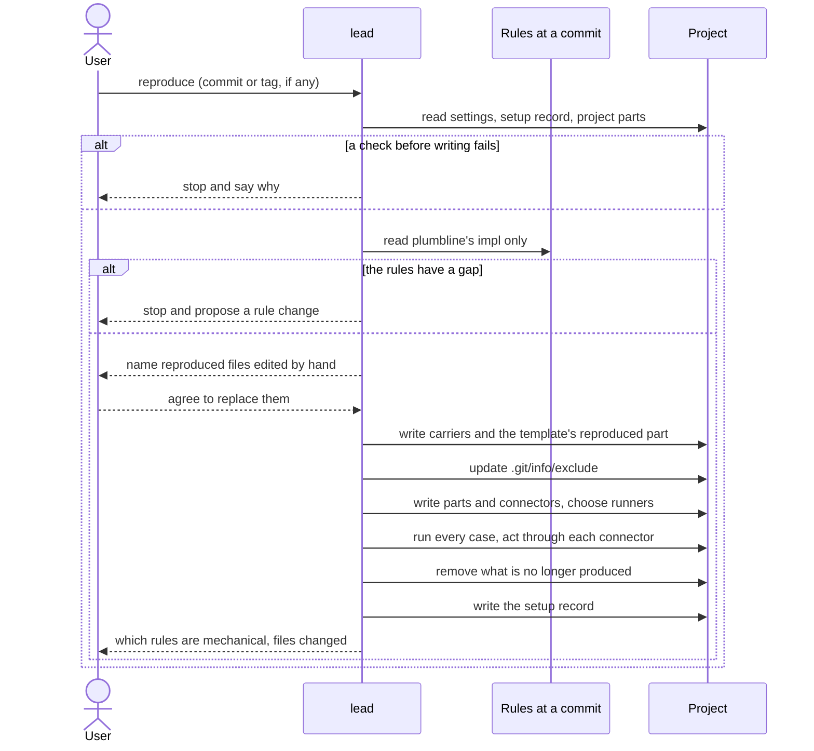
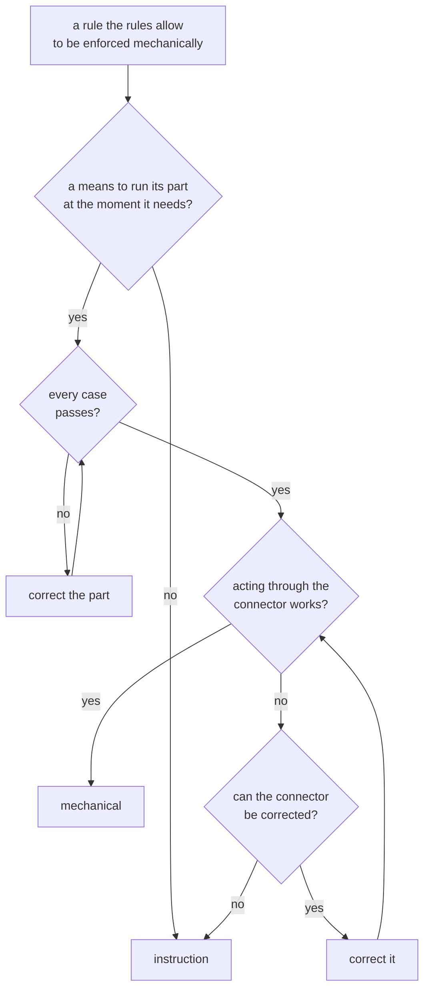

# reproduction

> Basis: intent 1.2 — §5.1, §5.2, §5.3, §5.4, §5.5 (choosing runners), §7 (layers kept out of git), §11 (M0).

## 1. Responsibilities

**Does**: defines how an agent builds a project's setup from the rules at one commit and the project settings, and how it builds it again. Defines what it checks before writing anything, what it does on a gap in the rules, how it chooses runners, how it decides which rules are enforced mechanically, and how it finishes: cases, connector checks, the setup record, and the report to the user.

**Does not**:

- Define the setup record, the cases, the carriers, or the mechanical parts. `setup-record`, `conformance` and `carriers` do; `guards` and `status` (M1) and `validate` (M2) define the parts.
- Decide the settings. The lead and the user do, while authoring (`authoring`).
- Look for newer rules. `status` does (M1).

## 2. Public interface

### Who and when

- The lead reproduces, in its conversation with the user (`roles`).
- The first reproduction comes after the module map is confirmed (`authoring`). A project reproduces again when it moves to another rules commit, when its settings change, or when the user asks.

### Input

- The plumbline repository and a commit: the ones the user names, or else the ones in the setup record. A tag is resolved to its commit. On a first reproduction with no commit named, the agent asks the user; it may propose the newest tag.
- The settings file (`settings`).
- The project as it is: the previous setup record, the project parts of carrier files, and the template's project part (`design-docs`).

### Before writing anything

The agent stops and says why when:

- the project is not a git repository;
- the settings file is not valid (`settings`);
- a layer location is `.plumbline/`, contains it, or lies inside it;
- the template's project part does not exist yet (`authoring`);
- the rules at that commit cannot be read.

### Reading the rules

- The agent reads only plumbline's impl at that commit, from a copy kept outside the project. It never reads plumbline's design, even when the copy holds it.
- No file of the rules is copied into the project. What agents must do reaches them through the carriers.
- When the rules do not say what to produce, the agent does not fill the gap. It stops, says what the rules do not say, and proposes a change to the rules.

### Steps

1. Name every file in the previous setup record whose checksum no longer matches: it was edited by hand. Replace such files only after the user agrees. If the user does not agree, stop before writing anything.
2. Choose the carriers and write them (`carriers`): whole files, and reproduced parts with the project parts kept.
3. Write the template's reproduced part (`carriers`), keeping its project part.
4. Add to `.git/info/exclude` every path of each layer in `not_in_git` that is not there yet. Remove the paths of a layer that the previous record kept out of git and the settings no longer do.
5. Write the mechanical parts and their connectors, and choose a runner for each. A runner must be present wherever its part runs: the developer's machine, and CI for a part that runs there. When there is none, report an environment error that names what is missing, and stop.
6. Run every conformance case (`conformance`). When one fails, correct the part and run every case again.
7. Act once through each connector to an agent with an action that must be blocked, and once with an action that must pass. When a connector does not give the expected results and cannot be corrected, its rule is enforced by instruction only.
8. Remove the files, and the reproduced parts, that the previous record listed and this reproduction no longer writes.
9. Write the setup record (`setup-record`), replacing the old one.
10. Tell the user which rules are enforced mechanically and which by instruction only, and which files were written, changed or removed.

In M0 a setup has no mechanical part, so steps 5 to 7 do nothing.

### Mechanical or instruction

A rule that the rules allow to be enforced mechanically is `mechanical` when all of these hold:

- the agent has a means to run the rule's part at the moment the rule needs: before an action, at the end of a turn, in CI;
- the part passed every case;
- acting through its connector gave the expected results.

Otherwise it is `instruction`, and the carriers state it as an instruction.

### Reproducing again

- The steps are the same. Reproduced files and reproduced parts are replaced; project parts are kept.
- The agent keeps the previous record's choices (carriers, begin and end lines, runners) unless the rules, the settings or the means it has require otherwise.

## 3. Flow

Deciding how a rule is enforced:

## 4. Invariants and contracts

- What a reproduction writes comes only from the rules at one commit and the settings. It keeps every project part, and keeps its earlier choices where the rules and the settings allow.
- The reproducing agent never reads plumbline's design, and no file of the rules is copied into the project.
- A gap in the rules is never filled by the reproducing agent.
- Every file a reproduction writes lies outside every layer location.
- The setup record is written last, and only after every case has passed.
- A reproduced file edited by hand is never replaced without the user knowing.

## 5. Decisions and reasons

- **The agent reads only plumbline's impl at one commit, and copies no rule file into the project.** intent §5.1.
- **A gap in the rules stops the reproduction and becomes a proposal.** intent §5.1.
- **A reproduction is done only when every case passes.** intent §5.3.
- **A runner must be present wherever its part runs; otherwise it is an environment error.** intent §5.5.
- **The user is told which rules are mechanical and which are instructions only.** intent §5.2, §5.4.
- **A connector to an agent is checked by acting through it, once to be blocked and once to pass; a rule whose connector cannot be made to work is enforced by instruction only.** (Design-level — confirmed 2026-10-17)
- **A rule is mechanical only when a means runs its part at the right moment, the part passed every case, and its connector check worked.** Otherwise the setup record would say a rule is enforced while nothing enforces it. (Design-level — confirmed 2026-10-17)
- **A reproduction needs a git repository, valid settings, no layer location at, around or inside `.plumbline/`, and the template's project part; otherwise it stops before writing anything.** The record and the exclusions need git. Settings, `.plumbline/` and the template's words are what the setup is built from and around, so building without them would build something wrong. (Design-level — confirmed 2026-10-17)
- **On a first reproduction the user names the commit, and the agent may propose the newest tag.** The commit decides every rule the project will follow. (Design-level — confirmed 2026-10-17)
- **The setup record is written last.** A reproduction that stops leaves the previous record, so the record still describes the last finished setup. (Design-level — confirmed 2026-10-17)
- **Reproducing again keeps the previous choices unless something requires a change.** Then the same rules and settings give the same files in a new session (intent §11, M0), and a project's carriers do not move around. (Design-level — confirmed 2026-10-17)
- **Reproduced files edited by hand are named first and replaced only after the user agrees; otherwise the reproduction stops before writing anything.** A hand edit that was never committed cannot be recovered once replaced. The user can first move it into a proposal for the rules, the settings or a project part. Rejected: replacing and reporting afterwards, which loses an uncommitted edit; refusing until the user reverts the edit by hand, which ends the same way with more work; keeping the edited file, which would make the setup record wrong. (Design-level — confirmed 2026-10-17)
- **What is no longer produced is removed, and exclusions of layers no longer kept out of git are removed.** The setup then is exactly what the record lists. (Design-level — confirmed 2026-10-17)

## 6. Verification criteria

These are checked in the M0 Done of intent §11, on an example project with the settings that came out of authoring:

- the agent reads only plumbline's impl and writes the carriers, the template's reproduced part and the setup record;
- every file in the setup record exists, and its checksum matches;
- reproducing again in a new session with the same rules and settings gives the same list of files;
- reproducing again leaves the project parts of carrier files and the template's project part as they were;
- with a layer in `not_in_git`, its paths are in `.git/info/exclude`;
- the agent stops before writing anything when the project is not a git repository, when the settings are invalid, when a layer location is at, around or inside `.plumbline/`, or when the template's project part is missing;
- a reproduced file edited by hand is named before anything is replaced.

## 7. Out of scope

- Mechanical parts, with their runners, cases and connectors: the gap guard and status (M1), the role guard and validate (M2).
- Looking for newer rules (`status`, M1).
