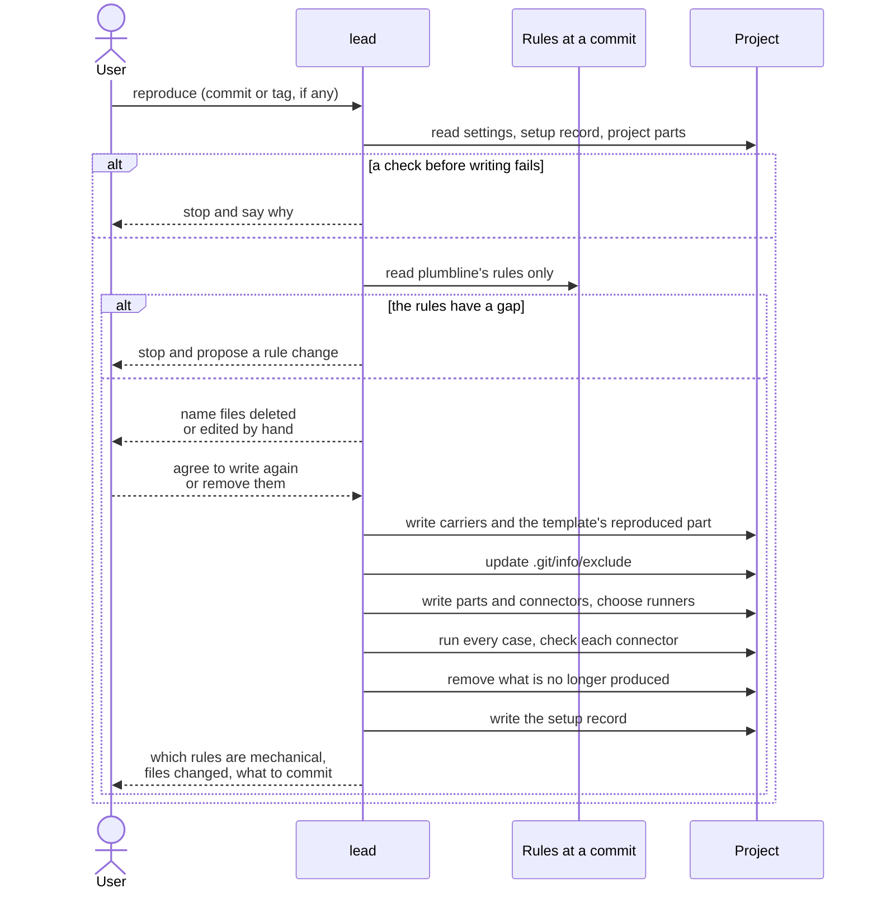
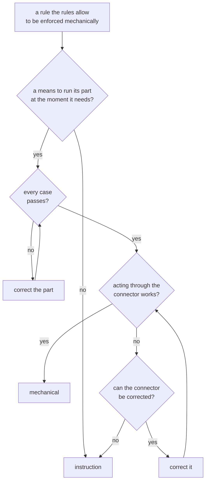

# reproduction

> Basis: intent 1.6 — §5.1, §5.2, §5.3, §5.4, §5.5 (choosing runners; validate also runs in CI), §7 (layers kept out of git), §8.3 (figures render where a renderer is present), §11 (M0, M2).

## 1. Responsibilities

**Does**: defines how an agent builds a project's setup from the rules at one commit and the project settings, and how it builds it again. Defines what it checks before writing anything, what it does on a gap in the rules, how it chooses runners, how it decides which rules are enforced mechanically, and how it finishes: cases, connector checks, the setup record, and the report to the user.

**Does not**:

- Define the setup record, the cases, the carriers, or the mechanical parts. `setup-record`, `conformance` and `carriers` do; `guards`, `status` and `validate` define the parts.
- Decide the settings. The lead and the user do, while authoring (`authoring`).
- Look for newer rules. The lead and `status` do.

## 2. Public interface

### Who and when

- The lead reproduces, in its conversation with the user (`roles`).
- The first reproduction comes after the module map is confirmed (`authoring`). A project reproduces again when it moves to another rules commit, when its settings change, or when the user asks.

### Input

- The plumbline repository and a commit: the ones the user names, or else the ones in the setup record. A tag is resolved to its commit. On a first reproduction with no commit named, the agent asks the user; it may propose the newest tag.
- The settings file (`settings`).
- The project as it is: the previous setup record, the project parts of carrier files, and the template's project part (`design-docs`).

### Before writing anything

The agent stops and says why when:

- the project is not a git repository;
- the settings file is not valid (`settings`);
- a layer location is `.plumbline/`, contains it, or lies inside it;
- the template's project part does not exist yet (`authoring`);
- the previous setup record exists, and what the reproduction reads from it does not have the form `setup-record` defines: that it is a JSON object, and its `rules`, `settings`, `files`, `carriers`, `parts`, `renderers` and `enforcement`, as far as the reproduction reads them. A record written under older rules, which lacks a key these rules added, is read as it is. A runner or a renderer command that these rules do not allow (`setup-record`, Commands) is read as it is too, whoever wrote it: that runner or renderer is not kept, and step 5 chooses it again;
- there is no setup record, but the git history of the checked-out commit holds one: it was removed by hand. The agent asks the user to restore it, from git;
- a file that the previous setup record lists with a reproduced part exists, but the part cannot be found in it (`setup-record`, checksums). The agent names the file, and the begin or end line that is missing, appears more than once, or comes in the wrong order. A file that no longer exists is not this case; step 1 names it;
- the agent has no means that reaches the lead at the start of every session by itself: neither one that reaches only the lead, nor one that every agent reads by itself (`carriers`). This is an environment error;
- the rules at that commit cannot be read.

The git history of the checked-out commit is that commit and every commit before it. In a git repository with no commit yet, that history holds no setup record, and every file that exists counts as differing from the checked-out commit.

### Reading the rules

- The agent reads only plumbline's rules and their conformance cases at that commit (`overview`), from a copy kept outside the project. It never reads plumbline's design, even when the copy holds it.
- No file of the rules is copied into the project. What agents must do reaches them through the carriers.
- When the rules do not say what to produce, the agent does not fill the gap. It stops, says what the rules do not say, and proposes a change to the rules.

### Steps

1. Name every file in the previous setup record that no longer exists or whose checksum no longer matches: it was deleted or edited by hand. Write such files again, or remove them in step 8, only after the user agrees. If the user does not agree, stop before writing anything.
2. Choose the carriers and write them (`carriers`): whole files, and reproduced parts with the project parts kept.
3. Write the template's reproduced part (`carriers`), keeping its project part.
4. Add to `.git/info/exclude` every path of each layer in `not_in_git` that is not there yet. Remove the paths of a layer that the previous record kept out of git and the settings no longer do.
5. Write the mechanical parts and their connectors, and choose a runner for each. A runner must be present wherever its part runs: the developer's machine, and CI for a part that runs there. A runner is present only when it can be recorded as `setup-record` allows: by a name found on the PATH. When there is none, report an environment error that names what is missing, and stop.
   - For CI, use the CI the project already uses. When the agent finds none, it asks the user which one; when the project uses none, there is no CI step.
   - For each `figure` name in the template (`design-docs`), choose a renderer present on the developer's machine and record it (`setup-record`). A renderer is present only when it can be recorded as `setup-record` allows. When none is present, record none for that name; when one is installed but can be reached only by an absolute path, record none and tell the user, in the final report, what to put on the PATH. A renderer need not be present in CI; where it is not, validate skips that kind of figure.
6. Run every conformance case (`conformance`). When one fails, correct the part and run every case again.
7. Check each connector as `carriers` says: a connector to an agent by acting through it once with an action that must be blocked and once with an action that must pass, or, for the end of a turn, by running it as the hook would; the CI connector by running its command locally on a copy. When a connector does not give the expected results and cannot be corrected, or cannot be checked in this session (`carriers`), its rule is enforced by instruction only. The connector stays in place and is listed in the setup record.
8. Remove the files, and the reproduced parts, that the previous record listed and this reproduction no longer writes.
9. Write the setup record (`setup-record`), replacing the old one.
10. Tell the user which rules are enforced mechanically and which by instruction only, and which files were written, changed or removed. Tell the user to commit the setup record and every file that the previous or the new setup record lists and that differs from the checked-out commit, and name them. The reproduction commits nothing.

A setup has four mechanical parts: `status`, the gap guard, the role guard (`guards`) and `validate`. The rules that may be enforced mechanically, by the names `enforcement` gives them, are:

| Rule | Part | Connector |
|---|---|---|
| `gap guard` | `gap-guard` | before an agent writes files |
| `role table` | `role-guard` | before an agent reads or writes files |
| `validate at the end of a turn` | `validate`, in `report` mode | when the lead ends a turn |
| `validate in CI` | `validate`, in `gate` mode | a CI step |

`status` and validate before closing have no connector (`carriers`).

### Mechanical or instruction

A rule that the rules allow to be enforced mechanically is `mechanical` when all of these hold:

- the agent has a means to run the rule's part at the moment the rule needs: before an action, at the end of a turn, in CI;
- the part passed every case;
- its connector check gave the expected results.

Otherwise it is `instruction`, and the carriers state it as an instruction.

### Reproducing again

- The steps are the same. Reproduced files and reproduced parts are replaced; project parts are kept.
- The agent keeps the previous record's choices (carriers, begin and end lines, runners, renderers, the CI) unless the rules, the settings or the means it has require otherwise. A runner or a renderer command that these rules do not allow is never kept.

## 3. Flow

Deciding how a rule is enforced:

## 4. Invariants and contracts

- What a reproduction writes comes only from the rules at one commit and the settings. It keeps every project part, and keeps its earlier choices where the rules and the settings allow.
- The reproducing agent never reads plumbline's design, and no file of the rules is copied into the project.
- A gap in the rules is never filled by the reproducing agent.
- Every file a reproduction writes lies outside every layer location.
- No file a reproduction writes, the setup record included, holds a path particular to the developer's machine, such as one under the developer's home folder.
- The setup record is written last, and only after every case has passed.
- A reproduced file deleted or edited by hand is never written again or removed without the user knowing.
- A reproduced part whose begin or end line cannot be found is never written over.
- A project whose checked-out commit has a setup record in its git history is never reproduced as if for the first time.
- A reproduction commits nothing. The user commits the setup record and every file that the previous or the new setup record lists and that differs from the checked-out commit.

## 5. Decisions and reasons

- **The agent reads only plumbline's rules at one commit, never its design, and copies no rule file into the project.** intent §5.1.
- **A gap in the rules stops the reproduction and becomes a proposal.** intent §5.1.
- **A reproduction is done only when every case passes.** intent §5.3.
- **A runner must be present wherever its part runs; otherwise it is an environment error.** intent §5.5.
- **The user is told which rules are mechanical and which are instructions only.** intent §5.2, §5.4.
- **A connector to an agent is checked by acting through it, once to be blocked and once to pass; a rule whose connector cannot be made to work is enforced by instruction only.** (Design-level — confirmed 2026-10-17)
- **A rule is mechanical only when a means runs its part at the right moment, the part passed every case, and its connector check worked.** Otherwise the setup record would say a rule is enforced while nothing enforces it. (Design-level — confirmed 2026-10-17)
- **A reproduction needs a git repository, valid settings, no layer location at, around or inside `.plumbline/`, and the template's project part; otherwise it stops before writing anything.** The record and the exclusions need git. Settings, `.plumbline/` and the template's words are what the setup is built from and around, so building without them would build something wrong. (Design-level — confirmed 2026-10-17)
- **On a first reproduction the user names the commit, and the agent may propose the newest tag.** The commit decides every rule the project will follow. (Design-level — confirmed 2026-10-17)
- **The setup record is written last.** A reproduction that stops leaves the previous record, so the record still describes the last finished setup. (Design-level — confirmed 2026-10-17)
- **Reproducing again keeps the previous choices unless something requires a change.** Then the same rules and settings give the same files in a new session (intent §11, M0), and a project's carriers do not move around. (Design-level — confirmed 2026-10-17)
- **Reproduced files edited by hand are named first and replaced only after the user agrees; otherwise the reproduction stops before writing anything.** A hand edit that was never committed cannot be recovered once replaced. The user can first move it into a proposal for the rules, the settings or a project part. Rejected: replacing and reporting afterwards, which loses an uncommitted edit; refusing until the user reverts the edit by hand, which ends the same way with more work; keeping the edited file, which would make the setup record wrong. (Design-level — confirmed 2026-10-17)
- **A reproduced file that no longer exists counts as edited by hand.** Deleting is an edit too, and the user may have meant it. Writing the file again without asking would undo that without the user knowing. (Design-level — confirmed 2026-10-17)
- **When the previous setup record is not valid, or a reproduced part it lists cannot be found, the reproduction stops before writing anything.** Without a valid record the agent cannot tell what it wrote last time. Only what it reads must be valid, so a record written under older rules, without a key added since, can still be replaced. Without both lines of a part it cannot tell where the project's part begins and ends, and a guess could write over the project's words or leave old rules behind as project text. The user restores the record or the lines, from git for example, and reproduces again. Rejected: writing the whole file again, which loses the project part; adding a new reproduced part next to the old text, which keeps old rules as project text. (Design-level — confirmed 2026-10-17)
- **When no means reaches the lead by itself at the start of every session, the reproduction stops with an environment error.** The lead's rules must reach it without the user doing anything (`carriers`). A setup that relies on the user pointing the lead to its rules in every session would leave them to memory, as when agents keep rules by themselves. Like a missing runner, this is a lack in the environment, not in the rules. Rejected: telling the user to point the lead to its carrier at the start of every session, which breaks that contract without anything recording it. (Design-level — confirmed 2026-10-17)
- **When there is no setup record but the git history of the checked-out commit holds one, the reproduction stops before writing anything and asks the user to restore it.** The record is in git, so a missing record that git once held was removed by hand. Reproducing as if for the first time would miss reproduced files edited by hand, and would leave the old reproduced parts behind as project text next to new ones. Rejected: asking the user at every reproduction without a record whether there was an earlier one, which asks on every true first reproduction and relies on memory; treating it as a first reproduction, which shows the damage only at the next reproduction. A record removed before it was ever committed, or one whose commits a shallow clone does not hold, is not caught. (Design-level — confirmed 2026-10-17)
- **The reproduction commits nothing; its final report tells the user to commit the setup record and every file that either record lists and that differs from the checked-out commit, and names them.** When to commit is the user's call, and a commit made by the reproduction could mix with the user's own work. Naming the files at the end of every reproduction makes forgetting unlikely, and the record must be committed for a removed record to be caught later. Removed files and removed parts are named too, so that what git holds is exactly what the record lists. Rejected: the reproduction committing by itself, which makes commits the user did not ask for. (Design-level — confirmed 2026-10-17)
- **A renderer is chosen per kind of figure at reproduction, on the developer's machine; where none is present, the figure check is skipped.** intent §8.3 runs the render check only where a renderer is. Renderers differ from machine to machine like runners, so they are chosen and recorded at reproduction. Rejected: requiring a renderer in CI, which makes every project's CI install one. (Design-level — confirmed 2026-10-18)
- **A runner or a renderer reachable only by an absolute path counts as not present, and no file the reproduction writes holds a path particular to the developer's machine.** The setup is in git and is used on other machines and in CI; a path true on one machine fails elsewhere and, under a home folder, shows that machine's user name. A renderer that is not recorded only leaves its figures unchecked, and telling the user what to put on the PATH lets the next reproduction record it. Rejected: writing a script into the project that calls the absolute path, which moves the same path into a file in git. (Design-level — confirmed 2026-10-18)
- **A runner or a renderer command that these rules do not allow does not stop a reproduction: it is read as it is and chosen again.** It is only a choice, and replacing it loses nothing. A record written under older rules can hold one, and the record can be neither edited by hand nor removed without stopping the next reproduction, so stopping would leave the project with no way to be reproduced again. Rejected: stopping for the user's agreement, which asks about an entry no one chose to keep and that loses nothing when replaced. Settled in [this change](../../.plumbline/changes/2026-10-18-no-absolute-paths/). (Design-level — confirmed 2026-10-18)
- **The CI step goes into the CI the project already uses; when none is found, the agent asks; with none, there is no CI step.** (Design-level — confirmed 2026-10-18)
- **What is no longer produced is removed, and exclusions of layers no longer kept out of git are removed.** The setup then is exactly what the record lists. (Design-level — confirmed 2026-10-17)
- Known limit: the rules at one commit do not say which keys of the setup record later rules added, so a reproducing agent cannot always tell a record written under older rules, which lacks such a key, from one whose key was removed by hand. Every setup record written since the first version holds every key these rules define.

## 6. Verification criteria

These are checked in the M0 Done of intent §11, on an example project with the settings that came out of authoring:

- the agent reads only plumbline's rules and conformance cases and writes the carriers, the template's reproduced part and the setup record;
- every file in the setup record exists, and its checksum matches;
- reproducing again in a new session with the same rules and settings gives the same list of files;
- reproducing again leaves the project parts of carrier files and the template's project part as they were;
- with a layer in `not_in_git`, its paths are in `.git/info/exclude`;
- the agent stops before writing anything when the project is not a git repository, when the settings are invalid, when a layer location is at, around or inside `.plumbline/`, when the template's project part is missing, when what it reads from the previous setup record is not valid, or when a reproduced part it lists cannot be found; in the last case it names the file and the line;
- with no setup record and one in the git history of the checked-out commit, the agent stops before writing anything and asks the user to restore it;
- the final report names, as files to commit, the setup record and every file that the previous or the new setup record lists and that differs from the checked-out commit, and the reproduction makes no commit;
- a reproduced file edited by hand, and one that was deleted, are named before anything is written.

In the M1 Done of intent §11, on the same project:

- every case of `status` and `gap-guard` passes in the project;
- acting through the gap guard's connector blocks the write below the proposed gap item and lets the other through (`carriers`), and the setup record lists the gap guard as `mechanical`.

In the M2 Done of intent §11, on the same project:

- every case of `role-guard` and `validate` passes in the project;
- the role guard's connector check blocks the reads it must block, as the lead and as each role started by hand-off, and the setup record lists the role table as `mechanical`;
- the end-of-turn and CI connector checks give the expected results, and leave nothing behind;
- a renderer is recorded for each kind of figure the template names and the developer's machine can render, by a name found on the PATH;
- after a reproduction, no file the reproduction wrote holds a path under the developer's home folder;
- with a previous setup record whose renderer command holds an absolute path, the reproduction does not stop; it records that kind of figure's renderer again, by a name found on the PATH, or records none.

## 7. Out of scope

- None. reproduction is complete in M2.
