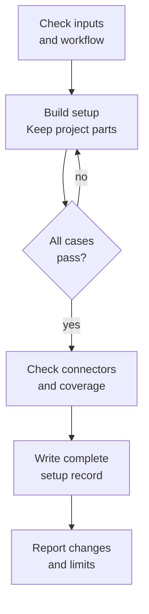

# Reproduction

## 1. Responsibilities

- Defines how the lead reads plumbline's rules and builds a project's setup.
- Defines how the configured roles receive their instructions and follow the project's workflow.
- Defines how to check mechanical enforcement and record its limits.
- Defines how to reproduce again while preserving project parts.

Layers and settings defines the settings. Roles defines permissions and guard behavior. A change defines the workflow. Setup record defines the record; Conformance cases defines how cases run.

## 2. Public interface

### Who and when

- The lead reproduces, in its conversation with the user.
- The first reproduction follows confirmation of the module map and completion of the settings and project workflow.
- Reproduce again when the rules commit or settings change, or when the user asks. A workflow change that needs different carriers or role startup also requires reproduction.

### Input

- The plumbline repository and commit named by the user, or otherwise those in the setup record. Resolve a tag to its commit. On a first reproduction with no version given, ask the user; the lead may propose the newest tag.
- The repository address must be usable from other machines (Setup record, Public interface). For a local copy without a usable recorded address, ask for the original repository's address before writing anything.
- The complete settings, previous setup record when present, project parts of carriers including the workflow, and the template's project part.

### Before writing

Check the inputs and planned setup first. Stop without writing and explain when:

- The project is not a git repository; the settings are missing or malformed; or a layer location is `.plumbline`, contains it, or lies inside it.
- The template's project part is absent (Design documents, Public interface).
- The workflow leaves a required choice open, refers to an unconfigured role, or cannot cover the planned work and the five checks with the assigned roles' permissions. Resolve this with the user; do not add default roles, models or permissions. An empty member list is valid settings syntax, but does not make unassigned work feasible.
- The previous record cannot be read in its documented form. An older form may be read to recover generated files, marker boundaries and tool choices; missing current role settings must be obtained from the user. An old local repository location or a now-disallowed command may be read, but needs a valid replacement before it is recorded again.
- No setup record exists but git history has one. Ask the user to restore the removed record from git.
- A previously recorded file exists but its reproduced part cannot be located: a marker is missing, repeated or out of order. Name the file and the faulty boundary; do not guess which contents to replace.
- No carrier can reach the lead automatically at every session start. This is an environment error.
- The chosen rules commit cannot be read, or the rules leave a necessary part of the setup undefined. Report the gap and propose a rules change.

Compare existing reproduced files and parts with the previous record's checksums. Tell the user which are missing or changed. Recreate, replace or remove them only with the user's agreement; without it, stop before writing. Changes solely in project parts are preserved and do not count as edits to reproduced parts.

Confirm that the workflow specifies assignments, work across zones, coordination of shared write zones, communication and reporting, handling findings, resuming after design updates, and responsibility for all five checks (A change, Public interface). It grants no extra permissions. Check that each declared part recognizer matches its description; a missing definition or disagreement is resolved with the user. Settle the contract of a recognizer to be made during reproduction before using it. A valid recognition method that cannot be implemented is an enforcement limitation, not permission to widen the zone.

### Reading the rules

- Read only plumbline's rules and conformance cases at the chosen commit, from a copy outside the project. Do not read plumbline's design, even when that copy contains it.
- Do not copy rule files or cases into the project. The reproduced carriers and tools provide the setup without needing that copy at runtime.
- When the rules leave a gap, stop the dependent reproduction work, explain what is missing and propose a rules change. Do not invent the missing contract.

### Producing the setup

1. Choose and write the rule carriers for `lead` and every member in the current settings. Preserve project parts, including the agreed workflow.
2. Write the template's reproduced part, preserving its project part.
3. Add the excluded layer locations and `/.plumbline/work-note.md` to `.git/info/exclude` when absent. Remove old layer-exclusion lines when that layer is now tracked; preserve unrelated lines.
4. Write both parts, `role-guard` and `validate`, and the available connectors. Write any required recognizer or analyzer helpers. Choose runners that meet Setup record's command form and can start by a name on PATH. Without a usable runner, report what is missing and stop with an environment error. For each figure kind, record an available renderer in the same command form; otherwise record none and explain the omission. If a renderer is available only by an absolute path, the final report says what to put on PATH.
5. Run every conformance case as specified in Conformance cases, including isolated files, links and helper commands. Preparation or runner-start failure is not a passing expected-error case. Fix a failing part and run all cases again. Separately check custom recognizers against selected and excluded contents and boundary changes; the shared marker cases do not prove a custom recognizer. If a part or its helpers change later in reproduction, rerun all cases before recording coverage.
6. Check the actual connectors as described below. Establish the tested scope and remaining instruction limits for each role and channel.
7. Remove obsolete reproduced files or parts listed in the previous record. When a file also has a project part, remove only the reproduced part and keep the project contents. Do not delete unrecorded files by inference from a removed role's name.
8. Replace the setup record whole, using the current settings snapshot, all generated files and helpers, carriers reaching every role, both parts, available renderers and the checked enforcement coverage (Setup record, Public interface).
9. Report completion and limitations as described below. Commit nothing.

Until all cases pass and the current coverage is recorded, reproduction is incomplete. If it stops after writing has begun, report the changed files and unfinished work; do not present the previous record as evidence for the changed setup.

### What each role receives

| Recipient | Receives |
|---|---|
| `lead` | Layer locations and git exclusions; read direction and its own read/write limits; the complete role list, duties, models and zones; role identification and startup; the agreed workflow and hand-offs; Writing intent, Design documents, A change and Status; running validate on request and reporting results; guard blocks and errors; reproduction and its recorded limits |
| Each configured member | Its name, duty, model, read zones and write zones with their paths, patterns and part definitions; the common limits in Roles; layer locations, including intent as forbidden; how to read design's seven sections; its workflow assignments, communication routes, hand-offs and reports; the five checks and diagnosis rules for its assigned check scope; guard blocks, errors and instruction limits |

Write paths as configured. Every non-lead role receives the limits against reading intent or its copies, searching their ancestor folders and changing design. It receives only its permitted share of a task, leaves gaps and work outside its zones, and reports without copying impl to the lead. Its own instructions, settings and `.git/HEAD` are setup reads under Roles; other roles' instructions and the work note are not shared context.

State all permission limits even where mechanical guards exist. Disabled, unavailable or untested guards leave those limits as instructions. The lead also receives the rules against copying an excluded layer's content into a tracked layer and editing reproduced contents by hand. Setup changes go through the rules, settings or project parts as appropriate, then reproduction.

### How carriers reach roles

- Choose from the available means: instruction files, marked parts of files, referenced files, hooks, skills and role startup mechanisms.
- Put each role's instructions in a carrier that only that role receives. A shared startup carrier holds only role names, role identification and references to role-specific instructions. Omit it when unnecessary. Recording a shared carrier does not authorize access to another role's instructions.
- The lead receives its rules at every session start without user action, either directly or through the shared carrier's reference.
- Start each configured member as a fresh AI with its selected model and without the lead's conversation or intent. Use the startup mechanism that delivers that role's rules. If no automatic carrier reaches it, name its instruction file in the hand-off. Do not silently substitute a role or model that the available tool cannot start; report the environment limitation.
- Carrier files are tracked, outside every layer, and listed in the setup record. Every configured role, including lead, must be reached by at least one recorded carrier.
- Reproduced carrier contents are rules only: no reasons, history, open questions, reference to plumbline's intent or design, or content from excluded layers. Project-specific working rules belong in project parts.

### Reproduced parts and project parts

- In a file also written by the project, write only the reproduced part between distinct begin and end marker lines, including the markers. Choose lines suitable for the file type and record them. Keep everything outside them unchanged.
- Project parts hold the project's workflow and other working rules, such as language and code comment policy. Arrange them so each role receives its relevant instructions within Roles' access limits. Reproduction does not rewrite those choices.
- Use a different file when the format cannot hold marker lines.
- The template has both parts. Its reproduced part describes the seven sections without adding level-2 headings.

### Connectors

Connect `role-guard` to the available file and shell hooks that run before an operation. A connector translates tool facts into the guard's input; it does not make its own permission decision or execute a shell command to discover its effects (Roles, Public interface).

- Role identity comes from the active role startup, not a role's claimed name. Without reliable identity, the affected coverage remains instruction-only.
- Paths, searched folders or the exact complete selection, ranges, edits and shell working directory describe the actual tool operation. `instruction_paths` comes from the active role's carriers; `intent_copies` comes from setup or tool provenance. Neither is a list invented by the requesting role.
- The checked operation must be the one applied. For partial edits, preserve the checked contents and exact replacements until application, or require a fresh check after a change. If the tool cannot guarantee this, record that limit. A claimed narrow edit cannot authorize an unverified whole-file replacement.
- Preserve the distinction between `block` and `error`. Report the reason, stop the affected operation and let the role report to the lead. Do not retry unchanged indefinitely or bypass through another tool.
- Validate has no automatic hook. The lead runs it only on user request, using its recorded runner and entry.

### Checking actual connectors

Check every role and tool channel for which mechanical coverage will be claimed. Start roles with the configured model and carrier mechanism, without the lead's conversation, and identify the task as a guard check. Exercise the actual tool hook and inspect its guard result; calling the guard directly proves only the part.

Use nonexistent paths or disposable synthetic files so that an unexpected pass cannot reveal or alter real intent, design or impl. File-part and write checks need disposable contents. A disposable test project is suitable only when it exercises the same connector, role startup, settings and relevant tool configuration; record any difference and leave unverified actual-project coverage as an instruction. Never copy real intent into a fixture. Remove synthetic files and stop temporary processes after checks, including failures.

| Coverage to check | Evidence through the connector |
|---|---|
| Mandatory limits | For each non-lead role, intent reads and ancestor searches, including outside parents, are blocked; design creation, changes and deletion are blocked. Check symbolic-link resolution and known-copy metadata where those are claimed. Include an allowed operation under that role's permissions or setup-read exceptions. |
| Optional zone guards | With each requested guard on, selected contents are allowed and excluded contents are blocked. Check the actual path patterns and any file parts. A role with no write zones is not assigned an allowed impl write merely to complete a probe. |
| File parts | Custom recognition matches the description; partial reads and edits stay inside the recognized ranges; boundary changes cannot acquire other contents. The operation applied matches the checked bytes and replacements, including detection of changed input. |
| Shell inspection | The chosen `none`, `literal` or `cautious` behavior agrees with Roles. Check identified file effects, ordinary arguments that are not paths, and unresolved effects. Inspection does not execute the command. The tool's later execution, if tested, uses only disposable data. |
| Metadata and failures | Identity, instruction paths and copy locations have the stated trusted sources. Guard errors are reported as errors and prevent the affected operation. Missing hooks or metadata are recorded as limits. |

An AI declining a probe, a missing target file or a tool's unrelated access error is not proof that the guard blocked it. A failed or unavailable check cannot support mechanical coverage. Repair and recheck, or leave that scope as an instruction. If a changed carrier requires a new session, keep the connector and record its untested scope as instruction-only; tell the user to reproduce again in a new session.

### Mechanical coverage and the record

Mechanical coverage requires all conformance cases to pass, a hook before the operation, trustworthy operation input, and successful checks through the actual connector for every listed role. It covers only the tools, operations and contents those checks support.

For each non-lead role, record `intent-read`, `design-write`, `read-zones` and `write-zones` for both `file` and `shell`, exactly once per combination. Group entries only when their scope and limits agree. Mechanical entries identify the cases and connector checks in `evidence`; instruction entries explain the reason in `limits` (Setup record, Public interface).

Disabled zone guards are instructions for those zone rules. Shell choice `none` makes all shell entries instructions. Other shell entries describe the chosen inspection behavior, not proof of arbitrary program effects. Partial-file coverage states recognition and checked-edit guarantees. Record unconnected tools, unknown-origin intent copies, unavailable recognizers and content-stability limitations wherever they apply. Never infer coverage from a setting, a declared recognizer or a passed case alone.

### Completion and reproducing again

Report in plain words:

- Which roles receive which carriers, and which changes take effect only in new sessions.
- Which rules are mechanically enforced for which roles and tools, what remains instruction-only, and what could not be checked or started.
- Which files were written, changed or removed; what to commit: the setup record and changed files listed in the previous or new record. Also explain any local exclusion changes and unavailable renderers.

Reproducing again follows the same checks and preserves project parts. Keep previous carrier, marker, runner and renderer choices when the rules, settings and available means still support them; never keep a now-invalid command. Old coverage is not evidence for changed settings, tools or connectors. Read old records only in their documented form and write the new record in full, without inventing missing roles.

## 3. Flow

Resolve input problems and changes made by hand before writing. Generate the setup, run all cases and check connectors. Remove obsolete reproduced contents, write the complete record and report. An unavailable connector can leave an instruction limit; a failed conformance case leaves reproduction incomplete.

## 4. Invariants and contracts

- Reproduction commits nothing and never changes project parts.
- Roles, models, permissions and workflow come from explicit project decisions; reproduction supplies no missing defaults.
- Reproduction finishes only after every conformance case passes and the record describes the actual setup and enforcement limits.
- Every lasting file written by reproduction is recorded, except the setup record and `.git/info/exclude`; every recorded file was written by reproduction. Disposable test files are removed.
- Rules and cases are not copied into the project. The finished setup works without the external rules copy.
- No untested or unavailable coverage is described as mechanical.

## 5. Decisions and reasons

- The lead reproduces because choices and gaps need the user. Another project's lead may read plumbline's rules: they are not that project's impl. Keeping the copy outside the project separates it from project files.
- Settings syntax alone cannot show whether the workflow is feasible. The assigned roles must collectively build the planned work and complete the five checks within their permissions.
- Project parts survive reproduction so project choices, including workflow, are not lost. Replacing manually changed reproduced contents needs agreement because the change may be intentional.
- Cases test the common parts; actual connector checks establish what the available AI tools enforce. Synthetic contents keep failed checks from exposing or damaging project work.
- Coverage is recorded separately by role, rule and channel because tools may enforce different subsets. New-session-only checks wait rather than being reported as already passed.

## 6. Verification criteria

These require judgment during reproduction in another project:

- Missing roles or workflow choices are reported before writing; no default roster, model or check assignment appears. A workflow that cannot cover required work is not accepted merely because settings parse.
- Every configured role receives only its own instructions through its specified startup and model. The lead starts with its rules automatically; non-lead roles receive neither intent nor the lead's conversation.
- All common cases pass using the reproduced parts and isolated fixtures. Custom recognizers are checked separately, and fixture preparation failure never counts as an expected error.
- Every mechanical record entry identifies passed cases and successful actual connector checks for its roles and scope. Disabled guards, shell `none`, unavailable recognition, unknown copy provenance, unconnected tools and unpreserved edits have the appropriate instruction limits.
- When the user requests validate after reproduction, it reports no `record`, `checksum`, `part-not-found` or `template` problem. Passing validate alone is not evidence of guard coverage.
- Reproduction with unchanged rules, settings, workflow and environment preserves the recorded file list. Project parts remain unchanged, including when a role or carrier is removed. Old files and marker boundaries are recovered from documented older records without inventing current roles.
- Excluded layers and the work note are excluded locally; unrelated exclusion lines remain. The final report covers changed files, the commit set, enforcement limits and new-session requirements.

## 7. Out of scope

None.
