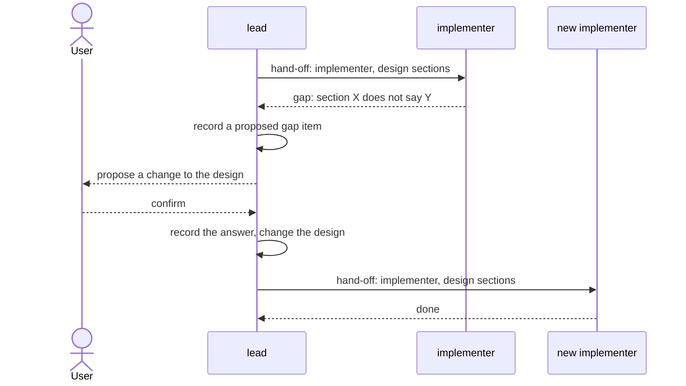
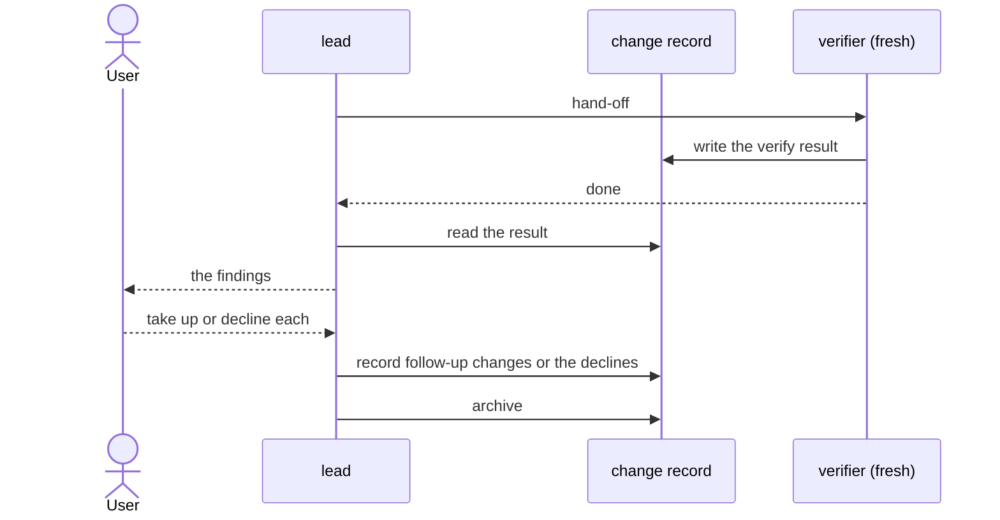

# roles

> Basis: intent 1.4 — §4 (principles 2, 3), §8.1 and §8.2 (who opens changes, records gaps and diagnoses), §8.3 (the verifier), §8.4, §8.5 (who writes intent and design), §11 (what each milestone adds).

## 1. Responsibilities

**Does**: defines the three roles that work in a project, the lead, the implementer and the verifier: what each does, which layers and files it may read and write, which role an agent plays, which roles start fresh, how work is handed from the lead to an implementer or a verifier, how a gap travels between them, and the lead's part in changes.

**Does not**:

- Enforce any of this. `guards` does where an agent has the means (the role guard). Elsewhere the rules reach agents as instructions (`carriers`).
- Say what the verifier checks and how it reports. `verify` does.
- Define change records, gap items and the current change. `changes` does.
- Word the instructions agents receive. `carriers` does.

## 2. Public interface

### The roles

| Role | Does |
|---|---|
| `lead` | talks with the user; writes intent and design with the user; opens, closes and archives changes; diagnoses; records gap items and the user's answers; edits the settings and reproduces the setup |
| `implementer` | builds the design sections it is given into impl; answers questions about impl |
| `verifier` | checks impl against the design sections it is given, for one change, and writes the result into that change (`verify`) |

What each role may read (R) and write (W):

| Path | `lead` | `implementer` | `verifier` |
|---|---|---|---|
| intent | R W | — | — |
| design | R W | R | R |
| impl | — | R W | R |
| the verify result of a change (`changes`) | R | — | R W: only that of the change it was given |
| other change records | R W | — | — |
| the current change | R W | — | — |
| the settings file | R W | R | R |
| rule carriers meant for that role or for every agent | R W | R | R |
| other setup files | R W | — | — |
| `.git/info/exclude` | R W: the lines the rules call for | — | — |
| other project files in no layer | R | R | R |
| files that are not project files | R W | R W | R W |

- A layer's paths are the ones the settings give (`settings`). A path lies in a layer when it equals one of them or lies under one.
- Setup files are what a reproduction writes and keeps: rule carriers, document templates, guards, checks, their connectors, the setup record. They are not a layer. The setup record says which roles each rule carrier is meant for (`setup-record`).
- The lead also writes the files a reproduction writes for its checks and removes again (`carriers`). They are setup work, not project files.
- A project file is a file under the project root that the project's own ignore rules (its ignore files and `.git/info/exclude`) do not ignore, outside `.git/`. A path outside the project root, a path git ignores, and a path under `.git/` other than `.git/info/exclude` are not project files.
- Files that tools create while they run, such as build outputs, are the tools' and not a role's writes; a role never writes them by an action of its own.
- The lead never reads impl. The implementer never reads intent, and never writes intent or design. The verifier never reads intent or change records, and writes nothing but its result.
- A project file that lies in no layer is written by no role, unless the table above says so. When the work needs such a file, the lead proposes to the user to add its path to a layer's locations, usually impl. This is not a gap item; the change record lists it among its tasks. Once the user agrees, the lead edits the settings and reproduces, and the role that writes that layer writes the file. An implementer that needs such a file stops that work and reports it to the lead; after the reproduction, a new implementer continues with the same design sections.

### Which role an agent plays

- An agent started by a hand-off that names it an implementer is an implementer. One started by a hand-off that names it a verifier is a verifier.
- Every other agent is the lead.

### Fresh agents

- The implementer and the verifier start without the lead's conversation.
- One implementer serves one hand-off. Work after a design change always goes to a new implementer.
- One verifier serves one check of one change.

### Hand-off

- The lead hands work to an implementer by naming its role and design sections: a design document and the sections in it.
- The lead starts the implementer with the hand-off. When the lead cannot start an agent itself, or not in the way the implementer's carrier needs, it gives the hand-off to the user, who starts the implementer with it, and tells the user how to start it. That instruction is for the user and is not part of the hand-off.
- The hand-off never carries intent content.
- A question about impl from the user goes from the lead to an implementer in the same way. The answer comes back to the lead.
- During a reproduction, a hand-off may ask an implementer or a verifier for a check of the role guard (`carriers`). Such a hand-off names the role, says it is a check, and lists the reads to try, with the carrier when one must be named; nothing else.
- The lead hands a check to a verifier by naming its role, the change, the change's diagnosis, the layers the change touched (`changes`), the commit the change's work started from, and the design sections the change touched (`verify`). The verifier writes its result into that change and tells the lead it is done.

### Changes

- The lead opens, closes and archives changes, and keeps the current change (`changes`).
- The lead diagnoses which layer is wrong from what the user said and from intent and design. When telling requires impl, the lead asks an implementer: the hand-off names the design sections the question is about, and the question.
- The lead records each gap as a gap item, and records the user's answer with its date.
- Once a change is closed, the lead hands its check to a verifier, reads the result, and takes up each finding before archiving the change (`changes`).

### A gap found by the implementer

1. The implementer stops work on that point and reports the gap to the lead, in terms of the design: which section, and what it does not say or says wrongly. It leaves that point unbuilt and does not choose a way to build it. Work on other points goes on.
2. The lead records it as a proposed gap item in the current change and proposes the change to the user. When it is a wording fix (`changes`), the lead makes the fix at once, records it in the change and tells the user instead.
3. The lead records the user's answer. After the user confirms, the lead changes the design, or intent first when the gap is at intent's level.
4. A new implementer continues the work.

## 3. Flow

- When the lead cannot start an implementer itself, the user starts it with the lead's hand-off (section 2, hand-off). The figure shows the lead starting it.

A closed change is checked:

- The hand-off names the role, the change, its diagnosis, the layers it touched, its start commit and the design sections it touched (section 2).

## 4. Invariants and contracts

- Every agent plays exactly one role: the implementer or the verifier when a hand-off names it so, the lead otherwise.
- No role reads or writes outside its row in the table.
- No hand-off and no question to an implementer or a verifier carries intent content.
- Work after a design change goes to a new implementer.
- A gap goes from the implementer to the lead, and from the lead to the user. The implementer never settles it, and leaves its point unbuilt.
- Every gap is recorded as a gap item before it is proposed to the user.
- Only the lead writes change records and the current change, except the verify result, which only the verifier writes.
- A project file in no layer is written only by the role the table names.

## 5. Decisions and reasons

- **The lead opens and closes changes, records gap items and diagnoses; it asks an implementer when diagnosing needs impl.** intent §8.2, §8.4.

- **The lead never reads impl; the implementer never reads intent; the implementer is fresh.** intent §8.4. A conversation that has read intent cannot test whether the design is enough.
- **The implementer never writes design.** intent §8.4. Otherwise a gap could be settled below.
- **Setup files are not a layer; the lead writes them, and edits the settings.** Reproducing a setup and choosing settings happen in the conversation with the user. They read and write no layer content, so they do not break the read direction. (Design-level — confirmed 2026-10-17)
- **One implementer per hand-off.** intent says a new implementer starts after a gap. Using a new one for every hand-off keeps the rule simple and keeps earlier work out of the next one's context. Rejected: reusing an implementer until a gap appears, which leaves the boundary to judgment. (Design-level — confirmed 2026-10-17)
- **On a gap, the implementer leaves that point unbuilt and chooses no way to build it.** intent §4 principle 3 and §8.4 say the implementer stops. A point built one way before the user answers turns the proposal into "impl already does this", and the design then follows impl. Rejected: building the point provisionally and recording that in the gap item, which leans the user's answer toward what was built. (Design-level — confirmed 2026-10-18)
- **A gap is reported in terms of the design.** The implementer has read only design and impl, so it can name only what the design does not say. The lead turns that into a proposal, adding intent when needed. (Design-level — confirmed 2026-10-17)
- **The hand-off names a design document and its sections.** A name the implementer can open is enough, and it cannot carry intent content by accident. (Design-level — confirmed 2026-10-17)
- **M0 has the lead and the implementer, without changes. The lead's work on changes comes in M1, and the verifier in M2.** intent §11 places change records, gap items and diagnosis in M1 and verify in M2. A rule that names them before then would tell agents to do what nothing defines. M0 still needs the hand-off and the gap flow, because M0 module documents are built into impl by implementers. (Design-level — confirmed 2026-10-17)
- **A project file in no layer, such as a VCS ignore file, is written only after its path is added to a layer.** What such a file holds often depends on that layer's work, as build outputs depend on impl, so the role that writes the layer writes it. Every file a role writes then lies in a layer or is a file the table lets that role write, so what each role may write can be judged for every path. Rejected: the lead writing such files, which writes content that depends on impl from reports alone and leaves paths no role owns; the user writing them by hand, which stops the work each time one is needed. (Design-level — confirmed 2026-10-18)
- **The verifier reads design and impl only, gets the diagnosis, the layers touched and the change's start from the hand-off, and writes only its result into the change.** intent §8.3, §8.4. A change record may hold intent content when intent is in git, so the verifier does not read change records; what it needs from the change comes in the hand-off. With the start commit it can see what the change did to design and impl, which is how it judges the diagnosis. Rejected: letting the verifier read the change record, which can carry intent content; giving it only the design sections, which leaves the diagnosis unchecked. (Design-level — confirmed 2026-10-18)
- **One verifier per check, fresh.** intent §8.4 says the verifier is new and knows no earlier conversation. (Design-level — confirmed 2026-10-18)
- **The table is written per kind of path, so that every path an action touches falls in exactly one row.** The role guard judges each path by its row (`guards`). Settings and project files in no layer are readable by every role: they hold no layer content. Files that are not project files are free to every role, since they are not kept with the project. Rule carriers are readable by the roles they are meant for, so each role's rules reach only that role. Rejected: listing only the layers, which leaves change records, carriers and the settings to judgment. (Design-level — confirmed 2026-10-18)
- **A project file is one under the project root that git does not ignore, outside `.git/`.** A guard can tell this from the files under its working directory. Rejected: any file in the working tree, which would treat scratch and build outputs as kept files; only files git already tracks, which would treat a new file the work is about to add as free. (Design-level — confirmed 2026-10-18)
- **An agent is an implementer when a hand-off names it so; every other agent is the lead.** The lead's rules must reach the lead at the start of every session without the user doing anything, so the lead is the default. An implementer always starts from a hand-off, so the hand-off is where it learns its role. Rejected: having the user name the role of every session, which makes the user act before the lead's rules can reach it. (Design-level — confirmed 2026-10-17)

## 6. Verification criteria

These are judgment checks, made during the M0 Done of intent §11:

- the rule carriers (`carriers`) state the role table, which role an agent plays, the hand-off and the gap flow as instructions, and the setup record lists the role table as enforced by `instruction`;
- a new session started without a hand-off acts as the lead;
- an agent started by a hand-off that names it an implementer acts as the implementer, and reports a gap to the lead instead of settling it.

These are judgment checks, made during the M2 Done of intent §11:

- an agent started by a hand-off that names it a verifier acts as the verifier: it reads design and impl, writes only the verify result of its change, and does not read intent or change records;
- the lead hands a closed change's check to a fresh verifier and archives the change only after taking up every finding.

The role guard enforces the table, with conformance cases for its cells (`guards`).

These are judgment checks, made during the M1 Done of intent §11:

- the lead opens, closes and archives each change, and keeps the current change;
- a gap reported by an implementer appears as a proposed gap item before the user is asked, and its answer is recorded with the date; the implementer left that point unbuilt;
- when a diagnosis needs impl, the lead asks an implementer and does not read impl itself;
- when the work needs a file in no layer, no role writes it until the user agrees to add its path to a layer and the setup is reproduced.

## 7. Out of scope

- None. roles is complete in M2.
