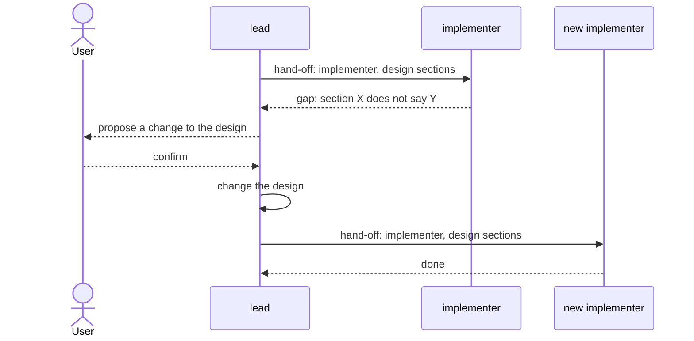

# roles

> Basis: intent 1.2 — §4 (principles 2, 3), §8.4, §8.5 (who writes intent and design), §11 (what each milestone adds).

## 1. Responsibilities

**Does**: defines the two roles that work in a project in M0, the lead and the implementer: what each does, which layers and files it may read and write, which role an agent plays, which role starts fresh, how work is handed from the lead to an implementer, and how a gap travels between them.

**Does not**:

- Enforce any of this. `guards` does where an agent has the means (M2). Elsewhere the rules reach agents as instructions (`carriers`).
- Define change records and gap items. `changes` does (M1).
- Word the instructions agents receive. `carriers` does.

## 2. Public interface

### The roles

| Role | Does | Reads | Writes |
|---|---|---|---|
| `lead` | talks with the user; writes intent and design with the user; edits the settings and reproduces the setup | intent, design, setup files | intent, design, settings, setup files |
| `implementer` | builds the design sections it is given into impl; answers questions about impl | design, impl, the rule carriers it receives | impl |

- Setup files are what a reproduction writes and keeps: rule carriers, document templates, guards, checks, the setup record. They are not a layer.
- The lead never reads impl. The implementer never reads intent, and never writes intent or design.

### Which role an agent plays

- An agent started by a hand-off that names it an implementer is an implementer.
- Every other agent is the lead.

### Fresh agents

- The implementer starts without the lead's conversation.
- One implementer serves one hand-off. Work after a design change always goes to a new implementer.

### Hand-off

- The lead hands work to an implementer by naming its role and design sections: a design document and the sections in it.
- The lead starts the implementer with the hand-off. When the lead cannot start an agent itself, or not in the way the implementer's carrier needs, it gives the hand-off to the user, who starts the implementer with it, and tells the user how to start it. That instruction is for the user and is not part of the hand-off.
- The hand-off never carries intent content.
- A question about impl from the user goes from the lead to an implementer in the same way. The answer comes back to the lead.

### A gap found by the implementer

1. The implementer stops work on that point and reports the gap to the lead, in terms of the design: which section, and what it does not say or says wrongly.
2. The lead proposes the change to the user.
3. After the user confirms, the lead changes the design, or intent first when the gap is at intent's level.
4. A new implementer continues the work.

## 3. Flow

- When the lead cannot start an implementer itself, the user starts it with the lead's hand-off (section 2, hand-off). The figure shows the lead starting it.

## 4. Invariants and contracts

- Every agent plays exactly one role: the implementer when a hand-off names it so, the lead otherwise.
- No role reads or writes outside its row in the table.
- No hand-off and no question to an implementer carries intent content.
- Work after a design change goes to a new implementer.
- A gap goes from the implementer to the lead, and from the lead to the user. The implementer never settles it.

## 5. Decisions and reasons

- **The lead never reads impl; the implementer never reads intent; the implementer is fresh.** intent §8.4. A conversation that has read intent cannot test whether the design is enough.
- **The implementer never writes design.** intent §8.4. Otherwise a gap could be settled below.
- **Setup files are not a layer; the lead writes them, and edits the settings.** Reproducing a setup and choosing settings happen in the conversation with the user. They read and write no layer content, so they do not break the read direction. (Design-level — confirmed 2026-10-17)
- **One implementer per hand-off.** intent says a new implementer starts after a gap. Using a new one for every hand-off keeps the rule simple and keeps earlier work out of the next one's context. Rejected: reusing an implementer until a gap appears, which leaves the boundary to judgment. (Design-level — confirmed 2026-10-17)
- **A gap is reported in terms of the design.** The implementer has read only design and impl, so it can name only what the design does not say. The lead turns that into a proposal, adding intent when needed. (Design-level — confirmed 2026-10-17)
- **The hand-off names a design document and its sections.** A name the implementer can open is enough, and it cannot carry intent content by accident. (Design-level — confirmed 2026-10-17)
- **M0 has the lead and the implementer, without changes. The lead's work on changes comes in M1, and the verifier in M2.** intent §11 places change records, gap items and diagnosis in M1 and verify in M2. A rule that names them before then would tell agents to do what nothing defines. M0 still needs the hand-off and the gap flow, because M0 module documents are built into impl by implementers. (Design-level — confirmed 2026-10-17)
- **An agent is an implementer when a hand-off names it so; every other agent is the lead.** The lead's rules must reach the lead at the start of every session without the user doing anything, so the lead is the default. An implementer always starts from a hand-off, so the hand-off is where it learns its role. Rejected: having the user name the role of every session, which makes the user act before the lead's rules can reach it. (Design-level — confirmed 2026-10-17)

## 6. Verification criteria

These are judgment checks, made during the M0 Done of intent §11:

- the rule carriers (`carriers`) state the role table, which role an agent plays, the hand-off and the gap flow as instructions, and the setup record lists the role table as enforced by `instruction`;
- a new session started without a hand-off acts as the lead;
- an agent started by a hand-off that names it an implementer acts as the implementer, and reports a gap to the lead instead of settling it.

## 7. Out of scope

- The lead's work on changes: opening and closing them, recording gaps as gap items, writing change records, and diagnosing which layer is wrong, asking an implementer when that needs impl (`changes`, M1).
- The verifier: what it does, reads and writes, that it starts fresh, and that one verifier serves one check (M2).
- Enforcing the table, with conformance cases for every cell of its Reads and Writes columns (`guards`, M2).
