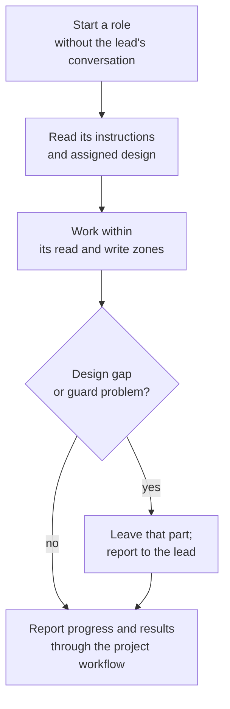

# Roles

## 1. Responsibilities

- Defines the lead and the limits every project-defined role keeps.
- Defines the role guard's input, decisions and output, including file parts and shell inspection.
- States what hand-offs and reports must preserve.

The settings form is in Layers and settings. The workflow and the five checks are in A change. Reproduction connects the guard to the available tools and checks what it can actually enforce.

## 2. Public interface

### The lead and the project-defined roles

| Role | Does | Reads | Writes |
|---|---|---|---|
| `lead` | talks with the user, writes intent and design, diagnoses, starts roles, reproduces the setup | intent, design, settings, work note; plumbline's rules when reproducing | intent, design, settings, work note, git exclusions, project parts of carriers and the template; setup files and setup record when reproducing |
| each entry in `roles.members` | its `duty`, through the project's workflow, using its selected `model` | its `read_zones` | its `write_zones` |

- A session plays one role. An explicitly started role must exist in the settings; an unknown name is an error, not the lead. A session started without another role is the lead.
- Every non-lead role starts as a new AI without the lead's conversation. Knowing intent cannot be undone by changing the role name.
- A role may read its own instructions, the settings and `.git/HEAD`, and inspect history only for its read zones. This does not permit reading another role's instructions, the work note, intent content in history, or raw repository contents outside its read zones. There is no general exemption for files outside the layers or inside `.git`.
- When work requires writing a project file outside every layer, the role leaves it and reports it. The lead asks the user which layer it belongs to, updates the settings and reproduces as needed before assigning the work. The lead's setup and bookkeeping writes in the table above are already assigned.

### Common limits

Every non-lead role:

- Never reads intent, a copy of it, or searches a folder containing it. The folder or copy being outside the project changes nothing.
- Never changes design. It writes only its write zones, and only its share of the assigned design.
- Leaves work outside its write zones and tells the lead what remains.
- Leaves a missing or wrong point in design unbuilt, reports the document and section title and what is missing or wrong, and continues independent work. Roles do not agree between themselves on a missing design decision.
- When blocked or unable to check a required guard, stops that operation and reports it. It does not bypass the guard through another tool or path.

The lead never reads impl. No role receives intent content in a hand-off. Reports to the lead describe results, gaps and findings in terms of design, without copying impl content; they may name impl locations. Direct messages between non-lead roles stay within the recipient's read zones. The workflow defines their routing and contents, who performs the five checks, and whether a design fix returns to the same AI or a new one (A change).

### The role guard

These restrictions are required for every non-lead role:

1. No intent read, including a search of an ancestor folder or a known copy.
2. No design write, including creation and deletion.

The settings additionally choose whether to enforce read zones and write zones, and how to inspect shell commands. A role's named zones are combined by union. A requested read or write passes a zone check only when all of the selected contents are allowed. A partial zone never grants access to the whole file by itself.

The restrictions still apply as instructions when mechanical enforcement is unavailable or a command is outside the chosen shell inspection. Reproduction records exactly what is checked and what remains an instruction; it never labels untested coverage as mechanical.

### File actions

The part's name is `role-guard`. It keeps the input, verdict and output contract in Conformance cases.

- Invocation: `role-guard ROLE ACTION PATH...`, where `ACTION` is `read` or `write`, and there is at least one path. A read of a folder means a search of its whole subtree. A connector may instead supply an exact, complete list of selected paths for a narrower search.
- Paths may be relative to the working directory (the project root) or absolute. Normalize `.` and `..` and resolve existing symbolic links, including the existing prefix of a new path. Compare complete path components, not text prefixes. Apply the same normalization to layer locations, zones and known copies.
- A read is blocked when its path belongs to intent or contains an intent location. There is no exemption for a parent directory outside the project. A design write is blocked whether its target exists or not.
- After the mandatory intent check, reads of the settings file, `.git/HEAD` and files in `instruction_paths` are allowed as setup reads. This exception grants no write permission.
- The lead passes these permission checks. An unknown role, unknown action, invalid input or missing or malformed settings gives `error`.
- When at least one target is forbidden, give `block`. Write one line per forbidden target, in argument order: `block`, normalized path, role, action, separated by tabs. Write paths relative to the project root, using `.` for the root and `..` for outside paths. Otherwise give `pass` and no result line. Tabs or line breaks in a path give `error`.

Standard input may be empty or one JSON object with only these optional fields:

| Field | Holds |
|---|---|
| `intent_copies` | paths known by the setup or tool to hold copies of intent; they are protected like intent locations |
| `instruction_paths` | exact carrier file paths supplied from the active setup for this role, including any shared dispatch-only carrier; never folders or a list proposed by the role |
| `ranges` | for `read` only: an object from an argument path to a nonempty list of `[start, end]` byte ranges that the operation will read |
| `edits` | for `write` only: an object from an argument path to a nonempty list of objects with exactly `start`, `end`, `text`, describing replacements against the current file |

Unknown keys or wrong value types give `error`. Both path-list fields default to empty lists. An omitted range or edit entry means the whole target. Entries for paths not in the arguments are invalid. Offsets are integers in UTF-8 bytes, start included and end excluded, on character boundaries. Ranges and edits are in order and do not overlap; two insertions at the same position are invalid. Edits are applied against the same original content, from the last position back to the first. Read ranges are nonempty. An edit with equal offsets inserts; an empty `text` deletes. New files have an empty initial content. Invalid offsets, unreadable files needed for a check, or an edit whose input has changed before it can be applied give `error` and require a new check. Reproduction records the content-stability check as an instruction when the available tool cannot preserve the checked operation until it is applied.

The connector supplies facts from the operation, not an AI's claim that it will touch only an allowed zone. The action applied must be the action checked. A whole-file replacement is checked as a whole-file write unless the connector can supply and preserve the exact replacements it represents.

### Recognizing file parts

Path and file-name matching uses Layers and settings, Zones. For a part-based zone, recognize its byte ranges in the current file. For an edit, also recognize them in the proposed result before any write occurs.

- A read must lie entirely in the union of allowed ranges.
- For an edit, every removed byte must be allowed in the current file, and every inserted byte must be allowed in the proposed file. Unchanged bytes outside the write zones are preserved, including which zones select them. An edit may not move a boundary to take ownership of other contents.
- Whole-file creation or deletion requires whole-file write permission. An exact edit may create or remove an allowed part without changing other contents.
- If another allowed zone already covers the whole target, a part recognizer is not needed for that target.

A command recognizer runs in the project root without a shell. It receives one JSON object on standard input, with exactly `path` (normalized path) and `content` (the UTF-8 text to inspect). It returns a JSON list of `[start, end]` ranges on standard output and exits with 0. Ranges are sorted, nonempty, disjoint, on character boundaries and within the supplied content. An empty list means no matching part. It examines only the supplied path and content; it does not use the network or read other project files. It is called separately for the current and proposed contents when needed. A missing program, nonzero exit, invalid result or no exit within 60 seconds gives `error`.

Marker recognition uses the exact-line method in Layers and settings, Zones. Line endings may be LF or CR LF; offsets remain offsets in the original bytes. A selected marker block includes the end marker's line ending when present. A malformed block gives `error` rather than treating the selection as the whole file.

Reproduction verifies custom recognizers against examples of selected and excluded contents, including boundary changes, using the project's chosen method. The shared guard cases use marker recognition so they do not depend on a project's programming language or custom program.

### Copies and indirect paths

Known copy locations come from setup or tool provenance, not from a non-lead role's assertion. For example, a tool that copies a file from intent can identify its destination as an intent copy. The guard does not scan file contents to find copies. A copy whose origin cannot be recognized remains forbidden by instruction, and that limit is reported during reproduction. Symbolic links and ancestor paths are handled by path normalization even without copy metadata.

### Shell commands

Invocation: `role-guard ROLE shell`, with no path arguments. Standard input is one JSON object with `command` (nonempty text), `cwd` (the command's working directory, absolute or relative to the project root), and optionally `intent_copies` and `instruction_paths` as defined for file actions. No other field is allowed. The guard inspects the command without executing it.

| Choice | Decision |
|---|---|
| `none` | give `pass` without inspecting file actions; permission rules remain instructions |
| `literal` | check file reads, searches and writes whose targets and effects can be identified directly from the command; block only a definite violation |
| `cautious` | check those same actions; also block a command when a possible forbidden action cannot be ruled out |

The reproducing AI chooses how to analyze commands. It must distinguish file operands from search patterns, options, revision names and ordinary text. Changing directory changes the base for later paths; it is not a file read. `git -C` sets a base too. Redirections are file actions. Variable expansion, command substitution and interpreter code are not executed to discover paths. A wildcard or unknown program is not by itself proof of a forbidden action in `literal` mode; in `cautious` mode unresolved file effects are blocked.

Identified file actions use the file permission checks above. A write with no exact replacement information is a whole-file write. For the lead, valid requests pass without permission restrictions, including unresolved shell effects.

A definite forbidden path gives the usual `block` line with `shell` as the action. Paths appear in their order in the command, once each. Unresolved effects in `cautious` mode add one final line `block-shell` and the role, separated by a tab. Such a line is not given when a definite violation already decides the command. Explain the reason in standard error. An unavailable analyzer or a failure of the inspection machinery is `error`, not a cautious block. When a command is understood but has unresolved effects, that is a policy decision, not an environment error.

### Reporting a guard result

On `block`, the connector tells the role in plain words what was blocked and why. On `error`, it reports the environment problem and does not turn it into `block`. The role stops the affected operation and reports it to the lead. The lead handles a design gap through A change, or explains what must be repaired or reproduced. The work is not retried unchanged in an endless blocking loop.

## 3. Flow

The lead starts a listed role with its selected model and role-specific instructions. It receives the design parts and task selected by the workflow. It does the permitted work, leaves and reports gaps or guard problems, and reports progress and results. After a design fix, work resumes with the same or a new AI as the workflow specifies. Independent work may continue while a gap is resolved.

## 4. Invariants and contracts

- Role names, duties, models and permissions come from settings. Only the lead is built in.
- Every non-lead role is isolated from intent and the lead's conversation, and never changes design.
- Every role stays within its permissions even when a guard is an instruction only.
- The lead can learn progress and completion of the five checks without reading impl.
- Every mechanical claim is supported by guard cases and checks through the actual connector (Reproduction).

## 5. Decisions and reasons

- Roles are started without the lead's conversation because an instruction cannot erase knowledge.
- Permissions are assigned to contents, not just files, so test and product work can share a file.
- Optional zone guards and the three shell choices let each project choose how much uncertainty it accepts from command inspection.
- Guard input describes the actual operation. Otherwise checking an allowed edit would not protect against a later, broader write.
- Unknown copies remain an explicit instruction limit; guessing their content would require reading the very material the role must not receive.

## 6. Verification criteria

The shared role-guard cases use intent `docs/intent.md`, design `docs/design`, impl `src` and `tests`. They declare `builder` and `tester`; both read design, `src` and `tests`. Builder writes all of `src`; tester writes `tests` and a part of `src/a.txt`. The part uses exact marker lines `BEGIN TESTS` and `END TESTS`. Both zone guards are on unless a case says otherwise.

File cases:

- Each non-lead role reads intent, searches `docs`, the project root, or its parent → `block`.
- Each non-lead role creates, edits or deletes a design path → `block`, even with both zone guards off.
- Reading `src/a.txt` and intent together → only the intent block line, in argument order.
- Builder reads design and writes `src/a.txt`; tester writes `tests/a.txt`; lead reads or writes intent or design → `pass`.
- Tester writes product content in `src/a.txt` → `block`; with write-zone enforcement off → `pass` from the guard, while the instruction still forbids it.
- A role with empty write zones writes impl → `block` with write enforcement on.
- Remove `tests` from builder's read zones: reading `tests/a.txt` → `block` with read enforcement on, `pass` with it off.
- Two roles with the same allowed write zone each write there → `pass`.
- A whole-tree search with only a partial-file or file-pattern zone cannot claim permission for excluded contents → `block`.
- A normalized `..` path or symbolic link that reaches intent → `block`; a supplied intent-copy path and a search of its parent → `block`.
- An unrelated outside path with read-zone enforcement off → `pass`. This grants no instruction-level permission to read it.
- Reading the settings, `.git/HEAD` or a file in trusted `instruction_paths` → `pass`; reading an unrelated setup file with read guards on → `block`. If an instruction path resolves to intent, the mandatory intent check still gives `block`.

Part cases use `product\nBEGIN TESTS\nold\nEND TESTS\n`, whose allowed range is `[8, 34]`:

- Tester replaces bytes `[20, 23]` with `new` → `pass`; replaces `[0, 7]` → `block`.
- A role that reads only the part reads `[20, 23]` → `pass`; reads the whole file → `block`.
- A whole-file replacement or deletion by tester → `block`.
- Moving markers to include unchanged product content → `block`. Malformed markers in a required current or proposed selection → `error`.
- Neither marker present → an empty selection; repeated, reversed or single markers → `error`.
- With CR LF, the same logical selection and edit pass using the corresponding byte offsets. A multibyte character split by an offset → `error`.

Shell cases run as `builder`, with `cwd` at the project root. In this table, `block-shell` means verdict `block` with the unresolved-command result line:

| Command | `none` | `literal` | `cautious` |
|---|---|---|---|
| `cat docs/intent.md` | pass | block | block |
| `printf x > docs/design/new.md` | pass | block | block |
| `cd . && git log -- src/a.txt` | pass | pass | pass |
| `git -C . log -- src/a.txt` | pass | pass | pass |
| `grep -r --include='*.md' needle docs/design` | pass | pass | pass |
| `grep 'docs/intent.md' src/a.txt` | pass | pass | pass |
| `cat "$TARGET"` | pass | pass | block-shell |
| `unknown-program .` | pass | pass | block-shell |

Also check a changed `cwd`, an intent path spelled with `..`, a variable inside an interpreter command, and a file wildcard that may reach intent. The first two must resolve explicit forbidden paths; unresolved effects pass in `literal` mode and block in `cautious` mode.

Error cases include an unknown role, missing paths, malformed settings or request, invalid ranges, unavailable recognition program, malformed recognition output and a recognition timeout. They report `error`, never substitute default roles or whole-file permissions.

Reproduction separately checks custom recognition, the command analyzer and actual connector coverage. Hand-off isolation, reports, workflow and instruction-only limits need judgment and are checked through the five checks (A change).

## 7. Out of scope

Finding every unmarked copy of intent, proving the effects of arbitrary programs, and guaranteeing that an AI obeys instructions through an unconnected tool.
