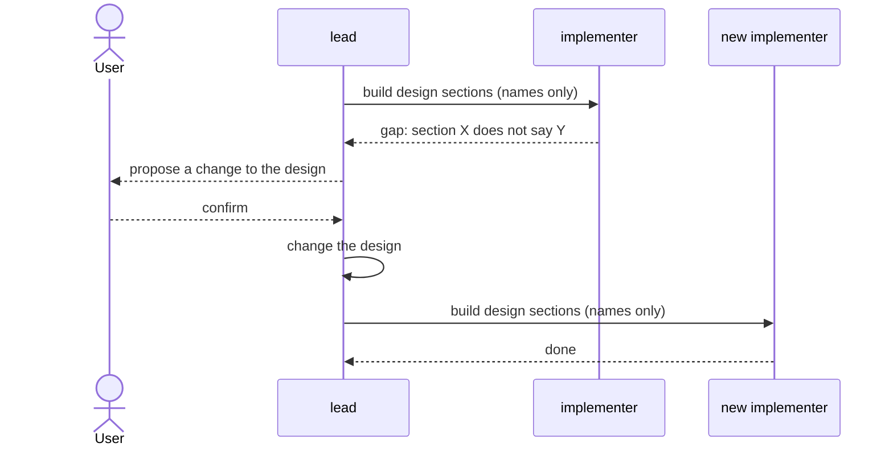

# roles

> Basis: intent 1.2 — §4 (principles 2, 3), §8.2 (who diagnoses), §8.4, §8.5 (who writes intent and design).

## 1. Responsibilities

**Does**: defines the three roles that work in a project: what each does, which layers and files it may read and write, which roles start fresh, how work is handed from the lead to an implementer, and how a gap travels between roles.

**Does not**:

- Enforce any of this. `guards` does where an agent has the means (M2). Elsewhere the rules reach agents as instructions (`carriers`).
- Define change records and gap items. `changes` does (M1).
- Word the instructions agents receive. `carriers` does.

## 2. Public interface

### The roles

| Role | Does | Reads | Writes |
|---|---|---|---|
| `lead` | talks with the user; writes intent and design with the user; opens and closes changes; records gaps; edits the settings and reproduces the setup | intent, design, setup files | intent, design, change records, settings, setup files |
| `implementer` | builds the design sections it is given into impl; answers questions about impl | design, impl, its own carrier | impl |
| `verifier` | checks impl against design | design, impl, its own carrier | check results in change records |

- Setup files are what a reproduction writes and keeps: rule carriers, document templates, guards, checks, the setup record. They are not a layer.
- The lead never reads impl. The implementer never reads intent, and never writes intent or design. The verifier writes nothing but check results.

### Fresh agents

- The implementer and the verifier start without the lead's conversation.
- One implementer serves one hand-off. Work after a design change always goes to a new implementer.
- One verifier serves one check.

### Hand-off

- The lead hands work to an implementer by naming design sections: a design document and the sections in it.
- The hand-off never carries intent content.
- A question about impl from the user goes from the lead to an implementer in the same way. The answer comes back to the lead.

### A gap found by the implementer

1. The implementer stops work on that point and reports the gap to the lead, in terms of the design: which section, and what it does not say or says wrongly.
2. The lead records it (`changes`, M1) and proposes the change to the user.
3. After the user confirms, the lead changes the design, or intent first when the gap is at intent's level.
4. A new implementer continues the work.

### Diagnosis

The lead opens a change and diagnoses which layer is wrong from what the user said and from intent and design. When telling requires impl, the lead asks an implementer (`changes`, M1).

## 3. Flow

## 4. Invariants and contracts

- No role reads or writes outside its row in the table.
- No hand-off and no question to an implementer carries intent content.
- Work after a design change goes to a new implementer.
- A gap goes from the implementer to the lead, and from the lead to the user. The implementer never settles it.

## 5. Decisions and reasons

- **The lead never reads impl; the implementer never reads intent; implementers and verifiers are fresh.** intent §8.4. A conversation that has read intent cannot test whether the design is enough.
- **The implementer never writes design.** intent §8.4. Otherwise a gap could be settled below.
- **Setup files are not a layer; the lead writes them, and edits the settings.** Reproducing a setup and choosing settings happen in the conversation with the user. They read and write no layer content, so they do not break the read direction. (Design-level — confirmed 2026-10-17)
- **One implementer per hand-off.** intent says a new implementer starts after a gap. Using a new one for every hand-off keeps the rule simple and keeps earlier work out of the next one's context. Rejected: reusing an implementer until a gap appears, which leaves the boundary to judgment. (Design-level — confirmed 2026-10-17)
- **A gap is reported in terms of the design.** The implementer has read only design and impl, so it can name only what the design does not say. The lead turns that into a proposal, adding intent when needed. (Design-level — confirmed 2026-10-17)
- **The hand-off names a design document and its sections.** A name the implementer can open is enough, and it cannot carry intent content by accident. (Design-level — confirmed 2026-10-17)

## 6. Verification criteria

- The role guard (`guards`, M2) lists conformance cases for every cell of the Reads and Writes columns, for example:
  - must-block: the implementer reads an intent file; the implementer writes a design file; the lead reads an impl file; the verifier writes an impl file;
  - must-pass: the implementer reads a design file; the implementer reads its own carrier; the lead writes a design file; the verifier writes a check result in a change record.
- Until then, the rule carriers (`carriers`) state the table as instructions, and the setup record says that it is not enforced mechanically.

## 7. Out of scope

- Enforcing the table (`guards`, M2).
- Change records, gap items and diagnosis records (`changes`, M1).
