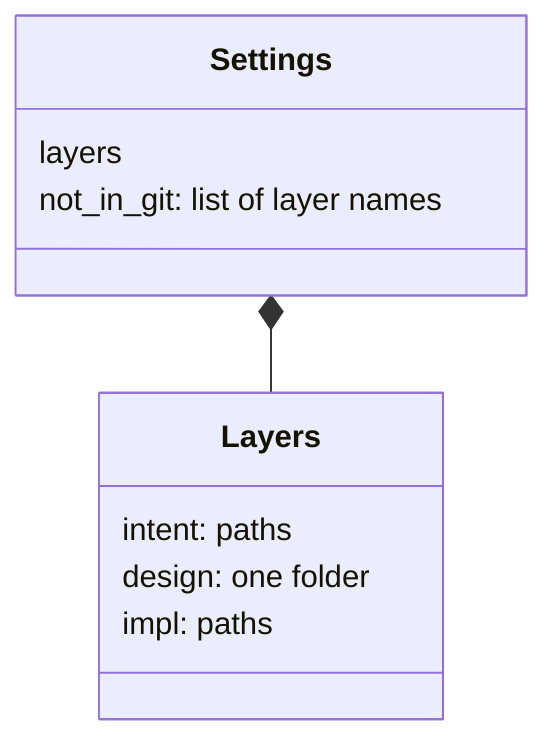
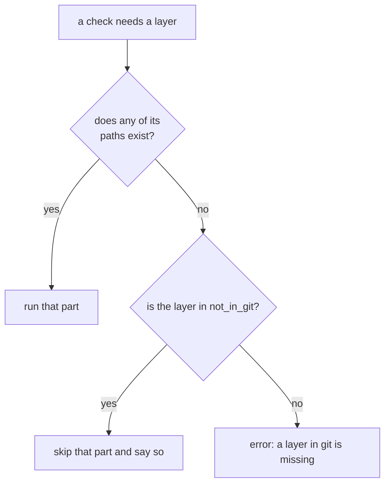

# settings

> Basis: intent 1.2 — §3, §5.2 (settings apart from the record), §7.

## 1. Responsibilities

**Does**: defines the project settings: the only two values a reproduction and the checks need that differ from project to project. Defines the file that holds them and its format, how a layer is kept out of git, what may never be copied out of such a layer, and what a check does when a layer is not present.

**Does not**:

- Hold anything a project decides in its own intent and design: natural language, comment policy, design layout and naming, kinds of figures, milestone names, project-specific consistency checks.
- Hold what a reproduction used and produced. `setup-record` does.
- Write `.git/info/exclude`. `reproduction` does, from these settings.

## 2. Public interface

### The file

- `.plumbline/settings.json` at the project root. People edit it. It is in git.
- `.plumbline/` is the one folder for everything plumbline keeps in a project: these settings, the setup record (`setup-record`), and change records (`changes`, M1).

### The format

A JSON object with exactly two keys:

```json
{
  "layers": {
    "intent": ["docs/intent.md"],
    "design": ["docs/design"],
    "impl": ["src", "tests"]
  },
  "not_in_git": ["intent"]
}
```

| Key | Value |
|---|---|
| `layers` | An object with exactly the keys `intent`, `design`, `impl`. Each value is a non-empty list of paths. |
| `not_in_git` | A list of layer names that are kept out of git. Empty when every layer is in git, which is the default. |

Paths:

- A path is relative to the project root and uses `/`.
- A path names a file or a folder. A folder means everything under it.
- `design` has exactly one path, and it is a folder. Its top-level `README.md` is the design's README (`design-docs`).
- No path of one layer lies inside, or contains, a path of another layer.

Any other key, anywhere in the object, is an error.

### A layer not in git

- Every path of a layer named in `not_in_git` is listed in the project's `.git/info/exclude`. The reproduction adds them.
- The content of a layer not in git is never copied into any file that is in git: design documents, change records, rule carriers, the setup record. Only its location may be cited: a document path, a version, a section.
- A check that needs a layer that is not present skips that part and says it skipped it. A layer is not present when none of its paths exist.
- A layer that is not in git has no git history. How its history is kept is the project's choice.

## 3. Flow



What a check does with a layer:



## 4. Invariants and contracts

- The settings hold exactly `layers` and `not_in_git`.
- All three layers have at least one path. `design` has exactly one, a folder.
- Paths of different layers never overlap.
- After a reproduction, every path of a layer in `not_in_git` is in `.git/info/exclude`.
- Nothing from a layer not in git is copied into a file in git.

## 5. Decisions and reasons

- **Exactly two settings.** intent §7. What else differs between projects belongs to each project's own intent and design.
- **Everything else a project decides is not a setting.** intent §7.
- **Content of a layer not in git is never copied out; its location may be cited.** intent §7.
- **The settings are a JSON file.** The language of the checks is not fixed, and JSON is read without a library by the runners projects commonly have. Rejected: YAML and TOML, which many runners cannot read without one. (Design-level — confirmed 2026-10-17)
- **One folder, `.plumbline/`, holds everything plumbline keeps in a project.** A project can see at a glance what belongs to the method, and the change records (M1) have a place from the start. (Design-level — confirmed 2026-10-17)
- **Unknown keys are an error.** It keeps the settings to the two values the method needs. A value a project wants to add belongs in its own intent or design. (Design-level — confirmed 2026-10-17)
- **`design` is exactly one folder.** The design needs one top-level README, so it needs one root. (Design-level — confirmed 2026-10-17)
- **A missing layer that is in git is an error, not a skip.** Skipping is only for layers a project chose to keep out of git. Otherwise a deleted design folder would pass every check. (Design-level — confirmed 2026-10-17)

## 6. Verification criteria

`reproduction` (M0) stops on invalid settings. `status` (M1), `guards` and `validate` (M2) read the settings and list conformance cases for the parts they use. Across them:

- the example in section 2 is valid;
- a missing `layers` key, a missing layer, an empty path list, a second `design` path, or a `design` path that is a file is an error;
- a path of `impl` inside the `design` folder is an error;
- an unknown key at any level is an error;
- with `intent` in `not_in_git` and no intent file present, a check that needs intent skips that part and says so;
- with `intent` not in `not_in_git` and no intent file present, a check that needs intent reports an error.

## 7. Out of scope

- The check that a file of a layer not in git is tracked by git (`validate`, M2).
