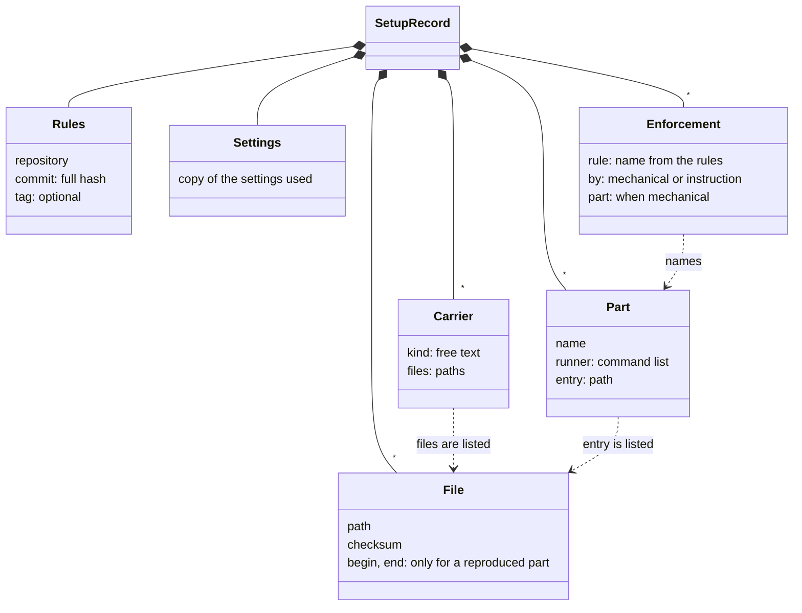
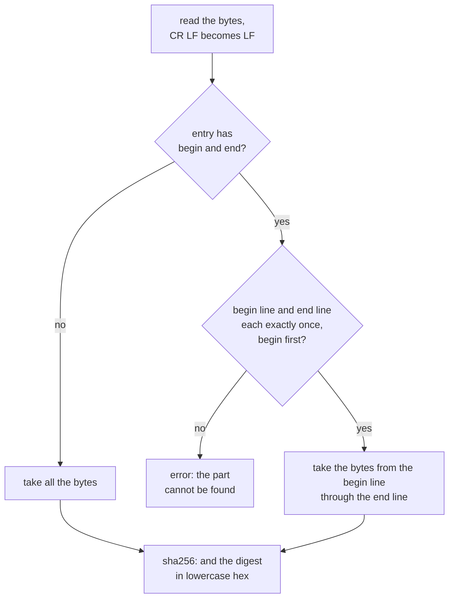
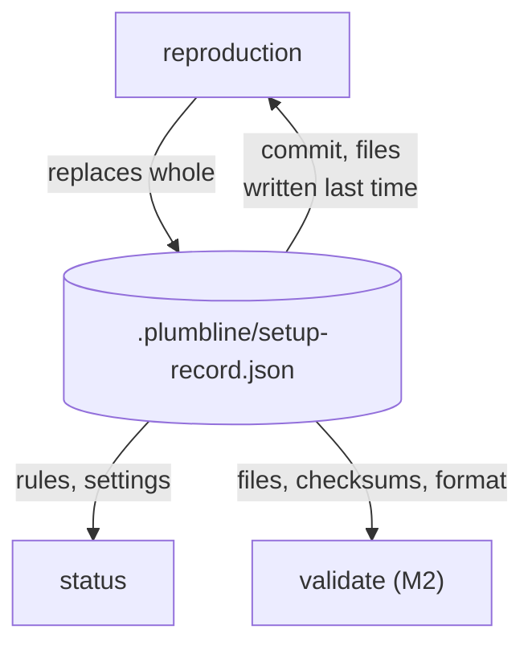

# setup-record

> Basis: intent 1.2 — §5.1 (the rules are not copied; reproduced files; reproduced and project parts), §5.2, §5.4 (carriers and enforcement are recorded), §5.5 (runners are recorded), §8.3 (what validate checks against the record).

## 1. Responsibilities

**Does**: defines the setup record: the one file in which a reproduction writes what it used and what it produced. Defines its place, its format and every field, how the checksum of a reproduced file is computed (also when the reproduction wrote only part of a file), and when two copies of the settings count as the same.

**Does not**:

- Decide what a reproduction writes, which rule carriers and runners it chooses, or which lines mark a reproduced part. `reproduction` and `carriers` do.
- Hold the settings people edit. `settings` does. The record holds a copy of the settings a reproduction used.
- Check the record, or the files against it. `validate` does (M2). Report from it. `status` does.
- Hold the rules. The record points at them.

## 2. Public interface

### The file

- `.plumbline/setup-record.json` at the project root.
- Only a reproduction writes it. Each reproduction replaces it whole. Nobody edits it by hand.
- It is in git, and so is every file it lists. validate in CI compares those files with their checksums, without the rules or the conformance cases.

### The format

A JSON object with exactly these keys:

```json
{
  "rules": {
    "repository": "https://github.com/OWNER/plumbline",
    "commit": "0123456789abcdef0123456789abcdef01234567",
    "tag": "v0.1"
  },
  "settings": {
    "layers": {
      "intent": ["docs/intent.md"],
      "design": ["docs/design"],
      "impl": ["src", "tests"]
    },
    "not_in_git": ["intent"]
  },
  "files": [
    {
      "path": "INSTRUCTIONS.md",
      "checksum": "sha256:0f8ffbd6cd643eb1b595ee683fc34eef9d208436d1ecbf35585077d17151e2d7",
      "begin": "<!-- plumbline:begin -->",
      "end": "<!-- plumbline:end -->"
    },
    {
      "path": ".plumbline/lead.md",
      "checksum": "sha256:bb5e6a13ff86dc4f333bbef04ca0657bfebcbc2b173a2a42aedd4d1e849e3d3e"
    },
    {
      "path": ".plumbline/implementer.md",
      "checksum": "sha256:d7643b3243eb56482b2b34a8dde980201d3787e34475476743fd182667eec2bd"
    },
    {
      "path": ".plumbline/template.md",
      "checksum": "sha256:ea86728e0c9f2933951b83eea2a0b9a9e30b4aa03de63621d1e8c59f8618e15d",
      "begin": "<!-- plumbline:begin -->",
      "end": "<!-- plumbline:end -->"
    }
  ],
  "carriers": [
    { "kind": "instruction file, reproduced part: the roles and where each role's rules are", "files": ["INSTRUCTIONS.md"] },
    { "kind": "file the instruction file names for the lead", "files": [".plumbline/lead.md"] },
    { "kind": "file the instruction file names for the implementer", "files": [".plumbline/implementer.md"] }
  ],
  "parts": [],
  "enforcement": [
    { "rule": "role table", "by": "instruction" }
  ]
}
```

| Key | Value |
|---|---|
| `rules` | where the rules came from |
| `settings` | a copy of the settings the reproduction used, in the format of `settings` |
| `files` | every file the reproduction wrote, except the record itself and `.git/info/exclude` |
| `carriers` | the rule carriers the reproduction chose |
| `parts` | the mechanical parts of the setup, and how each is run |
| `enforcement` | for each rule that the rules allow to be enforced mechanically, whether it is |

Any other key, anywhere in the object, is an error.

A record is valid when it follows everything this section says about its keys and values. Whether the files it lists still match their checksums has no bearing on whether the record is valid. Its copy of the settings is checked against the format of `settings` without looking at the file system: whether a path exists, or is a file or a folder, has no bearing either.

#### `rules`

| Key | Value |
|---|---|
| `repository` | the plumbline repository the rules were read from, as the user gave it |
| `commit` | the full hash of the commit the rules were read at: 40 or 64 lowercase hexadecimal digits |
| `tag` | optional. A tag that named that commit when the reproduction ran. It is for people; the commit is what counts |

#### `files`

A list with one object per file. No path appears twice.

| Key | Value |
|---|---|
| `path` | relative to the project root, with `/` |
| `checksum` | `sha256:` followed by 64 lowercase hexadecimal digits |
| `begin`, `end` | only for a file the project also writes: the exact text of the line that opens the reproduced part and of the line that closes it |

An entry without `begin` and `end` is a whole file: the reproduction wrote all of it. An entry with both is a reproduced part: the reproduction wrote the lines from `begin` to `end`, and the rest of the file is the project's.

#### `carriers`

A list with one object per rule carrier.

| Key | Value |
|---|---|
| `kind` | what the carrier is, in the reproducing agent's words: an instruction file, a file it refers to, a script a hook runs, a skill, and so on |
| `files` | the paths that make up the carrier. Each is listed in `files` |

#### `parts`

A list with one object per mechanical part: a guard or a deterministic check.

| Key | Value |
|---|---|
| `name` | the part's name, as the module that defines the part names it |
| `runner` | the command that runs the part, as a list: the program and any arguments it needs before the entry file |
| `entry` | the path of the file the runner runs. It is listed in `files` |

A part is run as its `runner`, then its `entry`, then the part's own arguments (`conformance`).

#### `enforcement`

A list with one object per rule that the rules allow to be enforced mechanically.

| Key | Value |
|---|---|
| `rule` | the rule's name, as the rules give it |
| `by` | `mechanical` or `instruction`. A rule is `mechanical` only when its part passed every case and acting through its connector gave the expected results (`conformance`, `reproduction`). Otherwise it is `instruction` |
| `part` | only when `by` is `mechanical`: the `name` of the part in `parts` that enforces it |

Every other rule reaches agents as an instruction and is not listed.

### Checksums

To compute the checksum of a listed file:

1. Read the file's bytes and replace every CR LF pair with LF.
2. For a whole file, take all the bytes.
3. For a reproduced part, split the bytes into lines at LF. The line equal to `begin` and the line equal to `end` each occur exactly once in the file, `begin` first. Take the bytes from the start of the `begin` line to the end of the `end` line, with the `end` line's LF when it has one.
4. The checksum is `sha256:` followed by the SHA-256 digest of the bytes taken, in lowercase hexadecimal.

If the `begin` line or the `end` line is missing, occurs more than once, or the `end` line comes first, the reproduced part cannot be found. That is an error, not a mismatch.

A file has at most one entry, so at most one reproduced part. A file the project also writes can hold a reproduced part only if it can hold those two lines. Otherwise a reproduction writes it whole or does not write it.

### The same settings

The settings in the record and the settings file are the same when every layer has the same set of paths and `not_in_git` names the same set of layers. Order and formatting do not count.

## 3. Flow



Computing a checksum:



Who writes and who reads the record:



- A reproduction reads the record it is about to replace: the commit, when the user names none, and the files written last time.
- status reports the setup's rules version and whether the settings changed since the reproduction.
- validate checks the record's format and every listed file's checksum.

## 4. Invariants and contracts

- Only a reproduction writes the record, and it replaces it whole.
- The record and every file it lists are in git.
- The record and every file it lists lie outside every layer location (`settings`).
- Right after a reproduction, every listed file exists and its checksum matches.
- No path is listed twice in `files`. Every path in `carriers` and `parts` is listed in `files`.
- Every `mechanical` entry in `enforcement` names a part in `parts`.
- The record holds nothing from a layer not in git. Its copy of the settings holds only paths and layer names.
- The record holds no copy of the rules.

## 5. Decisions and reasons

- **The record holds where the rules came from, the settings used, the reproduced files with their checksums, the carriers, the runners, and which rules are enforced mechanically.** intent §5.2.
- **The commit hash is what counts; a tag is for people.** intent §5.2.
- **The settings stay a file of their own, apart from the record.** intent §5.2.
- **The record is `.plumbline/setup-record.json`, a JSON file.** For the same reasons as the settings file: JSON is read without a library, and `.plumbline/` already holds what plumbline keeps in a project. (Design-level — confirmed 2026-10-17)
- **The record copies the whole settings, and the two are compared as sets.** status can then say what changed, not only that something did. The settings hold only paths and layer names, so the copy carries nothing from a layer not in git. (Design-level — confirmed 2026-10-17)
- **Checksums are SHA-256, taken after CR LF is turned into LF.** SHA-256 comes with the standard library of common runners and as a command on common systems. Git may change line endings when it checks a file out, which would otherwise change a checksum from one machine to another. (Design-level — confirmed 2026-10-17)
- **A reproduced part is marked by a begin line and an end line that the record names, with one part per file.** Comment syntax differs from one file type to another, so the rules cannot fix the lines. The reproducing agent chooses them and the record names them, so validate finds the part without knowing the file type. Rejected: fixed marker text, which some file types cannot hold; a checksum over the whole file, which would report the project's own edits. (Design-level — confirmed 2026-10-17)
- **The record and every file it lists are in git, and outside every layer location.** validate in CI needs both the files and the checksums. Setup files are not a layer (`roles`), so none of them lies at a layer location. (Design-level — confirmed 2026-10-17)
- **A carrier's kind is free text, and a rule's name is the one the rules give it.** The rules cannot name a coding agent's means, so the kind of a carrier is the reproducing agent's own description. No check compares these values; they are for people. (Design-level — confirmed 2026-10-17)
- **Each part records a runner, as a command list, and an entry file.** Every caller, the conformance cases included, needs only these two to run a part. The runner can differ from part to part, because each must be present only where its part runs. (Design-level — confirmed 2026-10-17)
- **The record holds no time.** Reproducing again with the same rules and settings then leaves the record as it was, and git shows no change. (Design-level — confirmed 2026-10-17)

## 6. Verification criteria

- After a reproduction, every file in `files` exists and its checksum matches (intent §11, M0).
- Checksums:
  - an empty whole file has `sha256:e3b0c44298fc1c149afbf4c8996fb92427ae41e4649b934ca495991b7852b855`;
  - a whole file holding `a` CR LF `b` CR LF and one holding `a` LF `b` LF both have `sha256:911169ddaaf146aff539f58c26c489af3b892dff0fe283c1c264c65ae5aa59a2`;
  - a reproduced part made of the lines `<!-- plumbline:begin -->`, `rule one`, `<!-- plumbline:end -->`, each ending in LF, has `sha256:0feea6f5b44d05e5c486ab443fce6ba01ec0951d9ee6c24d79a907c3758e9f67`, whatever project lines come before and after it; with `rule two` in place of `rule one` it has `sha256:372194c54600515e210c907b2e0b3ffc3381da531960057b83ac9ae667b1f878`;
  - a reproduced part whose `begin` line occurs twice, or whose `end` line is missing, is an error.
- The same settings: `["src", "tests"]` and `["tests", "src"]` for `impl` are the same; adding a path, or adding a layer to `not_in_git`, is not.
- `validate` (M2) lists conformance cases for the record's format. Among them: an unknown key, a commit of 39 digits, a checksum without `sha256:`, a path listed twice, a carrier file that is not listed in `files`, and a `mechanical` entry without a part are errors.

## 7. Out of scope

- Checking the record's format and the checksums (`validate`, M2).
- Mechanical parts in `parts` and `enforcement` added in M2: the role guard and validate. In M1, `parts` holds `status` and `gap-guard`, and `enforcement` lists the role table, enforced by `instruction`, and the gap guard.
