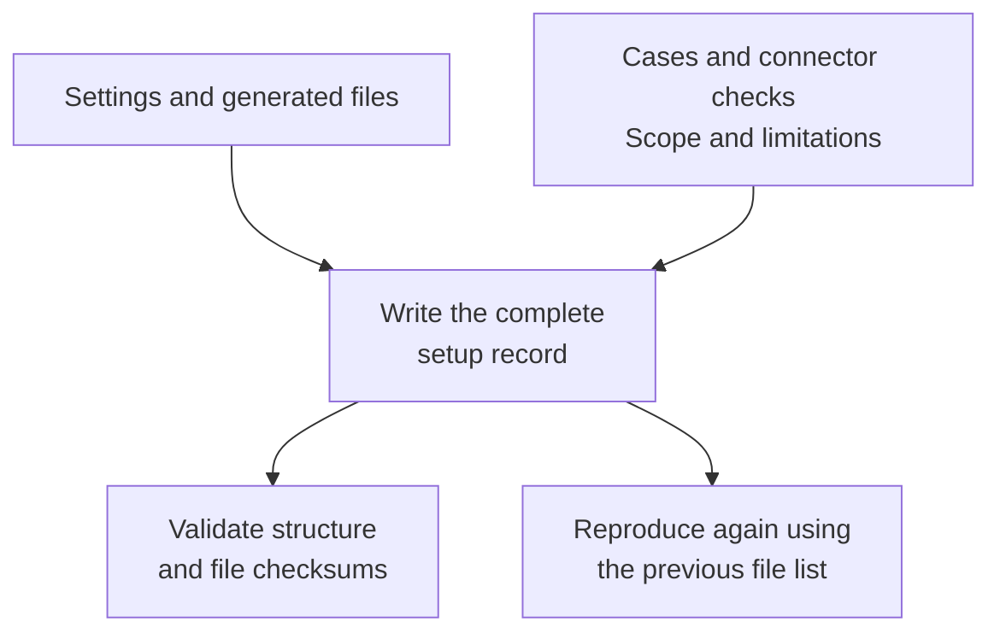

# Setup record

## 1. Responsibilities

- Defines the setup record, including the settings snapshot, role carriers and actual enforcement coverage.
- Defines file checksums and the references that validate can check.

Reproduction writes the record and verifies its claims through the actual tools. Validate checks its form and file checksums.

## 2. Public interface

### The file

- It is `.plumbline/setup-record.json`.
- Only reproduction writes it, replacing the whole record each time. It is not edited by hand.
- It and every file it lists are kept in git.

### The form

One JSON object with exactly the keys below. The example uses one project-defined role. Paths, commands, checksums and evidence are illustrative, not default settings or actual test results.

```json
{
  "rules": {
    "repository": "https://github.com/OWNER/plumbline",
    "commit": "0123456789abcdef0123456789abcdef01234567"
  },
  "settings": {
    "layers": {"intent": ["docs/intent.md"], "design": ["docs/design"], "impl": ["src"]},
    "not_in_git": ["intent"],
    "roles": {
      "zones": [
        {"name": "design", "layer": "design", "paths": ["docs/design"]},
        {"name": "product", "layer": "impl", "paths": ["src"]}
      ],
      "members": [{
        "name": "builder", "read_zones": ["design", "product"], "write_zones": ["product"],
        "duty": "Build assigned design and perform the five checks.", "model": "PROJECT_MODEL"
      }],
      "guard": {"read_zones": false, "write_zones": true, "shell": "literal"}
    }
  },
  "files": [
    {"path": "LEAD_INSTRUCTIONS.md", "checksum": "sha256:0000000000000000000000000000000000000000000000000000000000000000",
     "begin": "<!-- plumbline:begin -->", "end": "<!-- plumbline:end -->"},
    {"path": "BUILDER_INSTRUCTIONS.md", "checksum": "sha256:1111111111111111111111111111111111111111111111111111111111111111"},
    {"path": ".plumbline/parts/role-guard", "checksum": "sha256:2222222222222222222222222222222222222222222222222222222222222222"},
    {"path": ".plumbline/parts/validate", "checksum": "sha256:3333333333333333333333333333333333333333333333333333333333333333"}
  ],
  "carriers": [
    {"kind": "instruction file", "files": ["LEAD_INSTRUCTIONS.md"], "roles": ["lead"]},
    {"kind": "instruction file", "files": ["BUILDER_INSTRUCTIONS.md"], "roles": ["builder"]}
  ],
  "parts": [
    {"name": "role-guard", "runner": ["RUNNER"], "entry": ".plumbline/parts/role-guard"},
    {"name": "validate", "runner": ["RUNNER"], "entry": ".plumbline/parts/validate"}
  ],
  "renderers": [],
  "enforcement": [
    {"rules": ["intent-read", "design-write", "write-zones"], "roles": ["builder"], "channel": "file",
     "by": "mechanical", "part": "role-guard", "scope": "Connected file read, search and write tools",
     "limits": ["Unconnected tools and intent copies without known provenance remain instructions"],
     "evidence": "All role-guard cases at the recorded commit passed; allowed and forbidden operations checked through each connected tool"},
    {"rules": ["read-zones"], "roles": ["builder"], "channel": "file",
     "by": "instruction", "scope": "Reads outside the assigned zones", "limits": ["Read-zone enforcement was not requested"]},
    {"rules": ["intent-read", "design-write", "read-zones", "write-zones"], "roles": ["builder"], "channel": "shell",
     "by": "instruction", "scope": "Shell commands", "limits": ["No shell hook is available"]}
  ]
}
```

| Key | Holds |
|---|---|
| `rules` | the source repository and commit |
| `settings` | the complete settings used by reproduction, including zones, members and guard choices, in the form defined by Layers and settings |
| `files` | every file reproduction wrote, except this record and `.git/info/exclude` |
| `carriers` | rule carriers and the roles they reach |
| `parts` | mechanical parts and their runners |
| `renderers` | available figure renderers |
| `enforcement` | verified mechanical coverage and instruction limits for each role, rule and channel |

All keys are required. The last five values are lists; lists may be empty only where their contracts allow it. Every object uses only its documented fields and types. Role references are checked against this record's settings snapshot, not against later changes to the live settings.

#### `rules`

| Key | Holds |
|---|---|
| `repository` | a repository address usable from other machines: `<scheme>://` with a scheme other than `file`, or `<user>@<host>:<path>`; not a local path |
| `commit` | the full commit hash, 40 or 64 lowercase hexadecimal digits |
| `tag` | optional text: a tag naming that commit at reproduction time, for people; the commit remains authoritative |

#### `files`

One entry per file, with a unique project-relative `path` using `/` and a `checksum` of `sha256:` followed by 64 lowercase hexadecimal digits. Paths have no absolute prefix, empty component, `.` or `..`.

For a file the project also writes, add both `begin` and `end`: distinct, nonempty strings giving the exact opening and closing marker lines, without line endings. The checksum covers that part, including its markers. Without them it covers the whole file. Having just one marker field is invalid. Each file has at most one reproduced part.

#### `carriers`

Each entry has `kind` (nonempty descriptive text), `files` (a nonempty list of distinct paths listed in `files`) and `roles` (a nonempty list of distinct role names). Valid names are `lead` and the members in the settings snapshot. Every one of those roles is reached by at least one carrier.

A shared carrier may reach several roles, but Roles and Reproduction still restrict which instructions each role receives. Listing a shared carrier does not give a role permission to read another role's instructions. The project workflow stays in the carriers' project parts; its text is not copied into the record.

#### `parts`

Each entry has a unique, nonempty `name`, a nonempty command list `runner`, and an `entry` path listed in `files`. The module defining the part supplies its name: `role-guard` or `validate`. Both parts are recorded even if no connector can enforce a guard. Run a part as its runner, entry file and own arguments, in that order (Conformance cases).

Custom recognizers and analyzers written during reproduction are included in `files`. They are helpers, not additional parts with the common verdict contract. Their invocation and behavior follow Roles.

#### `renderers`

Each entry has a unique `figure` name from the template and a nonempty `command` list. Include only figure kinds with an available renderer. A reproduced file invoked by the command is listed in `files`.

The renderer runs from the project root, with the figure source between the fences on standard input. Exit 0 means it rendered; another exit means it did not. A renderer that cannot start counts as absent.

#### Commands

The `runner` and `command` lists contain strings and no absolute paths. Their first element is a nonempty program name found on PATH, without `/` or `\`. No element starts with `/` or `\`, or a letter followed by `:` and `/` or `\`.

#### `enforcement`

An entry groups roles and rules only when they share the same coverage and limitations.

| Field | Holds |
|---|---|
| `rules` | a nonempty list of distinct names: `intent-read`, `design-write`, `read-zones`, `write-zones` |
| `roles` | a nonempty list of distinct member names from the settings snapshot; never `lead` |
| `channel` | `file` for file tools, or `shell` for shell commands |
| `by` | `mechanical` or `instruction` |
| `scope` | nonempty text naming the tools, operations and content covered |
| `limits` | a list of nonempty descriptions of what remains instruction-only; may be empty if no further limit applies |
| `part` | required only for `mechanical`: `role-guard`, present in `parts` |
| `evidence` | required only for `mechanical`: nonempty text identifying the passed cases and the actual connector checks that support the stated scope |

Expand each entry into its rule × role × channel combinations. Every non-lead role has exactly one entry for each of the four rules on each of the two channels. Missing or duplicate combinations are invalid. With no non-lead roles, the list is empty. `intent-read` and `design-write` apply to every non-lead role; the other rules describe its configured zones.

`mechanical` applies only within the described, tested scope. Everything outside it remains an instruction. A requested guard is not evidence: cases must pass, and actual connected tools must demonstrate the allowed and forbidden operations for all listed roles. Partial-file coverage must state its recognition and checked-edit guarantees. Limits include unavailable recognition, unconnected tools, intent copies with unknown provenance and any inability to preserve a checked edit until application. `instruction` entries give the reason in a nonempty `limits` list and have neither `part` nor `evidence`.

Disabled zone guards cannot be recorded as mechanical for that zone rule. With shell choice `none`, all shell entries are instructions. Otherwise mechanical shell scope describes the selected `literal` or `cautious` behavior, not proof of arbitrary program effects. Roles remain bound by their permissions regardless of these entries.

### Previous records

A record from older rules is not silently converted into this form. Reproduction may read its documented old form to recover generated files, marker boundaries and reusable tool choices, but must obtain the current role settings instead of inventing missing roles. Validate reports `record` for a record that does not satisfy the current form. A valid snapshot may differ from current settings; that difference does not make its role references invalid. Settings changes still require reproduction.

### Checksums

1. Read the file's bytes and turn every CR LF into LF.
2. For a whole file, take all the bytes.
3. For a reproduced part, split the bytes into lines at LF. The line equal to `begin` and the line equal to `end` each occur exactly once in the file, `begin` first. Take the bytes from the start of the `begin` line to the end of the `end` line (with the `end` line's LF, when it has one).
4. The checksum is `sha256:` followed by the SHA-256 of the bytes taken, in lowercase hexadecimal.

When the `begin` line or the `end` line is missing, occurs more than once, or `end` comes first, the reproduced part cannot be found. That is not the same as a checksum that differs.

## 3. Flow



1. Reproduction writes the setup, passes every conformance case and checks the actual connectors. Unavailable or unverified coverage stays instruction-only.
2. It records the settings snapshot, generated files and checksums, role carriers, commands and coverage, replacing the whole record.
3. Validate checks the record's structure and compares the listed file checksums. A later reproduction uses the previous record to identify what it generated before.

## 4. Invariants and contracts

- Only a reproduction writes the setup record.
- Every file in `files` was written by the reproduction, and every file the reproduction wrote (except the setup record and `.git/info/exclude`) is in `files`.
- Every file named in `carriers`, `parts` and `renderers` is in `files`.
- A file has at most one reproduced part.
- Every role has a carrier, and every non-lead rule–role–channel combination is accounted for exactly once.
- Mechanical claims are bounded by the recorded scope and evidence; unchecked coverage remains an instruction.

## 5. Decisions and reasons

- The commit is what counts; the tag is added for people. A commit never changes.
- The repository address must be reachable from other machines, so that a clone or another machine can reproduce again.
- Commands hold no absolute path. Paths differ between machines, and the record would fit only one machine.
- Checksums are computed with line ends turned into LF. A change only in line ends, from the operating system or git settings, is not an edit by hand.
- A reproduced part's checksum covers only that part. The rest is where the project edits.
- The settings snapshot gives old role references a stable meaning. Coverage is recorded separately from requested guards because tools may enforce only part of what was requested.

## 6. Verification criteria

Shown by validate's conformance cases (Validate).

- A setup record with the right form → no problem.
- A custom role roster, including no non-lead roles, with matching carriers and coverage → no problem. Live settings may have changed since that snapshot.
- Unknown carrier roles, missing role carriers, invalid file or part references, missing or duplicate enforcement combinations, or mechanical claims incompatible with the snapshot's guard choices → `record`.
- A mechanical entry without scope or evidence, or an instruction entry without a reason → `record`.
- An unknown key; a `commit` that is not 40 or 64 digits; a `repository` that is a path on the machine; a `runner` whose first element is `/usr/bin/python3`; a part's `entry` that is not in `files` → `record` each.
- The content of a whole-file entry changed → `checksum`.
- The same content with CR LF line ends → no problem.
- A change inside a reproduced part → `checksum`. A change only outside it → no problem.
- A reproduced part with no `end` line, or with the `begin` line twice → `part-not-found`.

Reproduction also reviews the truth of the coverage and limitations against actual connector checks. A syntactically valid record alone does not prove them.

## 7. Out of scope

None.
