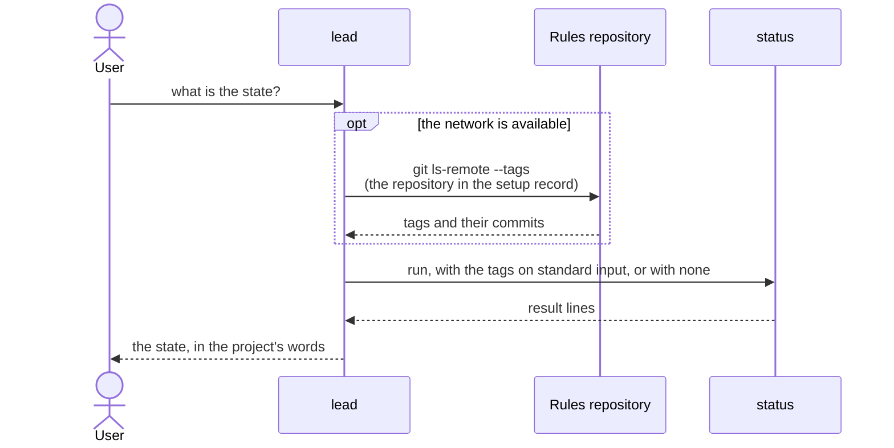
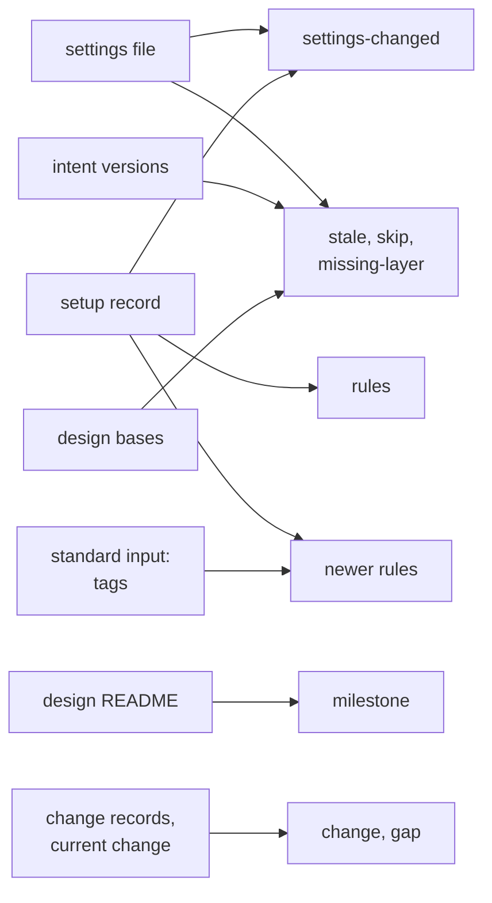

# status

> Basis: intent 1.5 — §5.2 (the rules version, settings changed since the reproduction, newer rules only with a network), §5.5, §7 (where status reads the milestone; a layer not present), §8.1 (what status shows), §11 (M1).

## 1. Responsibilities

**Does**: defines `status`, the mechanical part that reports the current state of a project in one run: the current milestone, the changes in progress, the gap items not yet answered, the design documents whose intent basis is behind, the rules version of the setup, the settings changed since the reproduction, and whether newer rules exist. Defines its input, its output lines and their order, and its conformance cases.

**Does not**:

- Block anything. Its verdict is always `pass` when it ran.
- Use the network. Whoever runs it fetches the rules repository's tags and gives them as input.
- Check formats or checksums. `validate` does. status checks the form only of the parts it reads.
- Decide who runs it and when. `carriers` says (the lead's procedures).

## 2. Public interface

### The part

- Its name is `status`. It runs under the contract in `conformance`.
- Arguments: none.
- Standard input: empty, or the output of `git ls-remote --tags` run on the rules repository the setup record names. Each line is a commit hash, a tab, and a ref name.
- Verdict: `pass` whenever it ran. Anything it cannot read is reported in its output, not as an error.

### What it reads

| What | Where |
|---|---|
| the layers and `not_in_git` | the settings file (`settings`) |
| the rules repository, commit and tag, and the settings used | the setup record (`setup-record`) |
| the current milestone | the `milestone` line of the design README's front matter (`design-docs`) |
| changes and gap items | `.plumbline/changes/*/` and `.plumbline/current-change` (`changes`) |
| intent versions | the `version` line of each intent document (`layers`) |
| design bases | the `basis` lines of each design document (`design-docs`) |

### Output lines

Each line is a code and its fields, separated by tabs (`conformance`).

| Code | Fields | When |
|---|---|---|
| `invalid` | path | a file status reads does not have the form its module defines: the settings file, the setup record, the design README's front matter, a `change.md`, a gap item, a design document's front matter or `basis` lines (below), or `.plumbline/current-change` when it names no open change |
| `milestone` | name | the design README's front matter has exactly one `milestone` line |
| `milestone-unknown` | — | the design README is missing, or it gives an `invalid` line (below), or it has no `milestone` line, or more than one |
| `rules` | repository, commit, tag or `-` | from a valid setup record |
| `rules-unknown` | — | there is no valid setup record |
| `newer-rules` | tag, commit | standard input was given, and a newer tag than the setup's rules exists (below) |
| `rules-up-to-date` | — | standard input was given, and no newer tag exists |
| `newer-rules-not-checked` | — | standard input was empty |
| `settings-changed` | key, `added` or `removed`, value | the settings differ from the record's copy (`setup-record`, the same settings): one line per layer path added to or removed from a layer, with the layer name as the key; one line per layer added to or removed from `not_in_git`, with `not_in_git` as the key |
| `change` | name, state, diagnosis, `current` or `-` | one line per change whose state is `open` or `closed` |
| `gap` | change, number, layer | one line per gap item whose state is `proposed`, in a change listed above |
| `stale` | design document, intent document, basis version, intent version | a `basis` line names an intent document whose `version` is newer than the version in the line |
| `skip` | layer | a layer that status needs is in `not_in_git` and not present (`settings`); the part that needs it was skipped |
| `missing-layer` | layer | a layer that status needs is not in `not_in_git` and not present |

- Paths are relative to the project root, with `/`.
- When the settings file is missing or not valid, the lines that need it (`settings-changed`, `stale`, `skip`, `missing-layer`, and `invalid` lines for design documents) are left out, and `milestone-unknown` takes the place of `milestone`, since the README is found through the settings. When the setup record is not valid or absent, `rules-unknown` takes the place of `rules`, and `newer-rules`, `rules-up-to-date`, `newer-rules-not-checked` and `settings-changed` are left out.
- When the intent layer is present, a design document without front matter or whose front matter does not have the form (`layers`), or a `basis` line that is not an intent document's path, a space and a version, or whose intent document does not exist or has no valid version, gives `invalid` with the design document's path. An intent document is a Markdown file at the intent location; a path elsewhere is not one. When the intent layer is not present, basis lines are not checked.

### What `invalid` covers

status checks the form only of the parts it reads:

| File | What is checked | When it is missing |
|---|---|---|
| the settings file | all of it (`settings`) | `invalid` with its path |
| the setup record | that it is a JSON object, and its `rules` and `settings` (`setup-record`) | no `invalid` line; `rules-unknown` says it |
| the design README | its front matter (`layers`), and, when the intent layer is present, its `basis` lines like any design document; a README without front matter does not have the form | no `invalid` line; `milestone-unknown` says it |
| `change.md`, in every folder directly under `.plumbline/changes/` | all of its front matter (`changes`) | `invalid` with the path the `change.md` should have |
| gap items | all of their front matter, only in changes whose `change.md` has the form and whose state is `open` or `closed` | — |
| `.plumbline/current-change` | that it names an existing change whose `change.md` has the form and whose state is `open`, when it is not empty | — |

- A file gives at most one `invalid` line, whatever problems it has.
- Nothing else is read from a file that gives an `invalid` line. A README that gives an `invalid` line gives `milestone-unknown`; a gap item that does not have the form gives no `gap` line; a `.plumbline/current-change` that names no open change marks no change `current`.
- A change whose `change.md` is missing or does not have the form is not listed, and its gap items are not read.

### Order of the lines

1. `invalid`, by path.
2. `milestone` or `milestone-unknown`.
3. `rules` or `rules-unknown`.
4. `newer-rules`, `rules-up-to-date` or `newer-rules-not-checked`.
5. `settings-changed`, by key, then `added` before `removed`, then value.
6. `change`, by name.
7. `gap`, by change, then number, compared as integers.
8. `skip` and `missing-layer`, by layer, in the order intent, design, impl.
9. `stale`, by design document, then intent document.

All other sorting is by the bytes of the text.

### Newer rules

- Each line of standard input is a hash, a tab, and a ref name. A line of any other form is ignored. Only ref names `refs/tags/<tag>` count. When a tag also appears as `refs/tags/<tag>^{}`, the hash on that line is the tag's commit; otherwise the hash on the plain line is.
- A tag names a version when it is `v` followed by a version, or a version alone, in the form `layers` defines for intent versions. Other tags are ignored.
- The newest tag is the one with the greatest version, compared as `layers` compares versions. When several tags name that version (`v1.2`, `1.2`, `v1.2.0`), the one whose name comes first by bytes is the newest.
- `newer-rules` is given with the newest tag when its commit differs from the setup record's commit, unless the record's tag names a version that is the same as or greater than the newest one. Otherwise `rules-up-to-date` is given. When no tag names a version, `rules-up-to-date` is given.

## 3. Flow

What status reports, and what each part needs:

## 4. Invariants and contracts

- status never blocks and never uses the network.
- The same files and the same standard input always give the same lines, in the same order.
- Every change whose `change.md` has the form and whose state is `open` or `closed` is listed, and no other change is.
- Every `proposed` gap item in a listed change is listed.
- A design document is listed as `stale` only when its basis names an intent document that is present.
- With empty standard input, status says it did not check for newer rules; it never says the rules are up to date.

## 5. Decisions and reasons

- **status reports the current milestone, changes in progress, gap items not answered, design documents whose intent basis is behind, the setup's rules version, settings changed since the reproduction, and newer rules.** intent §8.1, §5.2.
- **Newer rules are reported only when the network was available; validate never looks at them.** intent §5.2.
- **A part that needs a layer not present skips it and says so.** intent §7.
- **The current milestone is the `milestone` line of the design README's front matter.** The milestone is a fact about what the design now covers, and the README already holds the design's scope and reading order. Rejected: a file of its own under `.plumbline/`, which can drift from the README's scope; working it out from the module map, which cannot tell a milestone whose documents are done and whose impl is being built from the next one. (Design-level — confirmed 2026-10-17)
- **The caller fetches the rules repository's tags and gives them on standard input; status compares them.** Mechanical parts never use the network (`conformance`), and the comparison then has conformance cases. Rejected: leaving newer rules to the lead's own judgment, which no case can pin down; letting status use the network, which gives different results for the same files. (Design-level — confirmed 2026-10-17)
- **status lists changes that are `open` or `closed`, but not `archived`.** A closed change still waits for its checks; an archived one is finished. (Design-level — confirmed 2026-10-17)
- **What status cannot read becomes an `invalid` line, and its verdict stays `pass`.** status is how the user learns what is wrong; stopping at the first bad file would hide the rest. (Design-level — confirmed 2026-10-17)
- **Lines are codes and fields in a fixed order; the lead tells the user the state in the project's words.** Codes keep what cases compare free of any natural language (`conformance`). (Design-level — confirmed 2026-10-17)
- **The newest rules are the tag with the greatest version, compared like intent versions; tags that name no version are ignored.** Tag names are how people name releases of the rules (intent §5.2), and comparing them as versions puts `v1.10` after `v1.9`. A record without a tag cannot be ordered against tags, so a newest tag at another commit is reported. (Design-level — confirmed 2026-10-17)

## 6. Verification criteria

Conformance cases. Each case gives the files listed and the standard input, and expects `pass` and the lines given, in order. Unless a case says otherwise, it uses these files:

- `.plumbline/settings.json`: `intent` `["docs/intent.md"]`, `design` `["docs/design"]`, `impl` `["src"]`, `not_in_git` `[]`;
- `.plumbline/setup-record.json`: a valid record whose `rules` are repository `R`, commit `c1` (40 hex digits) and tag `v1.0`, and whose settings are the same as the settings file;
- `docs/intent.md` with `version: 2`;
- `docs/design/README.md` with `basis: docs/intent.md 2` and `milestone: M1`;
- `docs/design/cli.md` with `basis: docs/intent.md 2`;
- `.plumbline/changes/2026-11-02-a/change.md` with `state: open`, `diagnosis: design`, and `gap-1.md` with `layer: design`, `state: proposed`;
- `.plumbline/current-change` holding `2026-11-02-a`;
- empty standard input.

| # | Difference from the files above | Expected lines |
|---|---|---|
| 1 | none | `milestone M1`; `rules R c1 v1.0`; `newer-rules-not-checked`; `change 2026-11-02-a open design current`; `gap 2026-11-02-a 1 design` |
| 2 | `cli.md` has `basis: docs/intent.md 1` | as 1, then `stale docs/design/cli.md docs/intent.md 1 2` |
| 3 | `intent` in `not_in_git` in the settings file and in the record's copy, and no `docs/intent.md` | as 1, then `skip intent` |
| 4 | no `docs/intent.md`, `not_in_git` empty | as 1, then `missing-layer intent` |
| 5 | the settings file has `impl` `["src", "tests"]` | `settings-changed impl added tests` after `newer-rules-not-checked` |
| 6 | the README has no `milestone` line | `milestone-unknown` in place of `milestone M1` |
| 7 | standard input: `c1 refs/tags/v1.0`, `c2 refs/tags/v1.9`, `c3 refs/tags/v1.10` | `newer-rules v1.10 c3` in place of `newer-rules-not-checked` |
| 8 | standard input: `c1 refs/tags/v1.0`, `c9 refs/tags/nightly` | `rules-up-to-date` in place of `newer-rules-not-checked` |
| 9 | standard input: `t1 refs/tags/v1.1`, `c4 refs/tags/v1.1^{}` | `newer-rules v1.1 c4` |
| 10 | a second change `2026-11-03-b` with `state: archived`, and a third `2026-11-04-c` with `state: closed`, `diagnosis: impl` | as 1, then `change 2026-11-04-c closed impl -` after the first `change` line |
| 11 | no setup record | `rules-unknown` in place of `rules R c1 v1.0`, and no `newer-rules-not-checked` |
| 12 | `change.md` has `state: done` | `invalid .plumbline/changes/2026-11-02-a/change.md`, then `invalid .plumbline/current-change`, first; the change and its gap item are not listed |
| 13 | `gap-1.md` has `state: confirmed`, `date: 2026-11-03` | as 1 without the `gap` line |
| 14 | `.plumbline/current-change` is absent | `change 2026-11-02-a open design -` |
| 15 | standard input: `c2 refs/tags/v1.2`, `c3 refs/tags/1.2`, and a line `not a ref` | `newer-rules 1.2 c3` in place of `newer-rules-not-checked` |
| 16 | a `gap-2.md` and a `gap-10.md`, each with `layer: design`, `state: proposed` | as 1, then `gap 2026-11-02-a 2 design`, then `gap 2026-11-02-a 10 design` |
| 17 | no settings file | `invalid .plumbline/settings.json` first, and `milestone-unknown` in place of `milestone M1` |
| 18 | the settings file has an unknown key, and `cli.md` has `basis: docs/intent.md` with no version | `invalid .plumbline/settings.json` first, and `milestone-unknown` in place of `milestone M1`; no `invalid` line for `cli.md` |
| 19 | `cli.md` has a blank line inside its front matter | `invalid docs/design/cli.md` first |
| 20 | `docs/intent.md` has a line `bad line` inside its front matter, besides `version: 2` | `invalid docs/design/README.md`, then `invalid docs/design/cli.md`, first, and `milestone-unknown` in place of `milestone M1` |
| 21 | the README has a blank line inside its front matter | `invalid docs/design/README.md` first, and `milestone-unknown` in place of `milestone M1` |
| 22 | `change.md` has `state: done` and `diagnosis: code` | as 12: one `invalid` line for `change.md`, then the one for `.plumbline/current-change` |
| 23 | a folder `.plumbline/changes/2026-11-05-d/` holding only a `gap-1.md` with `layer: design`, `state: proposed` | `invalid .plumbline/changes/2026-11-05-d/change.md` first |
| 24 | `gap-1.md` has `state: proposed` and `date: 2026-11-03` | `invalid .plumbline/changes/2026-11-02-a/gap-1.md` first, and no `gap` line |
| 25 | a second change `2026-11-03-b` with `state: closed`, `diagnosis: impl`; `.plumbline/current-change` holds `2026-11-03-b` | `invalid .plumbline/current-change` first; `change 2026-11-02-a open design -`, then `change 2026-11-03-b closed impl -` |

In the table, fields are separated by spaces for reading; in the cases they are tabs. `c1` to `c9` and `t1` stand for distinct 40-digit hashes.

## 7. Out of scope

- None. status is complete in M1.
