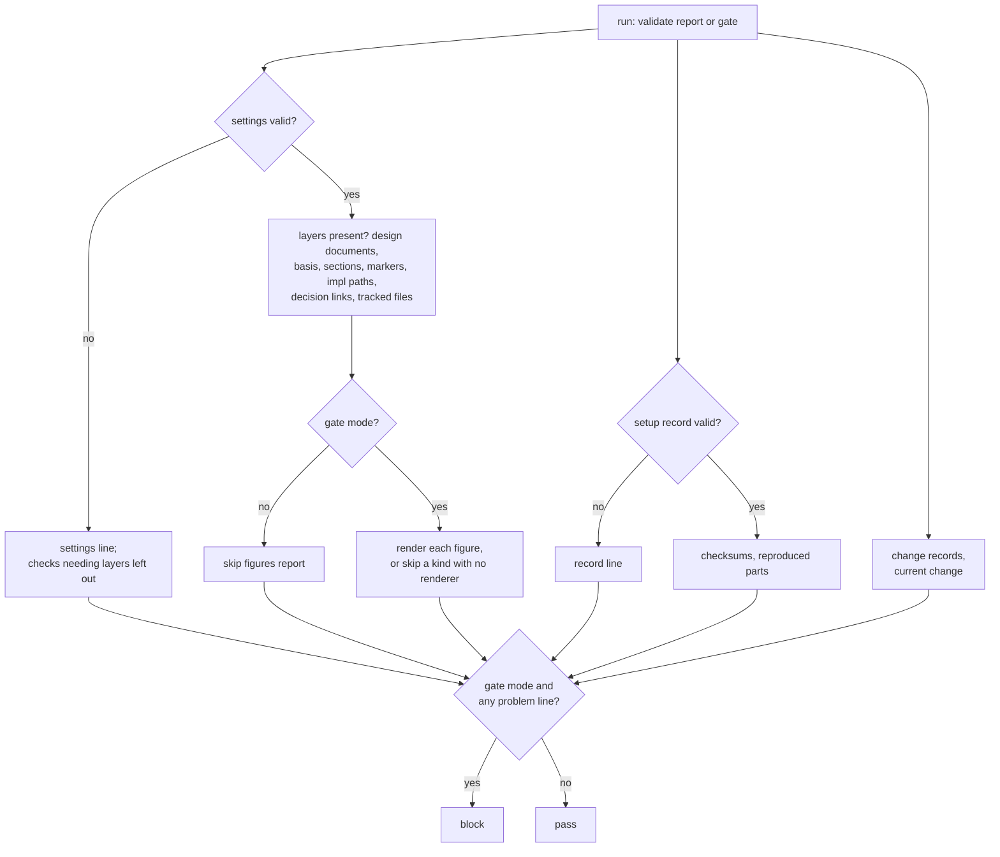

# validate

> Basis: intent 1.6 — §5.2 (checksums find hand edits; validate gives the same answer for the same input), §5.3, §5.5, §7 (which documents are module documents; a layer not present), §8.1 (a decision line points to its change), §8.3 (what validate checks, and when it reports or blocks), §11 (M2).

## 1. Responsibilities

**Does**: defines `validate`, the mechanical part that checks a project's design documents, change records and setup against the formats the rules define. Defines its two modes, its input, its output lines and their order, what it skips, and its conformance cases.

**Does not**:

- Judge what needs reading to tell: whether impl follows the design, or whether a design names an impl location that is not a path. `verify` does.
- Report the state of work. `status` does.
- Decide when it runs and what a block stops. `carriers` does: at the end of a turn, before a change closes, and in CI.

## 2. Public interface

### The part

- Its name is `validate`. It runs under the contract in `conformance`.
- Arguments: one, the mode: `report` or `gate`.
- Standard input: empty.
- Verdict: in `report` mode, `pass` whenever it ran. In `gate` mode, `block` when it gives at least one problem line, `pass` otherwise. `skip` lines never block.
- It gives `error` when its argument is missing or is not one of the two modes, and when a command it needs fails for a reason of the environment. A file it cannot read, or that does not have its form, is a problem line, not an error.
- It checks the whole project, not one change.

### What it reads

| What | Where |
|---|---|
| the layers and `not_in_git` | the settings file (`settings`) |
| the setup record, the files it lists, its renderers | `.plumbline/setup-record.json` (`setup-record`) |
| the section titles, marker texts and figure names | the template's project part (`design-docs`) |
| design documents | every Markdown file at the design location (`design-docs`) |
| intent versions | the `version` line of each intent document (`layers`) |
| change records and the current change | `.plumbline/changes/*/` and `.plumbline/current-change` (`changes`) |
| which files git tracks | the git repository at the project root, when there is one |

### Problem lines

Each line is a code and its fields, separated by tabs (`conformance`). Line numbers count from 1.

| Code | Fields | When |
|---|---|---|
| `settings` | path | the settings file is missing or not valid |
| `missing-layer` | layer | a layer is not in `not_in_git` and none of its paths exists (`settings`) |
| `record` | path | the setup record is missing or not valid (`setup-record`, the format) |
| `checksum` | path | a file the record lists is missing, or its checksum differs |
| `part-not-found` | path | a file the record lists with `begin` and `end` exists, but its reproduced part cannot be found |
| `template` | path | the template is missing, or its project part does not have the form `design-docs` defines |
| `milestone` | path | the design README is missing, or its front matter does not have exactly one `milestone` line |
| `basis` | document | a design document has no front matter of the form `layers` defines, no `basis` line, or a `basis` line that is not an intent document's path, a space and a version |
| `basis-target` | document, intent document | a `basis` line names a path that is not an intent document, or an intent document without a valid version |
| `stale` | document, intent document, basis version, intent version | a `basis` line names an intent document whose version is newer |
| `sections` | document | a module document's level-2 headings are not the template's, in order |
| `marker` | document, line | a marker in a module document is not one of the template's two forms, or a confirmed marker's date is not a date of the calendar |
| `impl-path` | document, line, token | a design document names a path under an impl location (below) |
| `figure` | document, line, figure name | in `gate` mode, the renderer for that kind of figure does not render it; the line is the opening fence's |
| `decision-link` | document, line, change | a line in section 5 of a module document links to a change folder that does not exist, or whose change has no gap item at the design layer with `state: confirmed` |
| `change` | path | a `change.md`, a gap item or a `verify.md` does not have the form `changes` defines; a change folder has no `change.md`; or `.plumbline/current-change` names a change that does not exist or is not open |
| `tracked` | path | git tracks a file that lies at a location of a layer in `not_in_git` |

### Skip lines

| Code | Fields | When |
|---|---|---|
| `skip` | `layer`, layer | a layer in `not_in_git` is not present: the checks that need it are left out. For intent: `basis-target` and `stale`. For design: `milestone`, `basis`, `sections`, `marker`, `impl-path`, `figure` and `decision-link`. For impl: none |
| `skip` | `figures`, `report` | in `report` mode, when a design document uses a kind of figure the template names: figures are not rendered |
| `skip` | `figures`, figure name | in `gate` mode, for a kind of figure the template names and a design document uses: there is no renderer for it, or its program cannot be started |
| `skip` | `tracked`, `not-git` | the project root is not a git repository |

### What depends on what

- When the settings file is missing or not valid, every check that needs the layers is left out: `missing-layer`, `milestone`, `basis`, `basis-target`, `stale`, `sections`, `marker`, `impl-path`, `figure`, `decision-link`, `tracked`, and the `skip` lines.
- When the setup record is missing or not valid, `checksum`, `part-not-found` and `figure` are left out; in `gate` mode, each figure name a design document uses gives its `skip figures` line.
- When the template is missing or not valid, `sections`, `marker` and `figure` are left out.
- A design document that gives `basis` is not checked for `basis-target` or `stale`.
- A layer that is not present leaves out the checks that need it, whether it gives `skip layer` or `missing-layer`.

### Markers

- The template's two marker texts are the confirmed form, with `YYYY-MM-DD` where the date goes, and the pending form.
- A marker candidate is any place in a module document where the longest beginning the two forms share appears. When they share no beginning, no candidate is checked.
- A candidate is a marker when, from there, the line continues with the pending form, or with the confirmed form with a date in place of `YYYY-MM-DD`. Otherwise it gives `marker`. A date that is not a date of the calendar, such as `2026-13-40`, gives `marker` too.
- Whether a decision should carry a marker at all is not checked.

### Impl paths

- A design document is cut into tokens: each maximal run of characters other than white space and `` ` `` `"` `'` `(` `)` `[` `]` `<` `>` `{` `}` `|`. From the end of a token, the characters `.` `,` `;` `:` `!` `?` are removed. A leading `./` is removed.
- A token names an impl location when it begins with an impl path followed by `/`, or equals an impl path that holds `/` or `.`.
- So `src/main.rs`, `src/` and `Cargo.toml` are named; `src` alone, and the word `tests`, are not.
- Every line of a design document is cut, code blocks and figures included.

### Figures

- A figure is a fenced code block whose info string's first word is a `figure` name of the template (`design-docs`). How blocks, headings, section 5 and links are found is in `design-docs`.
- In `gate` mode, each figure is handed to the renderer the setup record gives for its name (`setup-record`). A status other than 0 gives `figure`. A renderer that has not exited after 60 seconds is stopped and gives `figure`.
- In `report` mode, figures are not rendered.

### Decision links

- A link in a line of section 5 of a module document is a decision link when its target, taken relative to the document, is a folder directly under `.plumbline/changes/`, with or without a final `/`.

### Order of the lines

1. `settings`, `missing-layer`, by layer in the order intent, design, impl.
2. `record`, `checksum`, `part-not-found`, each by path.
3. `template`, `milestone`.
4. `basis`, `basis-target`, `stale`, `sections`, `marker`, `impl-path`, `figure`, `decision-link`, in this order, each by document, then line.
5. `change`, by path.
6. `tracked`, by path.
7. `skip`, in the order of the table above, then by its second field; layers in the order intent, design, impl.

Within a code, lines sort by their fields in turn: line numbers as integers, all other fields by the bytes of the text. A line that would be given twice is given once.

## 3. Flow

## 4. Invariants and contracts

- validate never uses the network.
- The same files, the same mode and the same renderers always give the same lines, in the same order.
- In `report` mode it never blocks. In `gate` mode it blocks exactly when it gives a problem line.
- A check that needs a layer that is not present and is kept out of git is skipped, and says so. A missing layer that is in git is a problem.
- A file it cannot read is a problem line, never an error.

## 5. Decisions and reasons

- **validate checks the template's seven sections, intent bases that are behind, impl paths in the design, figures that render where a renderer is present, the format of change records and the setup record, checksums, decision lines that link to a change with a confirmed gap item, and files of layers kept out of git that git tracks.** intent §8.3.
- **It only reports at the end of a turn, and blocks before a change closes and in CI.** intent §8.3.
- **A check that needs a layer that is not present runs only where the layer is.** intent §7, §8.3.
- **The same input gives the same answer; validate never looks for newer rules.** intent §5.2.
- **A token names an impl location when it begins with an impl path and `/`, or equals an impl path that holds `/` or `.`.** Path-like tokens are caught with or without code marks, and a plain word such as "tests" is never taken for a path. Rejected: every token equal to or under an impl path, which takes common words for paths; only tokens in code marks and links, which misses paths written as plain text. A single-segment folder name alone is not caught; like test names, it is left to `verify`. (Design-level — confirmed 2026-10-18)
- **Figures are handed to renderers only in `gate` mode.** A renderer may take seconds for each figure, and the end of a turn comes often; closing and CI still catch a figure that does not render. Rejected: rendering at the end of every turn, which slows every turn by the number of figures. (Design-level — confirmed 2026-10-18)
- **One part with two modes.** The checks are the same everywhere; only whether a problem blocks differs, and a connector makes no judgment of its own (`conformance`). Rejected: one part per place it runs, which would keep the same checks in three copies. (Design-level — confirmed 2026-10-18)
- **validate checks the whole project, also before a change closes.** CI checks the whole project, so a change that closes over a problem elsewhere would leave CI failing. Rejected: checking only the files the change touched, which needs to know them and lets a problem stay until CI. (Design-level — confirmed 2026-10-18)
- **What validate cannot read is a problem line, not an error.** A broken file is what validate is there to find. An error would hide every other problem behind it. (Design-level — confirmed 2026-10-18)
- **A marker candidate is found by the beginning the two marker texts share.** The texts are each project's own words, so the only thing a check can look for is what they have in common. A candidate that matches neither form is a malformed marker. Rejected: looking only for exact forms, which never finds a malformed one. (Design-level — confirmed 2026-10-18)
- **Problems have codes of their own, and skips are separate lines that never block.** The lead can tell the user what is wrong in the project's words, and a case can compare each kind of problem. (Design-level — confirmed 2026-10-18)

## 6. Verification criteria

Conformance cases. Each case gives the files listed and the argument, and expects the verdict and the lines given, in order. Unless a case says otherwise, the argument is `gate`, the working directory is a git repository that tracks every file in the case, and these files are used:

- `.plumbline/settings.json`: `intent` `["docs/intent.md"]`, `design` `["docs/design"]`, `impl` `["src", "Cargo.toml"]`, `not_in_git` `[]`;
- `.plumbline/setup-record.json`: a valid record whose settings are the same as the settings file, that lists `.plumbline/lead.md` as a whole file and `INSTRUCTIONS.md` with a reproduced part between `<!-- plumbline:begin -->` and `<!-- plumbline:end -->`, both with checksums that match, and whose `renderers` is empty;
- `.plumbline/lead.md` and `INSTRUCTIONS.md`, as the record lists them;
- `.plumbline/template.md`: front matter `confirmed: (DL ok YYYY-MM-DD)` and `pending: (DL pending)`, and seven level-2 headings `S1` to `S7`;
- `docs/intent.md` with `version: 2`;
- `docs/design/README.md` with `basis: docs/intent.md 2` and `milestone: M1`;
- `docs/design/cli.md` with `basis: docs/intent.md 2`, the headings `S1` to `S7`, and in `S5` a line ending in `(DL ok 2026-10-17)`;
- `src/main.rs`;
- `.plumbline/changes/2026-11-02-a/change.md` with `state: open`, `diagnosis: design`.

| # | Difference from the files above | Verdict | Lines |
|---|---|---|---|
| 1 | none | `pass` | none |
| 2 | argument `report` | `pass` | none |
| 3 | `cli.md` lacks `S6` | `block` | `sections docs/design/cli.md` |
| 4 | `cli.md` has `S4` and `S3` swapped | `block` | `sections docs/design/cli.md` |
| 5 | `cli.md` has an eighth level-2 heading | `block` | `sections docs/design/cli.md` |
| 6 | as 3, argument `report` | `pass` | `sections docs/design/cli.md` |
| 7 | the template's headings are `Eins` to `Sieben`, and so are `cli.md`'s | `pass` | none |
| 8 | the marker in `cli.md` is `(DL ok)` | `block` | `marker docs/design/cli.md` and the marker's line |
| 9 | the marker in `cli.md` is `(DL ok 2026-13-40)` | `block` | `marker docs/design/cli.md` and the marker's line |
| 10 | the marker in `cli.md` is `(DL pending)` | `pass` | none |
| 11 | `cli.md` has `basis: docs/intent.md 1` | `block` | `stale docs/design/cli.md docs/intent.md 1 2` |
| 12 | `cli.md` has no front matter | `block` | `basis docs/design/cli.md` |
| 13 | `cli.md` has `basis: docs/notes.md 2`, and `docs/notes.md` exists | `block` | `basis-target docs/design/cli.md docs/notes.md` |
| 14 | `intent` in `not_in_git` in the settings and the record's copy, no `docs/intent.md`, and `cli.md` has `basis: docs/intent.md 1` | `pass` | `skip layer intent` |
| 15 | no `docs/intent.md`, `not_in_git` empty | `block` | `missing-layer intent` |
| 16 | `cli.md` names `src/main.rs` in a sentence | `block` | `impl-path docs/design/cli.md`, that line, `src/main.rs` |
| 17 | `cli.md` names `` `Cargo.toml` `` | `block` | `impl-path docs/design/cli.md`, that line, `Cargo.toml` |
| 18 | `cli.md` says "the tests show it" and names `` `src` `` | `pass` | none |
| 19 | `cli.md` links to `[x](./src/main.rs)` | `block` | `impl-path docs/design/cli.md`, that line, `src/main.rs` |
| 20 | the README has no `milestone` line | `block` | `milestone docs/design/README.md` |
| 21 | the template has no front matter | `block` | `template .plumbline/template.md` |
| 22 | `.plumbline/lead.md` has a line added | `block` | `checksum .plumbline/lead.md` |
| 23 | no `.plumbline/lead.md` | `block` | `checksum .plumbline/lead.md` |
| 24 | `INSTRUCTIONS.md` has its begin line twice | `block` | `part-not-found INSTRUCTIONS.md` |
| 25 | `INSTRUCTIONS.md` has a line added outside its reproduced part | `pass` | none |
| 26 | the record has an unknown key | `block` | `record .plumbline/setup-record.json` |
| 27 | the record's commit has 39 digits | `block` | `record .plumbline/setup-record.json` |
| 28 | the record lists a path twice | `block` | `record .plumbline/setup-record.json` |
| 29 | a carrier names a file not listed in `files` | `block` | `record .plumbline/setup-record.json` |
| 30 | a carrier has no `roles` | `block` | `record .plumbline/setup-record.json` |
| 31 | an `enforcement` entry is `mechanical` without a part | `block` | `record .plumbline/setup-record.json` |
| 32 | the settings file has an unknown key | `block` | `settings .plumbline/settings.json` |
| 33 | `change.md` has `state: done` | `block` | `change .plumbline/changes/2026-11-02-a/change.md` |
| 34 | a `gap-1.md` with `state: proposed` and a `date` | `block` | `change .plumbline/changes/2026-11-02-a/gap-1.md` |
| 35 | a `verify.md` with `result: ok` | `block` | `change .plumbline/changes/2026-11-02-a/verify.md` |
| 36 | a folder `.plumbline/changes/2026-11-05-d/` holding only a `gap-1.md` | `block` | `change .plumbline/changes/2026-11-05-d/change.md` |
| 37 | `.plumbline/current-change` holds `2026-11-02-a`, and `change.md` has `state: closed` | `block` | `change .plumbline/current-change` |
| 38 | `S5` of `cli.md` links to `../../.plumbline/changes/2026-11-02-a/`, which has a `gap-1.md` with `layer: design`, `state: confirmed`, `date: 2026-11-03` | `pass` | none |
| 39 | as 38, but the gap item has `state: proposed` and no `date` | `block` | `decision-link docs/design/cli.md`, the link's line, `2026-11-02-a` |
| 40 | `S5` of `cli.md` links to `../../.plumbline/changes/2026-11-09-x/`, which does not exist | `block` | `decision-link docs/design/cli.md`, the link's line, `2026-11-09-x` |
| 41 | `intent` in `not_in_git` in the settings and the record's copy, and git tracks `docs/intent.md` | `block` | `tracked docs/intent.md` |
| 42 | as 41, but the working directory is not a git repository | `pass` | `skip tracked not-git` |
| 43 | the template has `figure: mermaid`, `cli.md` has a `mermaid` block, and the record's renderer for `mermaid` is `["git", "--version"]` | `pass` | none |
| 44 | as 43, but the renderer is `["git", "plumbline-no-such-command"]` | `block` | `figure docs/design/cli.md`, the opening fence's line, `mermaid` |
| 45 | as 43, but `renderers` is empty | `pass` | `skip figures mermaid` |
| 46 | as 43, but the renderer is `["plumbline-no-such-program"]` | `pass` | `skip figures mermaid` |
| 47 | as 44, argument `report` | `pass` | `skip figures report` |
| 48 | as 44, but the block's info string is `text` | `pass` | none |
| 49 | no argument | `error` | — |
| 50 | a checksum in the record without `sha256:` | `block` | `record .plumbline/setup-record.json` |
| 51 | the record has two renderers for `mermaid` | `block` | `record .plumbline/setup-record.json` |
| 52 | a `verify.md` with `result: clean` | `pass` | none |
| 53 | a `verify.md` with `result: clean` and a second key | `block` | `change .plumbline/changes/2026-11-02-a/verify.md` |
| 54 | `design` in `not_in_git` in the settings and the record's copy, and no `docs/design` | `pass` | `skip layer design` |

In the table, fields are separated by spaces for reading; in the cases they are tabs. Where a line number is not given, the case states it from its own file.

These are checked in the M2 Done of intent §11, on the example project: every case passes; validate only reports at the end of a turn, and blocks before a change closes and in CI; a file of a layer kept out of git, once added to git, is caught.

## 7. Out of scope

- None. validate is complete in M2.
