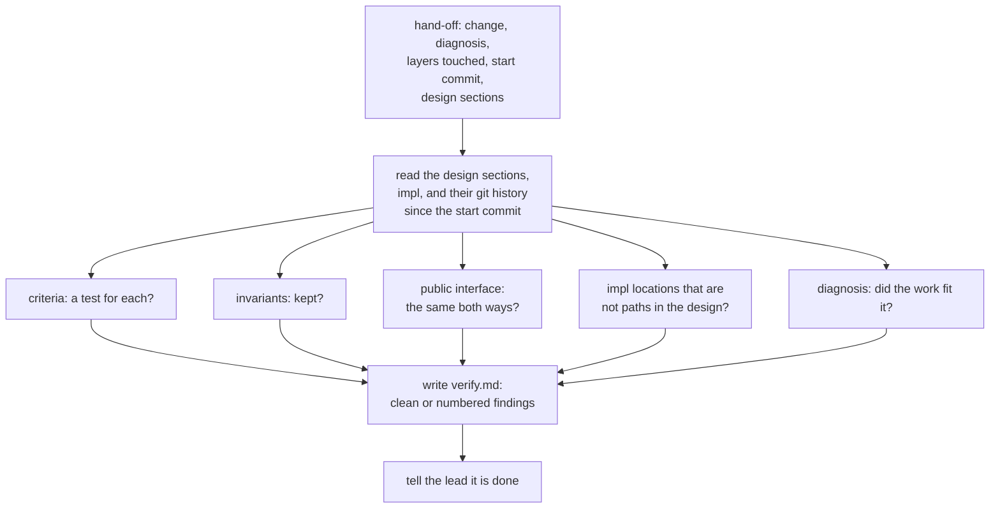

# verify

> Basis: intent 1.4 — §5.5 (a judgment check has no cases; it limits what is read and leaves its result in the change), §8.2 (whether the diagnosis held is checked when the change closes), §8.3 (what verify looks at), §8.4 (the verifier), §11 (M2).

## 1. Responsibilities

**Does**: defines verify, the judgment check a fresh verifier makes on a closed change: what it reads, what it looks for in the design sections it is handed, how it judges the diagnosis, and what it writes into the change.

**Does not**:

- Check formats, bases, impl paths or checksums. `validate` does.
- Define the verify result's file and front matter, or how findings are taken up. `changes` does.
- Define the verifier's role, its hand-off and what it may read and write. `roles` does.
- Have conformance cases. It is a judgment check (`conformance`).

## 2. Public interface

### Input

The hand-off (`roles`) names:

- the change, by its name;
- its diagnosis;
- the layers the change touched (`changes`);
- the commit the change's work started from;
- the design sections the change touched: design documents and their sections.

The verifier reads those design sections and whatever else of the design it needs to understand them, impl, and the history git keeps of the design and impl locations since the start commit. For the check, it reads nothing else.

### What it looks for

In the design sections it is handed:

| What | A finding when |
|---|---|
| verification criteria | a criterion has no test in impl that shows it |
| invariants and contracts | impl does not keep one |
| public interface | something the design defines is not in impl, or impl has a public name, field or contract the design does not define |
| impl locations | the design names an impl location that is not a path, such as a test name or a function name |
| the diagnosis | the change's work does not fit its diagnosis (below) |

### Whether the diagnosis held

Comparing the design and impl at the start commit with what they are now:

| Diagnosis | It held when |
|---|---|
| `impl` | at the start, impl did not follow the design sections, and now it does |
| `design` | the design sections changed, and impl now follows them |
| `intent` | the design documents changed carry a newer intent basis, and impl now follows them |

In every case, no layer outside the layers the change touched was changed.

### Output

- The verifier writes `verify.md` into the change's folder, in the form `changes` defines: `result: clean` when there is no finding, `result: findings` otherwise.
- Each finding names the design document and section and says what impl does not show or does otherwise, in terms of the design. It may name impl locations. It never quotes impl content.
- It says whether the diagnosis held.
- The verifier then tells the lead it is done. Nothing else is written.

## 3. Flow

## 4. Invariants and contracts

- The verifier never reads intent or change records.
- The verifier writes nothing but the `verify.md` of the change it was given.
- Every finding is named in terms of the design, and no impl content is quoted.
- A change whose work does not fit its diagnosis has a finding that says so.

## 5. Decisions and reasons

- **A fresh verifier gets design and impl only, never intent; it looks for a test for every verification criterion, invariants and contracts kept, the public interface in impl, the diagnosis, and impl locations in the design that are not paths; its result stays in the change.** intent §8.3, §8.4.
- **verify is a judgment check with no conformance cases.** intent §5.5.
- **The public interface is compared both ways.** A public name in impl that the design does not define is a decision made below the design (intent §4 principle 3), and intent §11 asks verify to find it. (Design-level — confirmed 2026-10-18)
- **The diagnosis is judged from what the change did to design and impl since its start commit.** The verifier reads no change record, so the hand-off carries the diagnosis, the layers touched and the start commit (`roles`). The work fits the diagnosis when it changed only the layers it touched and ended with impl following the design. Rejected: judging the diagnosis from the request, which the verifier does not read. (Design-level — confirmed 2026-10-18)
- **The verifier checks only the design sections it is handed.** A change touches some sections; checking the whole design at every change would repeat the same findings in every change. (Design-level — confirmed 2026-10-18)

## 6. Verification criteria

verify has no conformance cases. These are checked in the M2 Done of intent §11, on the example project:

- on a project made to disagree on purpose, with a public interface in impl that the design does not define and a verification criterion with no test, the verifier finds both and writes them in `verify.md` as findings, in terms of the design;
- the verifier reads no intent and no change record, and writes nothing but `verify.md`;
- when a change's work does not fit its diagnosis, `verify.md` says so.

## 7. Out of scope

- None. verify is complete in M2.
